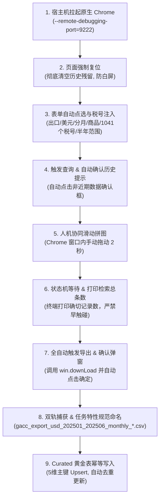

# GACC Customs CDP Automation (海关总署在线查询平台自动化采集指南)

本技能提供从**海关总署在线查询平台**（`stats.customs.gov.cn`）批量采集商品出口数据的全自动/半自动标准作业程序。

针对海关平台无官方 API、设有人机滑块 WAF、1000+ 重点税号需定期更新的业务痛点，采用 **CDP (Chrome DevTools Protocol) 远程调试接管** 架构，实现**“99% 流程全自动 + 人机协同滑动验证码 2 秒”**的最小摩擦闭环。

---

## 1. 核心架构与设计原则



### 核心防错机制

1. **页面强制复位机制**：每次执行脚本前，自动重置浏览器导航回初始空白查询表单，并等待 DOM 就绪。彻底根除因上一次查询结果残留（如旧的 `#totalSize`）导致脚本误判或提前触发下载而引发的白屏与异常。
2. **默认半年范围防截断**：海关平台单次导出存在行数硬上限（超出后会被静默截断丢失后半段数据）。对 1000+ 税号分月明细，**默认强制按半年（H1: 1 至 6 月，H2: 7 至 12 月）切片查询**。
3. **严密四阶段状态机（绝对防提前触发）**：
   - 阶段 1：等待验证码弹窗出现（期间持续自动确认“非近期数据查询提示”）；
   - 阶段 2：等待用户完成拼图（严格检测到验证码弹窗关闭才判定通过）；
   - 阶段 3：等待后台检索并渲染完成（loading 消失，`total_size > 0`，向终端打印醒目横幅）；
   - 阶段 4：自动触发下载并持续自动确认导出弹窗。
4. **任务特性规范命名**：导出的文件自动由无意义的“数据导出.csv”重命名为 `gacc_{flow}_{currency}_{start}_{end}_monthly_{timestamp}.csv`。
5. **黄金表 5 维复合主键幂等更新**：基于 `(year_month, goods_code, currency, flow_type, unit)` 主键，重复执行时自动去重并按最新数据覆盖（Upsert），不产生冗余重复行。

---

## 2. 标准作业程序 (SOP) 5 步走

### 步骤 1：宿主机启动原生 Chrome 调试实例

在 macOS 宿主机终端中执行（使用独立隔离目录，不干扰日常浏览）：

```bash
/Applications/Google\ Chrome.app/Contents/MacOS/Google\ Chrome \
  --remote-debugging-port=9222 \
  --user-data-dir="/tmp/chrome_gacc_profile" \
  "http://stats.customs.gov.cn/" &
```

> **注意**：必须在宿主机运行 Chrome，不要在容器或无 Mach Port 权限的沙箱中直接拉起 Chrome，否则会被 macOS 安全机制拦截导致崩溃。

### 步骤 2：启动 CDP 自动化脚本

```bash
# 采集 2025 年上半年 (H1: 1-6月，默认) 并自动导入
uv run python scripts/cdp/gacc_cdp_automation.py --year 2025 --half H1

# 采集 2025 年下半年 (H2: 7-12月) 并自动导入
uv run python scripts/cdp/gacc_cdp_automation.py --year 2025 --half H2
```

脚本将自动执行：
- 页面复位；
- 勾选出口、美元、分月展示；
- 选定年份与半年起止月份；
- 第一输出字段选“商品 (CODE_TS)”；
- 批量填入全部 1041 个合法 8 位税号；
- 自动触发【查询】；
- 自动点击“非近期数据查询提示”弹窗。

### 步骤 3：人工在 Chrome 浏览器中滑动一次验证码

当终端输出：
```text
============================================================
【请滑动验证码】
-> 海关拼图滑块验证码已弹出！
-> 请在已打开的 Chrome 浏览器中向右拖动滑块完成拼图验证。
============================================================
```
切换到 Chrome 窗口，向右拖动滑块完成拼图。**仅需耗时约 2 秒**。

### 步骤 4：终端见证条数查询完毕，脚本全自动下载

滑过拼图后，**无需人工点击任何下载按钮**：
1. 脚本感知验证码关闭，等待后台检索完成；
2. 终端打印检索结果确切条数：
   ```text
   ============================================================
   【海关数据查询完毕】
   -> 验证码已通过，海关平台数据检索完成！
   -> 本次实际检索返回总记录数: 5,221 条
   ============================================================
   ```
3. 脚本自动调用海关前端导出函数并自动确认下载提示框。

### 步骤 5：自动捕获、重命名与黄金表入库

脚本双轨监听捕获下载的 CSV 文件，自动完成：
- 重命名：如 `gacc_export_usd_202501_202506_monthly_20260913_112847.csv`；
- 移动归集到项目目录：`data/raw/industry/customs/gacc/downloads/`；
- 自动调用 Curated ETL 管道无缝落盘至 `data/curated/industry/customs_trade_gacc.parquet`。

---

## 3. CLI 常用命令集锦

```bash
# ==================== [标准采集流程] ====================
# 1. 采集 2025 年上半年数据 (H1)
uv run python scripts/cdp/gacc_cdp_automation.py --year 2025 --half H1

# 2. 采集 2025 年下半年数据 (H2)
uv run python scripts/cdp/gacc_cdp_automation.py --year 2025 --half H2

# 3. 指定非标准月份区间 (如 1 至 3 月)
uv run python scripts/cdp/gacc_cdp_automation.py --year 2025 --start-month 1 --end-month 3

# 4. 仅自动化下载，暂不导入黄金表
uv run python scripts/cdp/gacc_cdp_automation.py --year 2025 --half H1 --no-auto-import

# ==================== [2018-2026 批量回填排期调度] ====================
# 查看 2018-2026 全部 18 个半年度批次排期与现存入库行数巡检表
uv run python scripts/gacc_batch_scheduler.py --status

# 自动调度并执行下一个待采集的半年度批次
uv run python scripts/gacc_batch_scheduler.py --next

# 指定执行某一个半年度批次 (如 2024H2)
uv run python scripts/gacc_batch_scheduler.py --batch 2024H2

# ==================== [手动/补录导入已下载文件] ====================
# 将任意已下载的规范 GACC CSV 文件导入 Curated
uv run python -m stock_cli.customs import-gacc \
  --file data/raw/industry/customs/gacc/downloads/gacc_export_usd_202501_202506_monthly_20260913_112847.csv \
  --start-month 2025-01 \
  --end-month 2025-06 \
  --flow export \
  --currency USD

# ==================== [数据核验与盘点] ====================
# 检查 Curated 黄金表最新行数与分区分布
uv run python -c "import polars as pl; df = pl.read_parquet('data/curated/industry/customs_trade_gacc.parquet'); print('总行数:', len(df)); print('月份分布:', df['report_month'].unique().sort().to_list())"
```

---

## 4. 关键数据资产与存储规范

| 资产类型 | 物理路径 | 说明与规范 |
| :--- | :--- | :--- |
| **半年度回填排期表** | `.agents/skills/customs-gacc-automation/plans/` | 包含 2018-2026 年 18 个半年批次的结构化 YAML 与排期表说明 |
| **查询税号清单** | `config/data/customs/gacc_query_codes.txt` | 供海关在线平台批量填入的 1041 个逗号分隔 8 位税号 |
| **税号元数据字典** | `config/data/customs/good_h8_codes.csv` | 包含税号、商品中文名称、标准计量单位等元数据 |
| **原始下载暂存区** | `data/raw/industry/customs/gacc/downloads/` | 捕获并按任务特性规范重命名的原始 CSV 文件 |
| **黄金事实表** | `data/curated/industry/customs_trade_gacc.parquet` | 下游行业景气分析与交易信号的唯一黄金事实表 |
| **税号元数据字典** | `config/data/customs/good_h8_codes.csv` | 包含税号、商品中文名称、标准计量单位等元数据 |
| **原始下载暂存区** | `data/raw/industry/customs/gacc/downloads/` | 捕获并按任务特性规范重命名的原始 CSV 文件 |
| **黄金事实表** | `data/curated/industry/customs_trade_gacc.parquet` | 下游行业景气分析与交易信号的唯一黄金事实表 |

### 命名规范 (Task-specific Filename)

导出的 CSV 文件必须严格遵循以下模式：
```text
gacc_{flow_type}_{currency}_{start_period}_{end_period}_monthly_{timestamp}.csv
```
- `flow_type`：`export`（出口）/ `import`（进口）
- `currency`：`usd`（美元）/ `rmb`（人民币）
- `start_period` / `end_period`：真实数据起止年月（如 `202501` ~ `202506`）
- `timestamp`：采集执行批次时间戳（如 `20260913_112847`）

---

## 5. 故障排查 (Troubleshooting)

### Q1: 运行脚本报错 `无法连接到 Chrome 调试端口 127.0.0.1:9222`
- **原因**：Chrome 未启动或未开启远程调试端口。
- **排查**：在终端检查端口监听 `lsof -i :9222`；确认 Chrome 是用 `--remote-debugging-port=9222` 启动。

### Q2: 页面出现白屏，或者提示“提前触发下载”
- **原因**：历史版本没有页面重置逻辑，残留了上次查询的 `#totalSize`。
- **解决**：当前脚本已集成 `reset_to_clean_query_page`，启动时会自动重置并等待表单初始化。若浏览器异常，可在 Chrome 中手动按 `F5` 刷新后重新执行命令。

### Q3: 验证码弹窗没有出现，页面一直等待
- **原因**：查询非近期数据（如 2025 年）时，海关前端弹出了“当前查询时间范围包含非近期数据，查询时间较长，是否继续?”提示框，未被确认。
- **解决**：当前脚本的阶段 1 会自动轮询并点击该弹窗的【确定】按钮。若网络极慢，也可在 Chrome 中手动点击一次弹窗上的“确定”。

### Q4: 导出的行数少于预期 / 被截断
- **原因**：单次查询范围过大（例如直接勾选 1 至 12 月整年），超出海关接口单次最大返回记录限制。
- **解决**：严格遵守半年分段原则，上半年用 `--half H1`，下半年用 `--half H2`，两次采集入库会自动无缝合并。
