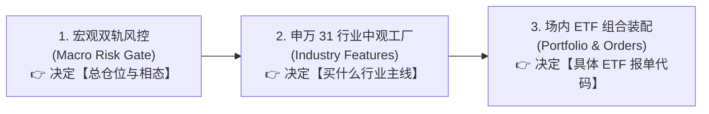

# Daily Market Review (每日全景量化复盘总入口)

本技能定义了每日盘后进行**端到端全景量化复盘**的标准操作流程（SOP），无缝串联 **宏观择时（Macro）** $\rightarrow$ **中观行业（Industry）** $\rightarrow$ **微观 ETF 装配（Execution）**。

---

## 1. 核心架构：投研串联三级火箭



1. **宏观层（Top-Down 仓位与相态）**：
   - 查验 `Overheat Index`（狂热指数）与 `Panic Index`（恐慌指数）；
   - 对齐中证全指收盘价与 **20日均线 (MA20)** 相对位置；
   - 状态机输出相态 0 ~ 相态 4（如相态 3 锁润：40% 红利 + 30% 国债 + 30% 黄金）。
2. **中观层（Mesoscopic 行业筛选与排雷）**：
   - **第一道风控（一票否决）**：`ind_crowding >= 80%` 的行业强制剔除，防抱团瓦解踩踏；
   - **第二道筛选（动量领涨）**：筛选 `ind_momentum` Top 5 主线；
   - **第三道验证（供需剪刀差）**：寻找 `ind_scissors` 绿色改善（毛利率扩张）且估值未透支的方向。
3. **微观层（Execution ETF 落地与 14:50 纪律）**：
   - 映射为场内高流动性行业 ETF（如化工 `516020`、煤炭 `515220`、红利 `510880`、国债 `511010`、黄金 `518880`）；
   - 执行 **3% 调仓死区** 过滤；
   - 严格以 MA20 破位作为相态 4 避险断路器。

---

## 2. 快速执行命令 (Fast Path)

```bash
# 1. 运行一键全景复盘生成脚本 (打印至终端)
uv run python .agents/skills/daily-market-review/scripts/generate_daily_review.py

# 2. 生成指定交易日并输出到 Markdown 报告文件
uv run python .agents/skills/daily-market-review/scripts/generate_daily_review.py --as-of 2026-08-28 --output output/reports/daily/2026-08-28_review.md
```

---

## 3. 标准四步交付报告规范

在向用户交付每日复盘时，必须包含以下 4 个核心板块：

1. **一、宏观风控大盘全景**：
   - 中证全指收盘点位 vs MA20 均线生命线（距离百分比）；
   - 双轨制雷达（狂热指数 / 恐慌指数）；
   - 当前宏观相态定位（相态 0/1/2/3/4）与研报定性。
2. **二、全天候大类资产配置与 14:50 调仓指令**：
   - 给出清晰的股/债/金资产大类目标权重表与配置逻辑。
3. **三、申万 31 行业中观特征与主线格局**：
   - 动量领涨 Top 5 行业与 ETF 映射；
   - 供需剪刀差改善 Top 5 行业；
   - ⚠️ 高拥挤度一票否决风险警报名单（`ind_crowding >= 80%`）。
4. **四、次日关键临界防线与操作纪律**：
   - 明确 MA20 刚性防守点位；
   - 明确多头守线纪律与破位拉闸触发相态 4 的执行条件。
