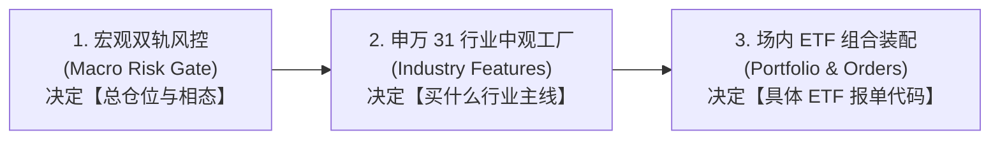

# Daily Market Review (每日全景量化复盘总入口)

本技能定义了每日盘后进行**端到端全景量化复盘**的标准操作流程（SOP），通过纯数据查验与状态机推演，串联 **宏观择时（Macro）** $\rightarrow$ **中观行业（Industry）** $\rightarrow$ **微观 ETF 装配（Execution）**。

---

## 1. 核心架构：投研串联三级火箭

1. **宏观层（Top-Down 仓位与相态）**：
   - 查验 `Overheat Index`（狂热指数）与 `Panic Index`（恐慌指数）；
   - 对齐中证全指收盘价与 **20日均线 (MA20)** 相对位置；
   - 根据策略层 `MacroAllWeatherStrategy` 状态机确定相态 0 ~ 相态 4（如相态 3 锁润：40% 红利 + 30% 国债 + 30% 黄金）。
2. **中观层（Mesoscopic 行业筛选与排雷）**：
   - **第一道风控（一票否决）**：`ind_crowding >= 80%` 的行业强制剔除，防范抱团瓦解踩踏；
   - **第二道筛选（动量领涨）**：筛选 `ind_momentum` Top 5 主线；
   - **第三道验证（供需剪刀差）**：寻找 `ind_scissors` 扩张（毛利率改善）且估值未透支的方向。
3. **微观层（Execution ETF 落地与 14:50 纪律）**：
   - 依据 `config/strategy/industry_rotation.yaml` 中的 `industry_etf_map` 映射为场内高流动性行业 ETF；
   - 执行 **3% 调仓死区** 过滤；
   - 严格以 MA20 破位作为相态 4 避险断路器。

---

## 2. 数据源与黄金产物规范 (Ground Truth First)

进行每日复盘时，必须直接从以下标准产物与策略层接口中提取真实数据：

| 模块 | 数据与配置来源 | 说明 |
| :--- | :--- | :--- |
| **宏观风控面板** | `data/analytics/macro_risk/latest/risk_factors.parquet` | 包含 `panic_index`, `overheat_index`, `close`, `dim_corporate`, `dim_valuation` 等字段 |
| **中观行业面板** | `data/analytics/industry_structure/latest/industry_factor_panel.parquet` | 包含申万 31 行业的 `ind_momentum`, `ind_scissors`, `ind_crowding`, `ind_valuation` |
| **行业 ETF 映射** | `config/strategy/industry_rotation.yaml` 或 `stock_strategy.industry.live.load_industry_etf_map()` | 申万行业代码到场内 ETF 代码与名称的唯一信任源 |
| **宏观状态机** | `stock_strategy.pool.MacroAllWeatherStrategy` 或 `stock_strategy.macro.live.inspect_live_signal` | 5 大相态判定与大类资产目标权重定义 |

---

## 3. 标准操作工作流 (SOP)

### 步骤 1：查验宏观风控大盘全景
1. 读取宏观最新因子数据，计算基准指数（中证全指 `000985.CSI`）收盘价与 MA20 的距离：
   $$\text{diff\_ma20\_pct} = \left(\frac{\text{close}}{\text{MA20}} - 1\right) \times 100\%$$
2. 提取 `overheat_index` 与 `panic_index`：
   - 狂热危险阈值：$\ge 65.0$
   - 恐慌冰点阈值：$\ge 65.0$（战略底 $\ge 75.0$）
3. 判定宏观相态：
   - **相态 4（泡沫破裂终极避险）**：`overheat > 65` 且 `close < MA20` $\rightarrow$ 60% 国债 ETF + 40% 黄金 ETF
   - **相态 3（泡沫膨胀中继锁润）**：`overheat > 65` 且 `close >= MA20` $\rightarrow$ 40% 红利 ETF + 30% 国债 ETF + 30% 黄金 ETF
   - **相态 1（恐慌出清打满弹性）**：`panic > 75` 或（`panic > 65` 且触发托底共振）
   - **相态 2（估值大底跨资产均衡）**：`panic > 65` 或估值分位 $\le 15\%$
   - **相态 0（常态中枢区间）**：延续既有持仓

### 步骤 2：生成大类资产配置与 14:50 调仓指令
根据上述相态，明确列出 5 大类资产（红利、创业板、300、国债、黄金）的目标权重及配置功能定性。

### 步骤 3：筛选申万 31 行业中观特征
1. **动量领涨 Top 5**：按 `ind_momentum` 降序排列取前 5，通过 `industry_etf_map` 关联 ETF 代码；
2. **供需剪刀差改善 Top 5**：按 `ind_scissors` 降序排列取前 5，重点关注低估值且剪刀差明显扩张行业；
3. **高拥挤度一票否决警报名单**：筛选 `ind_crowding >= 80.0` 的行业，标注严禁追高防踩踏。

### 步骤 4：界定次日关键临界防线与操作纪律
1. 明确 MA20 刚性防守点位与当前缓冲空间；
2. 明确多头守线条件与跌破 MA20 时的单日熔断避险指令。

---

## 4. 标准四步交付报告规范

在向用户交付每日复盘研报时，必须严格按以下 4 个核心板块组织输出：

1. **一、宏观风控大盘全景 (Macro Regime & Risk Gate)**：
   - 中证全指收盘点位 vs MA20 均线生命线（距离百分比）；
   - 双轨制雷达（狂热指数 / 恐慌指数）；
   - 当前宏观相态定位与定性研判。
2. **二、全天候大类资产配置与 14:50 调仓指令 (Portfolio Allocation)**：
   - 给出清晰的股/债/金资产大类目标权重表与配置逻辑。
3. **三、申万 31 行业中观特征与主线格局 (Industry Allocation)**：
   - 动量领涨 Top 5 行业与 ETF 映射；
   - 供需剪刀差改善 Top 5 行业与 ETF 映射；
   - 高拥挤度一票否决风险警报名单（`ind_crowding >= 80%`）。
4. **四、次日关键临界防线与操作纪律 (Action Rules)**：
   - 明确 MA20 刚性防守点位；
   - 明确多头守线纪律与破位拉闸触发相态 4 的执行条件。

---

## 5. 研报输出模板引用

Agent 在输出最终复盘报告时，需严格对齐模板中的板块布局、数据表头与字段格式：
- 统一研报模板路径：[templates/daily_review_template.md](templates/daily_review_template.md)
