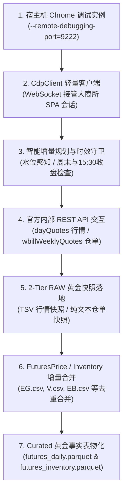

# DCE CDP Automation (大连商品交易所自动化智能采集指南)

本技能提供从 **大连商品交易所（DCE）官方报表平台** 自动化采集化工大宗商品（`EG` 乙二醇、`V` 聚氯乙烯 PVC、`EB` 苯乙烯、`PP` 聚丙烯、`L` 塑料 LLDPE）日度行情与交割仓库注册仓单日报的标准作业程序（SOP）。

针对大商所全站部署的瑞数动态安全（412 动态 JS 挑战）与 2026 年最新重构的 Vue SPA 报表前端，本技能复用宿主机真实 Chrome 实例的 CDP (Chrome DevTools Protocol) 会话，在浏览器真实环境中直连官方内部 REST API，实现**“零第三方爬虫依赖 + 100% 官方权威 Ground Truth + 全自动智能增量与自愈”**的数据工程闭环。

---

## 1. 核心架构与设计原则



### 核心防错与智能机制

1. **宿主机真实 Chrome 环境接管**：通过本地 CDP 调试端口（默认 `9222`）接管已打开的大商所前端页面，浏览器原生完成瑞数（Bot Detection）动态 JS 代码执行并自动维护 Session Cookie，完全规避纯 Python Requests 的 412/400 阻断。
2. **官方 Vue SPA 最新 REST API 适配**：
   - **日行情接口**：`POST /dcereport/publicweb/dailystat/dayQuotes`（返回全合约开高低收、结算价、成交量、持仓量）；
   - **仓单日报接口**：`POST /dcereport/publicweb/dailystat/wbillWeeklyQuotes`（返回指定交割库仓单明细与品种小计）。
3. **最高水位自动感知 (Watermark Tracking)**：
   - 自动探查本地 `data/raw/.../dce_daily_cache` 与 `futures_inventory/dce` 中已存在的最新日期 $T_{\max}$；
   - 未指定日期时，自动生成 $[T_{\max} + 1, T_{\text{today}}]$ 增量队列，无需人工记忆。
4. **幂等快照跳过 (Idempotent Cache Hit)**：
   - 单日快照本地已存在且有效（>100 字节）时，自动打出 `[CACHE HIT] 跳过请求`，0 浏览器网络开销。
5. **发布时效与收盘守卫 (Trading Session Guard)**：
   - 自动过滤周末；
   - 针对今日 (today)：行情需在 **15:30** 之后、仓单需在 **16:30** 之后发布。若早于发布时限自动跳过，防止空响应覆盖本地。
6. **历史缺口自愈探测 (`--fill-gaps`)**：
   - 自动比对交易日历与本地已有快照，找出所有漏采的工作日并自动补全。
7. **2-Tier 闭环物化 (`--sync`)**：
   - 抓取完成后自动触发 `FuturesPriceCollector` 和 `FuturesInventoryCollector` 写入 RAW CSV；
   - 自动联动 `stock_data.pipeline.sync_runner.run_sync` 物化更新 Curated Parquet 表，供下游直接消费。

---

## 2. 标准作业程序 (SOP)

### 步骤 1：确认或启动宿主机 Chrome 调试实例

> [!WARNING]
> **真实有头 GUI 环境硬约束（严禁 Headless 模式）**：
> 1. **严禁添加 `--headless` 或 `--headless=new` 参数**！大商所全站部署了瑞数动态安全防护（Bot Detection），无头浏览器会被永久拦截在动态 JS challenge 页面，导致所有数据接口静默返回空 `{}`；
> 2. **必须在具有宿主机原生 GUI 与用户目录写权限的环境下运行**。若在受限沙箱或自动化容器中执行，会因权限隔离无法创建 `~/.chrome_cdp_profile/SingletonLock` 而报错 `Operation not permitted`。

在 macOS 宿主机终端中检查 Chrome 是否已在 9222 端口运行：

```bash
# 检查是否已有 CDP 实例
curl -s http://127.0.0.1:9222/json/version
```

若未启动，在宿主机终端中执行：

```bash
/Applications/Google\ Chrome.app/Contents/MacOS/Google\ Chrome \
  --remote-debugging-port=9222 \
  --user-data-dir="/Users/mac/.chrome_cdp_profile" \
  --disable-blink-features=AutomationControlled &
```

> **提示**：建议在打开的 Chrome 中访问一次 `http://www.dce.com.cn/frontend/dcereport/#/zh/dayFuturesQuotation?variety=all&tradeType=1` 确认页面完整渲染出表格（标题显示“日行情”，而非空白页或挑战页）。

### 步骤 2：执行自动化采集与 2-Tier 物化

可使用 Makefile 标准命令或直接调用脚本：

```bash
# 1. 全自动智能增量采集 (自动探测最高水位，自动补齐至今日，收盘后自动同步物化)
make dce-harvest SYNC=1
# 或
uv run python scripts/cdp/dce_cdp_automation.py --sync

# 2. 采集指定单日数据并物化
make dce-harvest DATE=2026-09-17 SYNC=1
# 或
uv run python scripts/cdp/dce_cdp_automation.py --date 2026-09-17 --sync

# 3. 历史缺口探测与自愈补齐 (扫描历史漏采交易日并全部补全)
make dce-harvest FILL_GAPS=1 SYNC=1
# 或
uv run python scripts/cdp/dce_cdp_automation.py --fill-gaps --sync

# 4. 强制刷新指定区间 (覆盖本地已有快照)
make dce-harvest START=2026-09-01 END=2026-09-17 FORCE=1 SYNC=1

# 5. 探测模式 (不写盘，仅验证连接与规划)
make dce-harvest DRY_RUN=1
```

### 步骤 3：数据资产与对账验证

采集并物化完成后，在本地 Curated 表中验证数据：

```bash
uv run python -c "
import polars as pl
daily = pl.read_parquet('data/curated/industry/futures_daily.parquet')
inv = pl.read_parquet('data/curated/industry/futures_inventory.parquet')
print('行情表最新记录:\n', daily.filter(pl.col('symbol').is_in(['EG', 'V', 'EB'])).tail(5))
print('仓单表最新记录:\n', inv.filter(pl.col('symbol').is_in(['EG', 'V', 'EB'])).tail(5))
"
```

---

## 3. 故障排查 (Troubleshooting)

| 异常现象 | 可能原因 | 解决方案 |
| :--- | :--- | :--- |
| `有效日行情/仓单产出为 0 份` 且无报错 | 1. Chrome 误加了 `--headless` 无头参数导致瑞数拦截；<br>2. 瑞数 challenge 页面未跳转完成 (URL 带有 `?2kiG...`) | 1. 彻底杀掉 headless 进程，改用原生带界面的 Chrome 启动；<br>2. 在打开的 Chrome 窗口中手动回车刷新一次大商所报表页，确认标题显示“日行情”且表格出现 |
| `SingletonLock: Operation not permitted` | 在沙箱隔离或受限自动化子进程中启动 Chrome | Chrome 必须在宿主机原生终端或具有宿主系统权限的环境（BypassSandbox）下拉起 |
| `ConnectionRefusedError: 无法连接到 Chrome CDP 调试端口 9222` | Chrome 调试实例未拉起或端口被占用 | 按步骤 1 启动 Chrome，确保携带 `--remote-debugging-port=9222` |
| `未到发布时效跳过=1` | 当前时间早于交易所发布时间（行情 15:30，仓单 16:30） | 属于时效保护机制生效，等待收盘发布窗口后再跑即可 |
| `日行情 API 响应码非 200` 或页面报 412 | 瑞数动态 JS 挑战未通过或 Cookie 过期 | 在 Chrome 窗口中手动刷新一次大商所报表前端页面，完成初始人机挑战即可 |
| `[CACHE HIT] 跳过请求` | 本地已存在该日期的有效快照 | 正常幂等行为；若需强制覆盖请传入 `--force` 或 `FORCE=1` |
