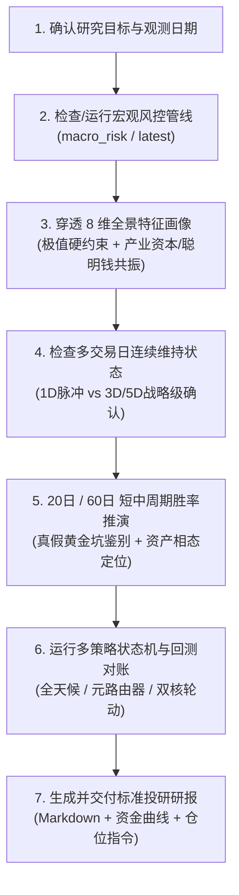

# 宏观风控与跨周期策略研究技能 (Macro Risk & Strategy Research)

## 1. 数据与交付铁律（约束层）

> 本节是**不可违反的边界**：所有引用与分析必须遵守，无例外。

1. **Ground Truth First**：
   - 宏观风控因子、分位数与双轨制指数必须来自本地黄金产物 `data/analytics/macro_risk/latest/risk_factors.parquet` 或历史运行目录；
   - 策略信号与回测净值必须来自 `stock_strategy.macro` 真实执行产物（`data/analytics/macro_strategy/multi_strategy_comparison.md` / `multi_strategy_nav.csv` / `multi_strategy_comparison.png`）；
   - 严禁凭记忆臆造历史点位、指数分位或策略净值；外部宏观政策与新闻必须显式标注为【外部背景】。
2. **口径披露**：引用因子或回测产物时，沿用产物/manifest 声明的口径（两融 T+1 平移、ETF 价格口径、净值首日归一），具体机制以工程实现为准，不得凭记忆另述；口径不明时显式披露不确定性。
3. **数据缺口处理**：两融数据（`dim_leverage`）为日终同步，最新交易日可能暂缺（缺失时该字段为 null，manifest 摘要亦不含该项）。涉及杠杆维度的硬约束排查前，先核对最新一日 `dim_leverage` 是否可用，缺失时需先补数或显式披露，不得静默跳过。
4. **回测机制契约**：
   - 执行语义：严格 T+1（交易日 $t$ 收盘生成信号，目标权重于 $t+1$ 日生效计算复利），由 `stock_strategy.macro.runner.MacroRiskRunner` 统一实现；
   - 基准对齐：报告必须同步对比**中证全指 (`000985.CSI`)** 与 **沪深300 (`000300.SH`)** 的 Buy & Hold 基准净值；
   - 摩擦成本：佣金率、滑点、调仓死区由 `config/strategy/macro_risk.yaml` 的 `friction` 节点驱动，策略本身不内置。
5. **证伪口径清单**（不作为信号使用）：
   - ETF 份额托底代理（`etf_flow_ratio`）已证伪（与国家队真实增持行为无关、前瞻收益无预测力、V5 托底分支净值贡献为负），不作为国家队识别与交易信号；
   - `smart_money_score` / `dim_smart_money` 为独立维度供策略选用，**未加入 overheat/panic 指数**；实证见 `data/analytics/macro_strategy/smart_money_composite.md`。

---

## 2. 标准研究流程 SOP（流程层）

> 按步骤顺序执行；每步只写"做什么 + 用什么命令/产物"，判定规则见 §3，命令入口见 §4。

### 步骤 1：加载/刷新宏观风控产物
- **Fast Path**：`uv run python .agents/skills/macro-risk-research/scripts/extract_cycle_snapshot.py`（极速截面提取，含两融缺失提示）；
- **全量刷新 / 指定历史日**：`uv run python -m stock_cli.macro_risk --last-n 60`（或 `--as-of YYYY-MM-DD`）；
- **产物清理**：`uv run python .agents/skills/macro-risk-research/scripts/cleanup_redundant_runs.py`（清理 runs 冗余批次）。

### 步骤 2：8 维画像穿透与极值检测
- 读取 `risk_factors.parquet` 最新行，按 §3 规则逐项排查：硬约束（§3.2）→ 真假黄金坑（§3.3）→ 聪明钱连续性（§3.4）；
- 涉及硬约束阈值、真假黄金坑分位及全部"历史胜率/均值"数字，均以复算脚本 `scripts/compute_cycle_winrate_matrix.py` 最新输出与 `risk_factors.parquet` 最新产物为准；references 仅提供定性规则与历史快照，禁止在研报中另存快照数字。

### 步骤 3：跨周期定位与胜率推演
- 宏观范式速查：`references/macro_regimes_playbook.md`（6 大范式定性特征）；
- 20日 vs 60日 胜率矩阵：`references/cycle_windows_matrix.md`（引用前用复算脚本核对）。

### 步骤 4：策略回测 / 审计 / 实盘推演
- 查看全部策略：`uv run python -m stock_cli.macro_strategy --list`；
- 单策略回测：`uv run python -m stock_cli.macro_strategy --strategy <策略键>`（策略键清单见 §4.5）；
- 全量对账报告：`uv run python -m stock_cli.macro_strategy_report`；
- 跨周期稳定性审计：`uv run python -m stock_cli.macro_strategy_audit --assert-guardrails`（追加 `--walk-forward` 做滚动样本外检验）；
- 盘尾 14:50 实盘推演：`uv run python -m stock_cli.macro_strategy_live --strategy <策略键> --dry-run`（或 `--webhook-type feishu --webhook-url "<URL>"` 真实推送）。

### 步骤 5：交付研报
- 直接引用工程产物组织交付（宏观雷达 → `macro_risk/latest/report.md`；策略对账 → `multi_strategy_comparison.*`）；
- 章节结构参考 `references/delivery_template.md`；数字铁律同 §1。

---

## 3. 判定规则速查（规则层）

> 分析时按需查阅；本节只保留**决策逻辑的一句话描述**，具体阈值/数字一律以产物、复算脚本或 references 为准。

### 3.1 8 维全景画像
- 维度分类：**3 大生存硬约束**（两融杠杆/换手拥挤/主力资金）、**2 大拐点快变量**（期权情绪/市场广度）、**1 个长线慢变量**（大盘估值）、**1 个微观基本面底**（产业资本）、**1 个全谱系流动性**（跨资产宏观）；
- 各维度因子构成与 `overheat_index` / `panic_index` 聚合方式：以 `config/analytics/macro_risk.yaml` 的 `factors/dimensions/indices` 节点为唯一信任源。

### 3.2 生存硬约束（四大不变物理常数）
- 按 `references/macro_regimes_playbook.md` 的"四大不变物理常数"核对两融杠杆与换手/估值双底极值，命中即触发清仓降杠杆 / 满仓锁仓纪律（阈值以产物与复算脚本为准）。

### 3.3 真假黄金坑与微观产业底
- **真黄金坑（产业托底强共振）**：恐慌区且产业资本/聪明钱/内部人增持高分位共振 → 产业托底成立，左侧重仓大盘宽基与红利；
- **假黄金坑警示（纯情绪多杀多中继）**：恐慌区但产业与聪明钱均未逆势接货 → 严禁盲目加杠杆抄底，以 MA20 为刚性止损线；
- **微观产业底抢跑**：恐慌区且聪明钱或内部人增持率先高分位 → 微观估值底先行，左侧跟随分批低吸；
- 具体分位阈值见 `references/cycle_windows_matrix.md` 第 1 节（单日截面口径）。

### 3.4 聪明钱与产业资本连续性
- `smart_money_score` 高分位（产业资本增持 + 大宗折价接盘 + 国家队股东锚点等权组合）且处于恐慌区间 → 聪明钱逆势接货，支持左侧分批布局（实证见 `smart_money_composite.md`）；
- 内部人增持高分位（`insider_net_score`）连续维持 → 确认内部人真金白银增持，左侧跟随低吸；
- ⚠️ 连续维持天数（≥1D / ≥3D / ≥5D）仅作为信号确认强度参考；**"连续维持 N 天"胜率矩阵尚未固化**，如做连续性胜率分析需自行按窗口复算并披露口径。

---

## 4. 工程入口与产物地图（入口层）

> 本节为"哪里有什么、怎么调"速查；细节以 CLI `--help` 与产物 manifest 为准。

### 4.1 宏观风控因子管线
| 用途 | 命令 / 入口 |
| :--- | :--- |
| 生成风险因子与雷达报告 | `uv run python -m stock_cli.macro_risk --last-n 60`（或 `--as-of`） |
| 产物位置 | `data/analytics/macro_risk/latest/`（`risk_factors.parquet` / `report.md` / `manifest.json`） |
| 因子构成配置 | `config/analytics/macro_risk.yaml` |

### 4.2 策略回测
| 用途 | 命令 / 入口 |
| :--- | :--- |
| 查看全部已配置策略 | `uv run python -m stock_cli.macro_strategy --list` |
| 单策略回测 | `uv run python -m stock_cli.macro_strategy --strategy <策略键>` |
| 策略配置 | `config/strategy/macro_risk.yaml`（唯一真实源） |

### 4.3 报告 / 审计 / 实盘
| 用途 | 命令 / 入口 |
| :--- | :--- |
| 多策略对账报告 | `uv run python -m stock_cli.macro_strategy_report` |
| 跨周期稳定性审计 | `uv run python -m stock_cli.macro_strategy_audit --assert-guardrails`（`--walk-forward` 做滚动样本外） |
| 盘尾实盘推演 | `uv run python -m stock_cli.macro_strategy_live --strategy <策略键> --dry-run` |
| Webhook 推送 | 追加 `--webhook-type feishu --webhook-url "<URL>"`（仅调仓时推送） |

### 4.4 产物路径地图
| 产物 | 路径 |
| :--- | :--- |
| 宏观风控因子（黄金产物） | `data/analytics/macro_risk/latest/risk_factors.parquet` |
| 宏观风控日报 | `data/analytics/macro_risk/latest/report.md` |
| 多策略对账报告 | `data/analytics/macro_strategy/multi_strategy_comparison.md` |
| 多策略净值 CSV | `data/analytics/macro_strategy/multi_strategy_nav.csv` |
| 多策略资金曲线 | `data/analytics/macro_strategy/multi_strategy_comparison.png` |
| 稳定性审计报告 | `data/analytics/macro_strategy/audit/strategy_stability_report.md` |
| 聪明钱实证 | `data/analytics/macro_strategy/smart_money_composite.md` |

### 4.5 策略池清单与新策略构建
- **策略池清单**（键名 → 类名 → 定位哲学）：维护在 `references/macro_strategies_playbook.md` 第〇节；新增/变更策略时同步该表，无需修改本 SKILL；
- **新策略构建 6 步流水线**：
  1. 编码：`src/stock_strategy/pool/` 下新建策略类，继承 `BaseStrategy`，实现 `on_init()` / `on_bar(data) -> list[Signal]`，注册至 `STRATEGY_REGISTRY`；
  2. 声明：`config/strategy/macro_risk.yaml` 的 `strategies:` 节点下声明 `strategy_class` / `benchmark_symbol` / `symbols` / `initial_weights` / `friction` / `thresholds`；
  3. 单测：`tests/unit/stock_strategy/pool/` 下编写极端行情分支与鲁棒性测试；
  4. 全周期对账：`uv run python -m stock_cli.macro_strategy_report`；
  5. 跨周期审计：`uv run python -m stock_cli.macro_strategy_audit --assert-guardrails`；
  6. 实盘推演：`uv run python -m stock_cli.macro_strategy_live --strategy <新策略> --dry-run`。

---

## 5. 专题进阶手册 (Deep-Dive References)

* 📘 [delivery_template.md](references/delivery_template.md)：研报交付章节结构参考；数字一律取自工程产物，不维护快照。
* 📘 [macro_strategies_playbook.md](references/macro_strategies_playbook.md)：宏观策略池清单（键名/类名/定位）、场内 ETF 实操 5 大铁律、4 大潜在盲区诊断与系统升级路线图。
* 📘 [macro_regimes_playbook.md](references/macro_regimes_playbook.md)：6 大宏观范式定性特征（主导矛盾、占优风格与最佳策略机制）与四大不变物理常数硬约束规则。
* 📘 [cycle_windows_matrix.md](references/cycle_windows_matrix.md)：20日 vs 60日 周期前向胜率、赔率实测矩阵与实战执行法则（可经 `scripts/compute_cycle_winrate_matrix.py` 复算）。
