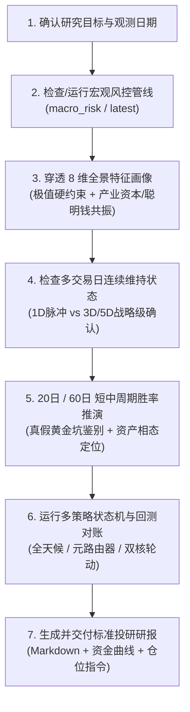

# 宏观风控与跨周期策略研究技能 (Macro Risk & Strategy Research)

## 1. 作用边界与数据准则

1. **Ground Truth First 铁律**：
   - 宏观风控因子、分位数与双轨制指数必须来自本地黄金产物 `data/analytics/macro_risk/latest/risk_factors.parquet` 或历史运行目录；
   - 策略信号与回测净值必须来自 `stock_strategy.macro` 真实执行产物（`data/analytics/macro_strategy/multi_strategy_comparison.md` / `multi_strategy_nav.csv` / `multi_strategy_comparison.png`）；
   - 严禁凭记忆臆造历史点位、指数分位或策略净值；外部宏观政策与新闻必须显式标注为【外部背景】。
   - **数据缺口披露**：两融数据（`dim_leverage`）为日终同步，最新交易日可能暂缺（缺失时该字段为 null，manifest 摘要亦不含该项）。涉及杠杆维度的硬约束排查前，先核对最新一日 `dim_leverage` 是否可用，缺失时需先补数或显式披露，不得静默跳过。
   - **时滞与复权口径披露**：引用因子或回测产物时，沿用产物/manifest 声明的口径（两融 T+1 平移、ETF 价格口径、净值首日归一），具体机制以工程实现为准，不得凭记忆另述；口径不明时显式披露不确定性。
   - **聪明钱维度（`smart_money_score` / `dim_smart_money`）**：由 `smart_money_daily` 领域 Mart 物化（构建入口见 `DomainMartBuilder.build_smart_money`），实证见 `data/analytics/macro_strategy/smart_money_composite.md`；仅作为独立维度供策略选用，**未加入 overheat/panic 指数**。ETF 份额托底代理（`etf_flow_ratio`）已证伪，不作为国家队识别与交易信号。
2. **8 维全景风控画像金字塔 (8-Dimension Pyramid)**：
   - 维度分类为 **3 大生存硬约束**（两融杠杆/换手拥挤/主力资金）、**2 大拐点快变量**（期权情绪/市场广度）、**1 个长线慢变量**（大盘估值）、**1 个微观基本面底**（产业资本）、**1 个全谱系流动性**（跨资产宏观）；
   - 各维度由哪些因子构成、如何聚合为 `overheat_index` / `panic_index`，一律以 [`config/analytics/macro_risk.yaml`](config/analytics/macro_risk.yaml) 的 `factors/dimensions/indices` 节点为唯一信任源，不在此重复。
3. **多时间窗口协同分析准则**：
   - **跨周期全景（2015 年以来，约 11 年）**：识别当前处于 6 大宏观范式中的哪一类（范式特征见 [`references/macro_regimes_playbook.md`](references/macro_regimes_playbook.md)）；
   - **60 日季度窗口**：评估均值回归与胜率兑现（历史胜率数字以 [`references/cycle_windows_matrix.md`](references/cycle_windows_matrix.md) 及复算脚本最新输出为准）；
   - **20 日月度窗口**：依托 20 日均线 (MA20) 过滤短期情绪冲顶与洗盘震荡，执行逃顶与控损；
   - **多交易日连续性窗口**：跟踪聪明钱组合信号（`smart_money_score`）与内部人增持（`insider_net_score`）的连续维持天数（$\ge$ 1D vs $\ge$ 3D vs $\ge$ 5D），连续性判定口径见 `references/cycle_windows_matrix.md`。
4. **回测机制与基准对齐规范**：
   - **执行语义**：严格 T+1（交易日 $t$ 收盘生成信号，目标权重于 $t+1$ 日生效计算复利），由 `stock_strategy.macro.runner.MacroRiskRunner` 统一实现；
   - **基准对齐**：报告必须同步对比**中证全指 (`000985.CSI`)** 与 **沪深300 (`000300.SH`)** 的 Buy & Hold 基准净值；
   - **真实摩擦成本**：佣金率、滑点、调仓死区由 [`config/strategy/macro_risk.yaml`](config/strategy/macro_risk.yaml) 的 `friction` 节点驱动，策略本身不内置。

---

## 2. 标准操作工作流 (SOP)



### 步骤 1：确认日期并执行/加载宏观风控产物
- **极速截面提取 (Fast Path)**：
  ```bash
  uv run python .agents/skills/macro-risk-research/scripts/extract_cycle_snapshot.py
  ```
- **多批次冗余产物清理 (Cleanup Utility)**：
  ```bash
  uv run python .agents/skills/macro-risk-research/scripts/cleanup_redundant_runs.py
  ```
- **若需全量刷新或指定历史日**：
  ```bash
  # 运行宏观风险管线 (支持 --last-n 60 或 --as-of YYYY-MM-DD)
  uv run python -m stock_cli.macro_risk --last-n 60
  ```

### 步骤 2：穿透 8 维核心画像与连续维持极值检测

> 本步骤涉及的硬约束触发阈值、真假黄金坑判定分位以及全部"历史胜率/均值"数字，
> 均以复算脚本 `scripts/compute_cycle_winrate_matrix.py` 最新输出与
> `data/analytics/macro_risk/latest/risk_factors.parquet` 最新产物为准；
> `references/` 仅提供定性规则与历史快照，禁止在 SKILL 主体内另存快照数字。

1. **生存硬约束排查**：按 `macro_regimes_playbook.md` 的"四大不变物理常数"核对两融杠杆与换手/估值双底极值（阈值以产物与复算脚本为准），命中即触发清仓降杠杆 / 满仓锁仓纪律；
2. **真假黄金坑与微观产业底抢跑排查 (连续维持口径)**：
   - **真黄金坑（产业托底强共振）**：恐慌区且产业资本/聪明钱/内部人增持高分位共振，判定产业托底成立，左侧重仓大盘宽基与红利；
   - **假黄金坑警示（纯情绪多杀多中继）**：恐慌区但产业与聪明钱均未逆势接货，严禁盲目加杠杆抄底，以 MA20 为刚性止损线；
   - **微观产业底抢跑**：恐慌区且聪明钱或内部人增持率先高分位，判定微观估值底先行，左侧跟随分批低吸；
   - 上述判定的具体分位阈值与"连续维持 $\ge$ N 天"胜率矩阵见 `references/cycle_windows_matrix.md`。
3. **聪明钱与产业资本连续性排查（替代已证伪的 ETF 份额托底口径）**：
   - `smart_money_score` 高分位（产业资本增持 + 大宗折价接盘 + 国家队股东锚点等权组合）且处于恐慌区间：聪明钱逆势接货，支持左侧分批布局，实证细节见 `data/analytics/macro_strategy/smart_money_composite.md`；
   - 内部人增持高分位（`insider_net_score`）连续维持：确认内部人真金白银增持，左侧跟随低吸；
   - ⚠️ **ETF 份额托底代理（`etf_flow_ratio_score`）已证伪**：与国家队真实增持行为无关、前瞻收益无预测力、V5 托底分支净值贡献为负——不再作为国家队识别与抄底信号。

### 步骤 3：跨周期 6 大宏观范式定位与周期胜率对账
- **宏观范式速查**：查阅 [`references/macro_regimes_playbook.md`](references/macro_regimes_playbook.md) 对齐 6 大历史范式；
- **20日 vs 60日 胜率矩阵**：查阅 [`references/cycle_windows_matrix.md`](references/cycle_windows_matrix.md) 评估当前信号前向胜率与赔率。

### 步骤 4：运行宏观策略回测与最新状态机判定
- **查看所有已配置策略**：
  ```bash
  uv run python -m stock_cli.macro_strategy --list
  ```
- **单策略运行与最新信号回测 (调试/单策略查看)**：
  ```bash
  # 运行 V3 单宽基择时
  uv run python -m stock_cli.macro_strategy --strategy macro_risk_v3
  # 运行 V4 哑铃双核轮动 (红利 + 创业板)
  uv run python -m stock_cli.macro_strategy --strategy macro_rotation_v4
  # 运行 V5 资金博弈增强 (聪明钱假黄金坑确认过滤)
  uv run python -m stock_cli.macro_strategy --strategy macro_rotation_v5
  # 运行 V6 三元资产自适应轮动 (红利 + 创业板 + 300)
  uv run python -m stock_cli.macro_strategy --strategy macro_rotation_v6
  # 运行 MacroMetaRouter 元策略路由器 (理论版)
  uv run python -m stock_cli.macro_strategy --strategy macro_meta_router
  # 运行 MacroMetaRouter 元策略路由器 (ETF 实盘版)
  uv run python -m stock_cli.macro_strategy --strategy macro_meta_router_etf
  # 运行 MacroAllWeather 全天候大类资产轮动 (红利/创业板/300/国债/黄金)
  uv run python -m stock_cli.macro_strategy --strategy macro_all_weather_etf
  ```
- **生成全量多策略横向对账全景报告与资金曲线 (一键出图出表)**：
  ```bash
  uv run python -m stock_cli.macro_strategy_report
  ```
  > 产物自动落盘至 `data/analytics/macro_strategy/`，包含 `multi_strategy_comparison.md`、`multi_strategy_comparison.png` 和 `multi_strategy_nav.csv`。

- **运行生产级跨周期稳定性审计与 CI 门禁断言 (6大范式+4大危机+滚动3Y)**：
  ```bash
  uv run python -m stock_cli.macro_strategy_audit --assert-guardrails
  # 追加 --walk-forward 可执行滚动 3Y 样本内 -> 1Y 样本外 Walk-Forward 检验 (产出 walk_forward_report.md)
  ```
  > 产物自动落盘至 `data/analytics/macro_strategy/audit/`，包含 `strategy_stability_report.md`、`strategy_stability_charts.png` 及 3 大维度 CSV 对账表。

- **盘尾 14:50 实时巡检推演与 Webhook 自动告警推送 (实盘自动化)**：
  ```bash
  # 本地 dry-run 预览巡检报单卡片
  uv run python -m stock_cli.macro_strategy_live --strategy macro_all_weather_etf --dry-run
  # 真实推送飞书/企微机器人告警 (仅触发调仓时推送)
  uv run python -m stock_cli.macro_strategy_live --strategy macro_all_weather_etf --webhook-type feishu --webhook-url "<FEISHU_URL>"
  ```

---

## 3. 配置驱动的宏观风控多策略池

策略体系由 [`config/strategy/macro_risk.yaml`](config/strategy/macro_risk.yaml) 统一驱动。**标的资产、初始权重、趋势基准、摩擦成本与状态机阈值一律以该文件为唯一真实源**，SKILL 不重复维护；各策略的状态机转移逻辑以 `src/stock_strategy/pool/` 下对应策略类实现为准。

| 策略键名 | 核心类名 | 定位说明（哲学） |
| :--- | :--- | :--- |
| **`macro_risk_v3` / `_etf`** | `MacroRiskV3Strategy` | 单宽基趋势防守压舱石：锚定大盘核心资产，破 MA20 减仓控损，冰点恐慌加仓博修复 |
| **`macro_rotation_v4` / `_etf`** | `MacroRotationV4Strategy` | 双核哑铃风格轮动：牛市主升打满创业板弹性，存量熊市切换高股息红利托底避险 |
| **`macro_rotation_v5` / `_etf`** 🌟 | `MacroRotationV5Strategy` | 资金博弈智能增强轮动：在 V4 基础上用 `smart_money_score` 做恐慌左侧确认过滤，未逆势接货判定假黄金坑不建仓 |
| **`macro_rotation_v6` / `_etf`** | `MacroRotationV6Strategy` | 三核资产与风格动量自适应轮动：恐慌左侧以聪明钱确认过滤，左侧探底偏重大盘压舱、低估值超配红利、高估值打满成长 |
| **`macro_meta_router` / `_etf`** | `MacroMetaRouterStrategy` | 宏观元策略动态路由器：融合聪明钱与产业资本双托底，动态切换 5 大宏观相态 |
| **`macro_all_weather_etf`** 🌟 | `MacroAllWeatherStrategy` | 大类资产全天候自适应相态轮动：泡沫破裂期刚性转入国债 + 黄金避险 |

> 各策略的全周期回测绩效（CAGR / 最大回撤 / 夏普 / 卡玛）以 `data/analytics/macro_strategy/multi_strategy_comparison.md` 最新产物为准；references 中的历史胜率/范式数字为研究快照，引用前以复算脚本 `scripts/compute_cycle_winrate_matrix.py` 或最新产物核对，禁止在 SKILL 主体内另存快照数字。

---

## 4. 构建与验证新策略标准流水线 (SOP)

后续研发新策略，按以下 6 步流水线实施闭环验证：

1. **策略编码**：在 `src/stock_strategy/pool/` 下新建策略类，继承 `BaseStrategy`，实现 `on_init()` 与 `on_bar(data) -> list[Signal]`，并注册至 `STRATEGY_REGISTRY`；
2. **YAML 声明**：在 `config/strategy/macro_risk.yaml` 的 `strategies:` 节点下声明 `strategy_class`、`benchmark_symbol`、`symbols`、`initial_weights`、`friction` 与 `thresholds`；
3. **编写单测**：在 `tests/unit/stock_strategy/pool/` 下编写针对新策略的极端行情分支与鲁棒性测试；
4. **全周期对账**：运行 `uv run python -m stock_cli.macro_strategy_report`，自动生成与现有策略/基准并列的资金曲线与 CAGR/MaxDD/Sharpe 对账表；
5. **跨周期审计**：运行 `uv run python -m stock_cli.macro_strategy_audit --assert-guardrails`，验证 6 大范式表现、4 大黑天鹅危机最深回撤及 3 年持有期胜率；
6. **实盘推演**：运行 `uv run python -m stock_cli.macro_strategy_live --strategy <新策略> --dry-run` 验证盘中报单生成。

---

## 5. 标准投研交付报告规范 (Delivery Template)

当用户请求进行“宏观风控复盘”、“周期定位”、“跨周期分析”、“宏观策略配置建议”或“多策略回测对比”时，必须严格按以下标准结构输出 Markdown 研报：

### 📅 宏观风控双轨雷达与跨周期投研周报 (YYYY-MM-DD)

> **🎯 宏观周期综合定位**：【当前状态定性，如：局部过热 / 极度冰点 / 震荡磨底 / 哑铃平衡】

#### 一、 双轨风控雷达与 3-2-1 金字塔多维穿透
| 核心风控维度 | 因子字段 | 当前历史分位 (0-100) | 历史中枢 | 风险等级与状态 |
| :--- | :--- | :---: | :---: | :--- |
| **🔥 狂热指数** | `overheat_index` | `XX.X` | 50.0 | 🔴 高危 / 🟡 偏热 / ⚪ 正常 |
| **🥶 恐慌指数** | `panic_index` | `XX.X` | 50.0 | 🟢 冰点 / 🟡 左侧 / ⚪ 正常 |
| **两融杠杆 (硬约束)** | `dim_leverage` | `XX.X` | 50.0 | 🔴 极度过热 / 🟢 出清 |
| **换手拥挤 (硬约束)** | `dim_crowding` | `XX.X` | 50.0 | 🔴 严重过载 / 🟢 地量冰封 |
| **主力资金 (资金博弈)**| `dim_flow` | `XX.X` | 50.0 | ⚪ 平衡 / 🟢 机构净流入 |
| **聪明钱 (资金博弈)**| `smart_money_score` | `XX.X` | 50.0 | 🟢 逆势接货 / ⚪ 常态 |
| **期权避险 (情绪)** | `dim_sentiment` | `XX.X` | 50.0 | 🟡 避险升温 / ⚪ 平稳 |
| **市场广度 (结构)** | `dim_breadth` | `XX.X` | 50.0 | ⚪ 均衡 / 🔴 极端背离 |
| **大盘估值 (慢变量)** | `dim_valuation` | `XX.X` | 50.0 | 🟢 绝对低估 / 🔴 泡沫高估 |

#### 二、 20日 (月度) vs 60日 (季度) 周期推演与前向胜率
- **20 日短线节奏与动量惯性**：结合当前 Overheat/Panic，评估未来 20 日短线冲顶惯性或二次探底洗盘风险；
- **60 日季度中枢与均值回归**：结合 [`references/cycle_windows_matrix.md`](references/cycle_windows_matrix.md) 的最新胜率/赔率矩阵（引用前用复算脚本核对），给出季度级别胜率与赔率评估。

#### 三、 跨周期 6 大宏观范式映射
- 明确当前宏观环境最贴近历史哪一阶段（如：类似 2018 慢熊尾声、类似 2021 存量红利、或 2024 新质牛），说明相似点与关键结构差异。

#### 四、 宏观多策略回测对账与最新状态机指引

##### 1. 全周期策略回测绩效对账 (2015-2026)

###### (1) 纯指数理论策略对比 (无交易摩擦)
| 核心指标项 | 中证全指 (基准) | 沪深300 (基准) | **macro_risk_v3** | **macro_rotation_v4** | **macro_rotation_v5** | **macro_rotation_v6** | **macro_meta_router** |
| :--- | :---: | :---: | :---: | :---: | :---: | :---: | :---: |
| **累计净值** | `X.XXX` | `X.XXX` | **`X.XXX`** | **`X.XXX`** | **`X.XXX`** | **`X.XXX`** | **`X.XXX`** |
| **累计收益** | `XX.XX%` | `XX.XX%` | **`XX.XX%`** | **`XX.XX%`** | **`XX.XX%`** | **`XX.XX%`** | **`XX.XX%`** |
| **年化收益 (CAGR)** | `X.XX%` | `X.XX%` | **`X.XX%`** | **`X.XX%`** | **`X.XX%`** | **`X.XX%`** | **`X.XX%`** |
| **最大回撤 (Max DD)** | `-XX.XX%` | `-XX.XX%` | **`-XX.XX%`** | **`-XX.XX%`** | **`-XX.XX%`** | **`-XX.XX%`** | **`-XX.XX%`** |
| **年化波动率** | `XX.XX%` | `XX.XX%` | **`XX.XX%`** | **`XX.XX%`** | **`XX.XX%`** | **`XX.XX%`** | **`XX.XX%`** |
| **夏普比率 (Sharpe)** | `0.XX` | `0.XX` | **`0.XX`** | **`0.XX`** | **`0.XX`** | **`0.XX`** | **`0.XX`** |
| **卡玛比率 (Calmar)** | `0.XX` | `0.XX` | **`0.XX`** | **`0.XX`** | **`0.XX`** | **`0.XX`** | **`0.XX`** |

###### (2) 场内 ETF 实盘策略对比 (扣除佣金/滑点/死区)
| 核心指标项 | 中证全指 (基准) | 沪深300 (基准) | **macro_risk_v3_etf** | **macro_rotation_v4_etf** | **macro_rotation_v5_etf** | **macro_rotation_v6_etf** | **macro_meta_router_etf** | **macro_all_weather_etf** |
| :--- | :---: | :---: | :---: | :---: | :---: | :---: | :---: | :---: |
| **累计净值** | `X.XXX` | `X.XXX` | **`X.XXX`** | **`X.XXX`** | **`X.XXX`** | **`X.XXX`** | **`X.XXX`** | **`X.XXX`** |
| **累计收益** | `XX.XX%` | `XX.XX%` | **`XX.XX%`** | **`XX.XX%`** | **`XX.XX%`** | **`XX.XX%`** | **`XX.XX%`** | **`XX.XX%`** |
| **年化收益 (CAGR)** | `X.XX%` | `X.XX%` | **`X.XX%`** | **`X.XX%`** | **`X.XX%`** | **`X.XX%`** | **`X.XX%`** | **`X.XX%`** |
| **最大回撤 (Max DD)** | `-XX.XX%` | `-XX.XX%` | **`-XX.XX%`** | **`-XX.XX%`** | **`-XX.XX%`** | **`-XX.XX%`** | **`-XX.XX%`** | **`-XX.XX%`** |
| **年化波动率** | `XX.XX%` | `XX.XX%` | **`XX.XX%`** | **`XX.XX%`** | **`XX.XX%`** | **`XX.XX%`** | **`XX.XX%`** | **`XX.XX%`** |
| **夏普比率 (Sharpe)** | `0.XX` | `0.XX` | **`0.XX`** | **`0.XX`** | **`0.XX`** | **`0.XX`** | **`0.XX`** | **`0.XX`** |
| **卡玛比率 (Calmar)** | `0.XX` | `0.XX` | **`0.XX`** | **`0.XX`** | **`0.XX`** | **`0.XX`** | **`0.XX`** | **`0.XX`** |

> 表格列与 `data/analytics/macro_strategy/multi_strategy_comparison.md` 最新产物一致（已按纯指数理论版与场内实盘版清晰分组）；数字一律取自该产物。ETF 版已按配置扣佣滑点与死区；绩效指标口径（含 Sharpe 无风险利率）以 `src/stock_strategy/macro/report.py` 实现为准。


##### 2. 当前交易日最新调仓信号与目标配置
- **当前推荐策略**：【单宽基择时 / 双核风格轮动 / 资金博弈增强 / 三核自适应轮动】
- **目标持仓结构**：
  - 价值防守仓（红利 ETF `510880`）：`XX%`
  - 成长进攻仓（创业板 ETF `159915`）：`XX%`
  - 核心压舱仓（300 ETF `510300`）：`XX%`
  - 固收与现金（防守备用金）：`XX%`
- **风控纪律与触发条件**：状态机触发阈值一律以 `config/strategy/macro_risk.yaml` 为准（如清仓/进攻条件），报告按当前状态机结论描述，不另述实现细节。
- **最近 5 期状态机调仓日志**：
  - `YYYY-MM-DD` 标的 方向 `weight=XX%` 原因: 【如：跌破 MA20 减仓 / 恐慌左侧聪明钱确认建仓】

---

## 6. 专题进阶手册 (Deep-Dive References)

* 📘 [macro_strategies_playbook.md](references/macro_strategies_playbook.md)：宏观风控多策略实战纪律（场内 ETF 实操 5 大铁律）、4 大潜在盲区诊断与系统升级路线图；状态机、回测语义与绩效公式以工程实现为准，本文档不重复。
* 📘 [macro_regimes_playbook.md](references/macro_regimes_playbook.md)：A 股跨周期（2015 年以来）6 大宏观范式定性特征（主导矛盾、占优风格与最佳策略机制）与四大不变物理常数硬约束规则。
* 📘 [cycle_windows_matrix.md](references/cycle_windows_matrix.md)：20日 (月度) vs 60日 (季度) 周期前向胜率、赔率实测矩阵与实战执行法则（可经 `scripts/compute_cycle_winrate_matrix.py` 复算）。
