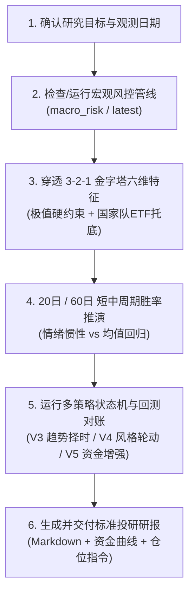

# 宏观风控与跨周期策略研究技能 (Macro Risk & Strategy Research)

## 1. 作用边界与数据准则

1. **Ground Truth First 铁律**：
   - 宏观风控因子、分位数与双轨制指数必须来自本地黄金产物 `data/analytics/macro_risk/latest/risk_factors.parquet` 或历史运行目录；
   - 策略信号与回测净值必须来自 `MacroRiskRunner` 真实执行产物（`data/analytics/macro_strategy/multi_strategy_comparison.md` / `multi_strategy_nav.csv` / `multi_strategy_comparison.png`）；
   - 严禁凭记忆臆造历史点位、指数分位或策略净值；外部宏观政策与新闻必须显式标注为【外部背景】。
2. **3-2-1 金字塔 6 大核心风控画像**：
   - **3 大生存硬约束**：两融杠杆 (`dim_leverage`)、换手拥挤 (`dim_crowding`)、主力资金 (`dim_flow`)；
   - **2 大拐点快变量**：期权情绪 (`dim_sentiment`)、市场广度 (`dim_breadth`)；
   - **1 个长线慢变量**：大盘估值 (`dim_valuation`)。
   - *(注：个股解禁压力 `dim_unlock` 属微观选股排雷，已从宏观风控雷达中剥离)*。
3. **多时间窗口协同分析准则**：
   - **10~15 年跨周期全景**：识别当前处于 6 大宏观范式中的哪一类；
   - **60 日季度窗口**：评估均值回归、胜率兑现与主升浪吃满（极度恐慌底 60 日胜率高达 88%）；
   - **20 日月度窗口**：依托 20 日均线 (MA20) 过滤短期情绪冲顶与洗盘震荡，执行逃顶与控损。
4. **回测机制与基准对齐规范**：
   - **执行语义**：T+1 规则（交易日 $t$ 收盘生成信号，目标权重于 $t+1$ 日生效计算复利）；
   - **基准对齐**：必须同步对比**中证全指 (`000985.CSI`)** 与 **沪深300 (`000300.SH`)** 的 Buy & Hold 基准净值；
   - **成本与约束披露**：纯量化研究回测默认未计滑点与手续费，输出研报时必须显式标注研究假设。

---

## 2. 标准操作工作流 (SOP)



### 步骤 1：确认日期并执行/加载宏观风控产物
- **极速截面提取 (Fast Path)**：
  ```bash
  uv run python .agents/skills/macro-risk-research/scripts/extract_cycle_snapshot.py
  ```
- **多批次冗余产物清理 (Cleanup Utility)**：
  ```bash
  uv run python .agents/skills/macro-risk-research/scripts/cleanup_redundant_runs.py
  ```
- **若需全量刷新或指定历史日**：
  ```bash
  # 运行宏观风险管线 (支持 --last-n 60 或 --as-of YYYY-MM-DD)
  uv run python -m stock_cli.macro_risk --last-n 60
  ```

### 步骤 2：穿透六大核心维度与极端信号检测
1. **生存硬约束排查**：
   - 若 `dim_leverage >= 85.0` 且 `overheat_index >= 65.0`：触发【高杠杆多杀多毁灭警报】（历史后验 60 日胜率 0%），坚决建议清仓降杠杆；
   - 若 `dim_crowding <= 20.0` 且 `dim_valuation <= 5.0` 且 `dim_leverage <= 20.0`：触发【地量估值双底大底】（历史后验 1 年胜率 100%），坚决满仓锁仓。
2. **多主体资金博弈与国家队托底排查**：
   - 查验 `etf_flow_ratio_score`：若 `panic_index > 65` 且 `etf_score >= 90.0`，判定为国家队宽基 ETF 战略性大额买入，确认黄金坑，触发左侧反攻抢跑；
   - 查验 `divergence_score_score`：若狂热高位散户激进接盘而主力坚决出货（`div_score >= 85.0`），提前防范流动性断崖。

### 步骤 3：跨周期 6 大宏观范式定位与周期胜率对账
- **宏观范式速查**：查阅 [`references/macro_regimes_playbook.md`](references/macro_regimes_playbook.md) 对齐 6 大历史范式；
- **20日 vs 60日 胜率矩阵**：查阅 [`references/cycle_windows_matrix.md`](references/cycle_windows_matrix.md) 评估当前信号前向胜率与赔率。

### 步骤 4：运行宏观策略回测与最新状态机判定
- **查看所有已配置策略**：
  ```bash
  uv run python -m stock_cli.macro_strategy --list
  ```
- **单策略运行与最新信号回测 (调试/单策略查看)**：
  ```bash
  # 运行 V3 单宽基择时
  uv run python -m stock_cli.macro_strategy --strategy macro_risk_v3
  # 运行 V4 哑铃双核轮动
  uv run python -m stock_cli.macro_strategy --strategy macro_rotation_v4
  # 运行 V5 资金博弈增强
  uv run python -m stock_cli.macro_strategy --strategy macro_rotation_v5
  ```
- **生成全量多策略横向对账全景报告与资金曲线 (一键出图出表)**：
  ```bash
  uv run python -m stock_cli.macro_strategy_report
  ```
  > 产物自动落盘至 `data/analytics/macro_strategy/`，包含 `multi_strategy_comparison.md`、`multi_strategy_comparison.png` 和 `multi_strategy_nav.csv`。

- **运行生产级跨周期稳定性审计与 CI 门禁断言 (6大范式+4大危机+滚动3Y)**：
  ```bash
  uv run python -m stock_cli.macro_strategy_audit --assert-guardrails
  ```
  > 产物自动落盘至 `data/analytics/macro_strategy/audit/`，包含 `strategy_stability_report.md`、`strategy_stability_charts.png` 及 3 大维度 CSV 对账表。

- **盘尾 14:50 实时巡检推演与 Webhook 自动告警推送 (实盘自动化)**：
  ```bash
  # 本地 dry-run 预览巡检报单卡片
  uv run python -m stock_cli.macro_strategy_live --strategy macro_rotation_v4_etf --dry-run
  # 真实推送飞书/企微机器人告警 (仅触发调仓时推送)
  uv run python -m stock_cli.macro_strategy_live --strategy macro_rotation_v4_etf --webhook-type feishu --webhook-url "<FEISHU_URL>"
  ```


---

## 3. 配置驱动的宏观风控多策略池

策略体系由 [`config/strategy/macro_risk.yaml`](file:///Users/mac/workspace/personal/finance/stock/config/strategy/macro_risk.yaml) 统一驱动。标的资产、初始权重、均线窗口与回测绩效指标以配置文件及 `macro_strategy_report` 运行产物为唯一真实源。

| 策略键名 | 核心类名 | 交易标的与初始权重 | 趋势基准 | 核心投资哲学与风险收益特征 |
| :--- | :--- | :--- | :--- | :--- |
| **`macro_risk_v3`** | `MacroRiskV3Strategy` | 沪深300 (`000300.SH`: 100%) | 沪深300 (`000300.SH`) | **单宽基趋势防守压舱石**：锚定大盘核心资产，破 MA20 减仓控损，冰点恐慌加仓博修复，追求低波动与稳健抗跌。 |
| **`macro_rotation_v4`** | `MacroRotationV4Strategy` | 中证红利 (`000922.CSI`: 50%)<br>创业板指 (`399006.SZ`: 50%) | 中证全指 (`000985.CSI`) | **双核哑铃风格轮动 (终极版)**：牛市主升打满创业板弹性，存量熊市切换至高股息红利托底避险，兼顾进攻与防守。 |
| **`macro_rotation_v5`** | `MacroRotationV5Strategy` | 中证红利 (`000922.CSI`: 50%)<br>创业板指 (`399006.SZ`: 50%) | 中证全指 (`000985.CSI`) | **资金博弈智能增强轮动**：在 V4 基础上融入国家队宽基 ETF 战略托底感知 (`etf_score >= 90`) 提前全仓反击，提升极值捕获效率。 |
| **`macro_rotation_v6`** | `MacroRotationV6Strategy` | 中证红利 (`000922.CSI`: 40%)<br>创业板指 (`399006.SZ`: 40%)<br>沪深300 (`000300.SH`: 20%) | 中证全指 (`000985.CSI`) | **三核资产与动量自适应智能轮动 (终极版)**：国家队托底左侧对齐沪深300防踩踏、低估值环境增配红利大盘防踏空、高估值打满创业板弹性。 |

### 核心量化绩效评估维度：
1. **收益能力**：累计收益率 (Total Return)、年化复合增长率 (CAGR)；
2. **风险控制**：最大回撤 (Max Drawdown)、年化波动率 (Annual Volatility)；
3. **风险调整后收益**：夏普比率 (Sharpe Ratio, $R_f=0$)、卡玛比率 (Calmar Ratio, $\text{CAGR} / |\text{MaxDD}|$)。

---

## 4. 标准投研交付报告规范 (Delivery Template)

当用户请求进行“宏观风控复盘”、“周期定位”、“跨周期分析”、“宏观策略配置建议”或“多策略回测对比”时，必须严格按以下标准结构输出 Markdown 研报：

### 📅 宏观风控双轨雷达与跨周期投研周报 (YYYY-MM-DD)

> **🎯 宏观周期综合定位**：【当前状态定性，如：局部过热 / 极度冰点 / 震荡磨底 / 哑铃平衡】

#### 一、 双轨风控雷达与 3-2-1 金字塔多维穿透
| 核心风控维度 | 因子字段 | 当前历史分位 (0-100) | 历史中枢 | 风险等级与状态 |
| :--- | :--- | :---: | :---: | :--- |
| **🔥 狂热指数** | `overheat_index` | `XX.X` | 50.0 | 🔴 高危 / 🟡 偏热 / ⚪ 正常 |
| **🥶 恐慌指数** | `panic_index` | `XX.X` | 50.0 | 🟢 冰点 / 🟡 左侧 / ⚪ 正常 |
| **两融杠杆 (硬约束)** | `dim_leverage` | `XX.X` | 50.0 | 🔴 极度过热 / 🟢 出清 |
| **换手拥挤 (硬约束)** | `dim_crowding` | `XX.X` | 50.0 | 🔴 严重过载 / 🟢 地量冰封 |
| **主力资金 (资金博弈)**| `dim_flow` | `XX.X` | 50.0 | ⚪ 平衡 / 🟢 机构净流入 |
| **国家队托底 (ETF申购)**| `etf_flow_ratio_score` | `XX.X` | 50.0 | 🟢 大额托底 / ⚪ 常态 |
| **期权避险 (情绪)** | `dim_sentiment` | `XX.X` | 50.0 | 🟡 避险升温 / ⚪ 平稳 |
| **市场广度 (结构)** | `dim_breadth` | `XX.X` | 50.0 | ⚪ 均衡 / 🔴 极端背离 |
| **大盘估值 (慢变量)** | `dim_valuation` | `XX.X` | 50.0 | 🟢 绝对低估 / 🔴 泡沫高估 |

#### 二、 20日 (月度) vs 60日 (季度) 周期推演与前向胜率
- **20 日短线节奏与动量惯性**：结合当前 Overheat/Panic，评估未来 20 日短线冲顶惯性或二次探底洗盘风险；
- **60 日季度中枢与均值回归**：结合历史后验矩阵（如冰点底 60 日胜率 88%、均收益 +18%），给出季度级别胜率与赔率评估。

#### 三、 跨周期 6 大宏观范式映射
- 明确当前宏观环境最贴近历史哪一阶段（如：类似 2018 慢熊尾声、类似 2021 存量红利、或 2024 新质牛），说明相似点与关键结构差异。

#### 四、 宏观多策略回测对账与最新状态机指引

##### 1. 全周期策略回测绩效对账 (2015-2026)
| 核心指标项 | 中证全指 (基准) | 沪深300 (基准) | **macro_risk_v3** | **macro_rotation_v4** | **macro_rotation_v5** |
| :--- | :---: | :---: | :---: | :---: | :---: |
| **累计净值** | `X.XXX` | `X.XXX` | **`X.XXX`** | **`X.XXX`** | **`X.XXX`** |
| **累计收益** | `XX.XX%` | `XX.XX%` | **`XX.XX%`** | **`XX.XX%`** | **`XX.XX%`** |
| **年化收益 (CAGR)** | `X.XX%` | `X.XX%` | **`X.XX%`** | **`X.XX%`** | **`X.XX%`** |
| **最大回撤 (Max DD)** | `-XX.XX%` | `-XX.XX%` | **`-XX.XX%`** | **`-XX.XX%`** | **`-XX.XX%`** |
| **年化波动率** | `XX.XX%` | `XX.XX%` | **`XX.XX%`** | **`XX.XX%`** | **`XX.XX%`** |
| **夏普比率 (Sharpe)** | `0.XX` | `0.XX` | **`0.XX`** | **`0.XX`** | **`0.XX`** |
| **卡玛比率 (Calmar)** | `0.XX` | `0.XX` | **`0.XX`** | **`0.XX`** | **`0.XX`** |


##### 2. 当前交易日最新调仓信号与目标配置
- **当前推荐策略**：【单宽基择时 / 双核风格轮动 / 资金博弈增强】
- **目标持仓结构**：
  - 价值防守仓（中证红利 `000922`）：`XX%`
  - 成长进攻仓（创业板指 `399006`）：`XX%`
  - 固收与现金（防守备用金）：`XX%`
- **风控纪律与触发条件**：
  - 触发全额清仓的条件（如：Overheat > 65 且收盘跌破 MA20）；
  - 触发全仓进攻的条件（如：Panic > 75 或 国家队 ETF 托底分位 >= 90）。
- **最近 5 期状态机调仓日志**：
  - `YYYY-MM-DD` 标的 方向 `weight=XX%` 原因: 【如：跌破 MA20 减仓 / 国家队托底抢跑】

---

## 5. 专题进阶手册 (Deep-Dive References)

* 📘 [macro_strategies_playbook.md](references/macro_strategies_playbook.md)：宏观风控多策略（V3/V4/V5/V6 及场内 ETF 代理版）状态机规则、T+1 回测语义、全市场排位对比、5 大实操铁律纪律与 4 大潜在盲区诊断。
* 📘 [macro_regimes_playbook.md](references/macro_regimes_playbook.md)：A 股 14 年跨周期 6 大宏观范式特征、主导矛盾与最佳策略表现。
* 📘 [cycle_windows_matrix.md](references/cycle_windows_matrix.md)：20日 (月度) vs 60日 (季度) 周期前向胜率、赔率实测矩阵与实战执行法则。
