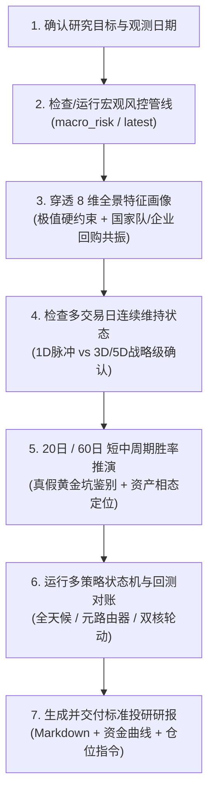

# 宏观风控与跨周期策略研究技能 (Macro Risk & Strategy Research)

## 1. 作用边界与数据准则

1. **Ground Truth First 铁律**：
   - 宏观风控因子、分位数与双轨制指数必须来自本地黄金产物 `data/analytics/macro_risk/latest/risk_factors.parquet` 或历史运行目录；
   - 策略信号与回测净值必须来自 `stock_strategy.macro` 真实执行产物（`data/analytics/macro_strategy/multi_strategy_comparison.md` / `multi_strategy_nav.csv` / `multi_strategy_comparison.png`）；
   - 严禁凭记忆臆造历史点位、指数分位或策略净值；外部宏观政策与新闻必须显式标注为【外部背景】。
   - **数据缺口披露**：两融数据（`dim_leverage`）为日终同步，最新交易日可能暂缺（缺失时该字段为 null，manifest 摘要亦不含该项）。涉及杠杆维度的硬约束排查前，先核对最新一日 `dim_leverage` 是否可用，缺失时需先补数或显式披露，不得静默跳过。
   - **时滞与复权口径披露**：① 两融原始序列按 T+1 交易日平移后入因子（T 日收盘仅使用 T-1 日两融值，消除发布时滞前视）；② ETF 版回测采用未复权场内收盘价，未计分红再投资（对高分红红利类持仓为保守低估）；③ 回测净值首日归一为 1.0（首日为建仓日）。
   - **聪明钱维度（`smart_money_score` / `dim_smart_money`）**：由 `smart_money_daily` 领域 Mart 物化（产业资本增持 + 大宗折价接盘 + 国家队股东锚点等权组合，实证有效性见 `data/analytics/macro_strategy/smart_money_composite.md`）；仅作为独立维度供策略选用，**未加入 overheat/panic 指数**。ETF 份额托底代理（`etf_flow_ratio`）经四重证据证伪，不作为国家队识别与交易信号。
2. **8 维全景风控画像金字塔 (8-Dimension Pyramid)**：
   - **3 大生存硬约束**：两融杠杆 (`dim_leverage`)、换手拥挤 (`dim_crowding`)、主力资金 (`dim_flow`)；
   - **2 大拐点快变量**：期权情绪 (`dim_sentiment`)、市场广度 (`dim_breadth`)；
   - **1 个长线慢变量**：大盘估值 (`dim_valuation`)；
   - **1 个微观基本面底**：产业资本 (`dim_corporate`：回购 + 董监高增持)；
   - **1 个全谱系流动性**：跨资产宏观 (`dim_cross_asset`：转债中位数 + 美债利差 + 铜金比)。
3. **多时间窗口协同分析准则**：
   - **跨周期全景（2015 年以来，约 11 年）**：识别当前处于 6 大宏观范式中的哪一类；
   - **60 日季度窗口**：评估均值回归、胜率兑现与主升浪吃满（极度恐慌底 60 日胜率高达 88%）；
   - **20 日月度窗口**：依托 20 日均线 (MA20) 过滤短期情绪冲顶与洗盘震荡，执行逃顶与控损；
   - **多交易日连续性窗口**：跟踪国家队 ETF 申购（`etf_score >= 90`）与企业回购（`repurchase_score >= 80`）的连续维持天数（$\ge$ 1D vs $\ge$ 3D vs $\ge$ 5D）。
4. **回测机制与基准对齐规范**：
   - **执行语义**：严格 T+1 规则（交易日 $t$ 收盘生成信号，目标权重于 $t+1$ 日生效计算复利）；
   - **基准对齐**：必须同步对比**中证全指 (`000985.CSI`)** 与 **沪深300 (`000300.SH`)** 的 Buy & Hold 基准净值；
   - **真实摩擦成本**：策略支持佣金率 (`commission_rate`)、滑点 (`slippage_rate`) 与调仓死区 (`rebalance_deadband`) 配置。

---

## 2. 标准操作工作流 (SOP)



### 步骤 1：确认日期并执行/加载宏观风控产物
- **极速截面提取 (Fast Path)**：
  ```bash
  uv run python .agents/skills/macro-risk-research/scripts/extract_cycle_snapshot.py
  ```
- **多批次冗余产物清理 (Cleanup Utility)**：
  ```bash
  uv run python .agents/skills/macro-risk-research/scripts/cleanup_redundant_runs.py
  ```
- **若需全量刷新或指定历史日**：
  ```bash
  # 运行宏观风险管线 (支持 --last-n 60 或 --as-of YYYY-MM-DD)
  uv run python -m stock_cli.macro_risk --last-n 60
  ```

### 步骤 2：穿透 8 维核心画像与连续维持极值检测

> 本步骤所有"历史胜率/均值"数字均为历史快照统计，来源与复算脚本见
> [`references/cycle_windows_matrix.md`](references/cycle_windows_matrix.md) 顶部说明；
> 引用时以复算脚本 `scripts/compute_cycle_winrate_matrix.py` 最新输出为准。

1. **生存硬约束排查**：
   - 若 `dim_leverage >= 85.0` 且 `overheat_index >= 65.0`：触发【高杠杆多杀多毁灭警报】（历史后验 60 日胜率 0%），坚决建议清仓降杠杆；
   - 若 `dim_crowding <= 20.0` 且 `dim_valuation <= 5.0` 且 `dim_leverage <= 20.0`：触发【地量估值双底大底】（历史后验 1 年胜率 100%），坚决满仓锁仓。
2. **真假黄金坑与微观产业底抢跑排查 (连续维持胜率矩阵)**：
   - **真黄金坑（产业托底强共振）**：`panic_index > 65` 且 `(dim_corporate >= 75 或 repurchase_score >= 80)`。
     - 若回购高分位**连续维持 $\ge$ 2~3 天**：历史 60 日胜率达 **100%**（后60日均值 **+12.3%**），确认战略级历史大底，坚决在左侧重仓大盘宽基与红利；
   - **假黄金坑警示（纯情绪多杀多中继）**：`panic_index > 65` 但 `(dim_corporate <= 25 且 repurchase_score <= 30)`。
     - 警示实体企业尚未认可估值底线，**严禁盲目加杠杆抄底**，坚决以 20 日均线 (MA20) 为刚性止损线；
   - **微观产业底抢跑**：`panic_index > 65` 且 `etf_score < 40` 但 `repurchase_score >= 80`。
     - 判定产业资本先行于宏观调令，微观估值底率先形成，左侧跟随分批低吸。
3. **国家队 ETF 托底连续性排查**：
   - 若 `etf_score >= 90.0` 仅维持 1 天：胜率约 53.3%（警惕单日脉冲诱多）；
   - 若 `etf_score >= 90.0` **连续维持 $\ge$ 5 天**：历史 20 日胜率达 **100.0%**（后20日均值 **+8.48%**），确认战略级资金持续扫货。

### 步骤 3：跨周期 6 大宏观范式定位与周期胜率对账
- **宏观范式速查**：查阅 [`references/macro_regimes_playbook.md`](references/macro_regimes_playbook.md) 对齐 6 大历史范式；
- **20日 vs 60日 胜率矩阵**：查阅 [`references/cycle_windows_matrix.md`](references/cycle_windows_matrix.md) 评估当前信号前向胜率与赔率。

### 步骤 4：运行宏观策略回测与最新状态机判定
- **查看所有已配置策略**：
  ```bash
  uv run python -m stock_cli.macro_strategy --list
  ```
- **单策略运行与最新信号回测 (调试/单策略查看)**：
  ```bash
  # 运行 V3 单宽基择时
  uv run python -m stock_cli.macro_strategy --strategy macro_risk_v3
  # 运行 V4 哑铃双核轮动 (红利 50% + 创业板 50%)
  uv run python -m stock_cli.macro_strategy --strategy macro_rotation_v4
  # 运行 V5 资金博弈增强 (国家队托底抢跑)
  uv run python -m stock_cli.macro_strategy --strategy macro_rotation_v5
  # 运行 V6 三元资产自适应轮动 (红利 40% + 创业板 40% + 300 20%)
  uv run python -m stock_cli.macro_strategy --strategy macro_rotation_v6
  # 运行 MacroMetaRouter 元策略路由器 (理论版)
  uv run python -m stock_cli.macro_strategy --strategy macro_meta_router
  # 运行 MacroMetaRouter 元策略路由器 (ETF 实盘版)
  uv run python -m stock_cli.macro_strategy --strategy macro_meta_router_etf
  # 运行 MacroAllWeather 全天候大类资产轮动 (红利/创业板/300/国债/黄金)
  uv run python -m stock_cli.macro_strategy --strategy macro_all_weather_etf
  ```
- **生成全量多策略横向对账全景报告与资金曲线 (一键出图出表)**：
  ```bash
  uv run python -m stock_cli.macro_strategy_report
  ```
  > 产物自动落盘至 `data/analytics/macro_strategy/`，包含 `multi_strategy_comparison.md`、`multi_strategy_comparison.png` 和 `multi_strategy_nav.csv`。

- **运行生产级跨周期稳定性审计与 CI 门禁断言 (6大范式+4大危机+滚动3Y)**：
  ```bash
  uv run python -m stock_cli.macro_strategy_audit --assert-guardrails
  ```
  > 产物自动落盘至 `data/analytics/macro_strategy/audit/`，包含 `strategy_stability_report.md`、`strategy_stability_charts.png` 及 3 大维度 CSV 对账表。

- **盘尾 14:50 实时巡检推演与 Webhook 自动告警推送 (实盘自动化)**：
  ```bash
  # 本地 dry-run 预览巡检报单卡片
  uv run python -m stock_cli.macro_strategy_live --strategy macro_all_weather_etf --dry-run
  # 真实推送飞书/企微机器人告警 (仅触发调仓时推送)
  uv run python -m stock_cli.macro_strategy_live --strategy macro_all_weather_etf --webhook-type feishu --webhook-url "<FEISHU_URL>"
  ```

---

## 3. 配置驱动的宏观风控多策略池

策略体系由 [`config/strategy/macro_risk.yaml`](config/strategy/macro_risk.yaml) 统一驱动。标的资产、初始权重、摩擦成本与策略阈值以配置文件为唯一真实源。

| 策略键名 | 核心类名 | 交易标的与初始权重 | 趋势基准 | 核心投资哲学与风险收益特征 |
| :--- | :--- | :--- | :--- | :--- |
| **`macro_risk_v3`** | `MacroRiskV3Strategy` | 沪深300 (`000300.SH`: 100%) | 沪深300 (`000300.SH`) | **单宽基趋势防守压舱石**：锚定大盘核心资产，破 MA20 减仓控损，冰点恐慌加仓博修复，追求低波动与稳健抗跌。 |
| **`macro_rotation_v4`** | `MacroRotationV4Strategy` | 中证红利 (`000922.CSI`: 50%)<br>创业板指 (`399006.SZ`: 50%) | 中证全指 (`000985.CSI`) | **双核哑铃风格轮动 (理论版)**：牛市主升打满创业板弹性，存量熊市切换至高股息红利托底避险，兼顾进攻与防守。 |
| **`macro_rotation_v5`** | `MacroRotationV5Strategy` | 中证红利 (`000922.CSI`: 50%)<br>创业板指 (`399006.SZ`: 50%) | 中证全指 (`000985.CSI`) | **资金博弈智能增强轮动**：在 V4 基础上融入国家队宽基 ETF 战略托底感知 (`etf_score >= 90`) 提前全仓反击，提升极值捕获效率。 |
| **`macro_rotation_v6`** | `MacroRotationV6Strategy` | 中证红利 (`000922.CSI`: 40%)<br>创业板指 (`399006.SZ`: 40%)<br>沪深300 (`000300.SH`: 20%) | 中证全指 (`000985.CSI`) | **三核资产与动量自适应智能轮动 (终极版)**：国家队托底左侧对齐沪深300防踩踏、低估值环境增配红利大盘防踏空、高估值打满创业板弹性。 |
| **`macro_rotation_v4_etf`** | `MacroRotationV4Strategy` | 红利 ETF (`510880.SH`: 50%)<br>创业板 ETF (`159915.SZ`: 50%) | 中证全指 (`000985.CSI`) | **双核哑铃风格轮动 (场内 ETF 代理实盘版)**：可直接使用普通 A 股股票账户在场内一键报单交易。 |
| **`macro_rotation_v6_etf`** | `MacroRotationV6Strategy` | 红利 ETF (`510880.SH`: 40%)<br>创业板 ETF (`159915.SZ`: 40%)<br>300 ETF (`510300.SH`: 20%) | 中证全指 (`000985.CSI`) | **三核自适应轮动 (场内 ETF 代理实盘版)**：兼顾左侧防微盘踩踏与牛市弹性的场内实战组合。 |
| **`macro_meta_router`** | `MacroMetaRouterStrategy` | 中证红利 (`000922.CSI`: 40%)<br>创业板指 (`399006.SZ`: 40%)<br>沪深300 (`000300.SH`: 20%) | 中证全指 (`000985.CSI`) | **宏观元策略动态路由器 (理论版)**：融合国家队与企业回购双托底，动态切换 5 大宏观相态。 |
| **`macro_meta_router_etf`** | `MacroMetaRouterStrategy` | 红利 ETF (`510880.SH`: 40%)<br>创业板 ETF (`159915.SZ`: 40%)<br>300 ETF (`510300.SH`: 20%) | 中证全指 (`000985.CSI`) | **宏观元策略动态路由器 (ETF 版)**：融合国家队与企业回购双托底，动态切换 5 大宏观相态。 |
| **`macro_all_weather_etf`** 🌟 | `MacroAllWeatherStrategy` | 红利 ETF (30%) + 创业板 ETF (30%)<br>300 ETF (20%) + 国债 ETF (20%)<br>黄金 ETF (0%) | 中证全指 (`000985.CSI`) | **大类资产全天候自适应相态轮动 (终极跨资产版)**：泡沫破裂期刚性转入 60% 国债 + 40% 黄金避险，全周期波动率压至 **16.69%**，最大回撤收窄至 **-36.17%**。 |

---

## 4. 构建与验证新策略标准流水线 (SOP)

后续研发新策略，按以下 6 步流水线实施闭环验证：

1. **策略编码**：在 `src/stock_strategy/pool/` 下新建策略类，继承 `BaseStrategy`，实现 `on_init()` 与 `on_bar(data) -> list[Signal]`，并注册至 `STRATEGY_REGISTRY`；
2. **YAML 声明**：在 `config/strategy/macro_risk.yaml` 的 `strategies:` 节点下声明 `strategy_class`、`benchmark_symbol`、`symbols`、`initial_weights`、`friction` 与 `thresholds`；
3. **编写单测**：在 `tests/unit/stock_strategy/pool/` 下编写针对新策略的极端行情分支与鲁棒性测试；
4. **全周期对账**：运行 `uv run python -m stock_cli.macro_strategy_report`，自动生成与现有策略/基准并列的资金曲线与 CAGR/MaxDD/Sharpe 对账表；
5. **跨周期审计**：运行 `uv run python -m stock_cli.macro_strategy_audit --assert-guardrails`，验证 6 大范式表现、4 大黑天鹅危机最深回撤及 3 年持有期胜率；
6. **实盘推演**：运行 `uv run python -m stock_cli.macro_strategy_live --strategy <新策略> --dry-run` 验证盘中报单生成。

---

## 5. 标准投研交付报告规范 (Delivery Template)

当用户请求进行“宏观风控复盘”、“周期定位”、“跨周期分析”、“宏观策略配置建议”或“多策略回测对比”时，必须严格按以下标准结构输出 Markdown 研报：

### 📅 宏观风控双轨雷达与跨周期投研周报 (YYYY-MM-DD)

> **🎯 宏观周期综合定位**：【当前状态定性，如：局部过热 / 极度冰点 / 震荡磨底 / 哑铃平衡】

#### 一、 双轨风控雷达与 3-2-1 金字塔多维穿透
| 核心风控维度 | 因子字段 | 当前历史分位 (0-100) | 历史中枢 | 风险等级与状态 |
| :--- | :--- | :---: | :---: | :--- |
| **🔥 狂热指数** | `overheat_index` | `XX.X` | 50.0 | 🔴 高危 / 🟡 偏热 / ⚪ 正常 |
| **🥶 恐慌指数** | `panic_index` | `XX.X` | 50.0 | 🟢 冰点 / 🟡 左侧 / ⚪ 正常 |
| **两融杠杆 (硬约束)** | `dim_leverage` | `XX.X` | 50.0 | 🔴 极度过热 / 🟢 出清 |
| **换手拥挤 (硬约束)** | `dim_crowding` | `XX.X` | 50.0 | 🔴 严重过载 / 🟢 地量冰封 |
| **主力资金 (资金博弈)**| `dim_flow` | `XX.X` | 50.0 | ⚪ 平衡 / 🟢 机构净流入 |
| **国家队托底 (ETF申购)**| `etf_flow_ratio_score` | `XX.X` | 50.0 | 🟢 大额托底 / ⚪ 常态 |
| **期权避险 (情绪)** | `dim_sentiment` | `XX.X` | 50.0 | 🟡 避险升温 / ⚪ 平稳 |
| **市场广度 (结构)** | `dim_breadth` | `XX.X` | 50.0 | ⚪ 均衡 / 🔴 极端背离 |
| **大盘估值 (慢变量)** | `dim_valuation` | `XX.X` | 50.0 | 🟢 绝对低估 / 🔴 泡沫高估 |

#### 二、 20日 (月度) vs 60日 (季度) 周期推演与前向胜率
- **20 日短线节奏与动量惯性**：结合当前 Overheat/Panic，评估未来 20 日短线冲顶惯性或二次探底洗盘风险；
- **60 日季度中枢与均值回归**：结合历史后验矩阵（如冰点底 60 日胜率 88%、均收益 +18%），给出季度级别胜率与赔率评估。

#### 三、 跨周期 6 大宏观范式映射
- 明确当前宏观环境最贴近历史哪一阶段（如：类似 2018 慢熊尾声、类似 2021 存量红利、或 2024 新质牛），说明相似点与关键结构差异。

#### 四、 宏观多策略回测对账与最新状态机指引

##### 1. 全周期策略回测绩效对账 (2015-2026)
| 核心指标项 | 中证全指 (基准) | 沪深300 (基准) | **macro_risk_v3** | **macro_rotation_v4** | **macro_rotation_v5** | **macro_rotation_v6** | **macro_rotation_v4_etf** | **macro_rotation_v6_etf** | **macro_meta_router** | **macro_meta_router_etf** | **macro_all_weather_etf** |
| :--- | :---: | :---: | :---: | :---: | :---: | :---: | :---: | :---: | :---: | :---: | :---: |
| **累计净值** | `X.XXX` | `X.XXX` | **`X.XXX`** | **`X.XXX`** | **`X.XXX`** | **`X.XXX`** | **`X.XXX`** | **`X.XXX`** | **`X.XXX`** | **`X.XXX`** | **`X.XXX`** |
| **累计收益** | `XX.XX%` | `XX.XX%` | **`XX.XX%`** | **`XX.XX%`** | **`XX.XX%`** | **`XX.XX%`** | **`XX.XX%`** | **`XX.XX%`** | **`XX.XX%`** | **`XX.XX%`** | **`XX.XX%`** |
| **年化收益 (CAGR)** | `X.XX%` | `X.XX%` | **`X.XX%`** | **`X.XX%`** | **`X.XX%`** | **`X.XX%`** | **`X.XX%`** | **`X.XX%`** | **`X.XX%`** | **`X.XX%`** | **`X.XX%`** |
| **最大回撤 (Max DD)** | `-XX.XX%` | `-XX.XX%` | **`-XX.XX%`** | **`-XX.XX%`** | **`-XX.XX%`** | **`-XX.XX%`** | **`-XX.XX%`** | **`-XX.XX%`** | **`-XX.XX%`** | **`-XX.XX%`** | **`-XX.XX%`** |
| **年化波动率** | `XX.XX%` | `XX.XX%` | **`XX.XX%`** | **`XX.XX%`** | **`XX.XX%`** | **`XX.XX%`** | **`XX.XX%`** | **`XX.XX%`** | **`XX.XX%`** | **`XX.XX%`** | **`XX.XX%`** |
| **夏普比率 (Sharpe)** | `0.XX` | `0.XX` | **`0.XX`** | **`0.XX`** | **`0.XX`** | **`0.XX`** | **`0.XX`** | **`0.XX`** | **`0.XX`** | **`0.XX`** | **`0.XX`** |
| **卡玛比率 (Calmar)** | `0.XX` | `0.XX` | **`0.XX`** | **`0.XX`** | **`0.XX`** | **`0.XX`** | **`0.XX`** | **`0.XX`** | **`0.XX`** | **`0.XX`** | **`0.XX`** |

> 表格列与 `data/analytics/macro_strategy/multi_strategy_comparison.md` 最新产物一致（产物共 9 策略 + 2 基准）；数字一律取自该产物，禁止引用本文档或 references 中的历史快照数字。ETF 版已按配置扣佣滑点与死区；Sharpe 口径为无风险利率 1.5%（与 `src/stock_strategy/macro/report.py` 一致）。


##### 2. 当前交易日最新调仓信号与目标配置
- **当前推荐策略**：【单宽基择时 / 双核风格轮动 / 资金博弈增强 / 三核自适应轮动】
- **目标持仓结构**：
  - 价值防守仓（红利 ETF `510880`）：`XX%`
  - 成长进攻仓（创业板 ETF `159915`）：`XX%`
  - 核心压舱仓（300 ETF `510300`）：`XX%`
  - 固收与现金（防守备用金）：`XX%`
- **风控纪律与触发条件**：
  - 触发全额清仓的条件（如：Overheat > 65 且收盘跌破 MA20）；
  - 触发全仓进攻的条件（如：Panic > 75 或 国家队 ETF 托底分位 >= 90）。
- **最近 5 期状态机调仓日志**：
  - `YYYY-MM-DD` 标的 方向 `weight=XX%` 原因: 【如：跌破 MA20 减仓 / 国家队托底抢跑】

---

## 6. 专题进阶手册 (Deep-Dive References)

* 📘 [macro_strategies_playbook.md](references/macro_strategies_playbook.md)：宏观风控多策略（V3/V4/V5/V6 及场内 ETF 代理版）状态机规则、T+1 回测语义、全市场排位对比、5 大实操铁律纪律与 4 大潜在盲区诊断。
* 📘 [macro_regimes_playbook.md](references/macro_regimes_playbook.md)：A 股跨周期（2015 年以来）6 大宏观范式特征、主导矛盾与最佳策略表现。
* 📘 [cycle_windows_matrix.md](references/cycle_windows_matrix.md)：20日 (月度) vs 60日 (季度) 周期前向胜率、赔率实测矩阵与实战执行法则。
