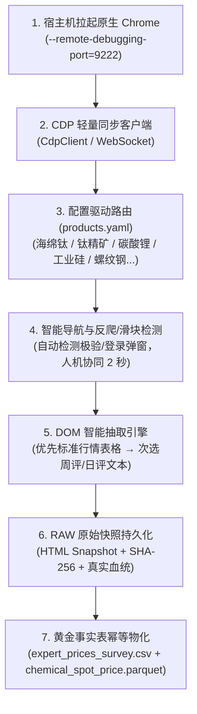

# Mysteel CDP Automation (我的钢铁网多产品自动化智能采集指南)

本技能提供从 **Mysteel（我的钢铁网 / 隆众能化 / 有色网 / 新能源网）** 批量采集大宗商品（海绵钛、钛精矿、碳酸锂、工业硅、螺纹钢、纯碱等）现货价格的全自动与人机协同标准作业程序。

针对 Mysteel 平台严苛反爬（极验滑块/WAF 阻断）、多二级域名碎片化、非标表格结构及付费墙壁垒，复用本仓库成熟的 **CDP (Chrome DevTools Protocol) 远程调试接管** 架构，实现**“配置驱动 + 智能 DOM 解析 + 秒级人机协同过滑块”**的高鲁棒性数据工程闭环。

---

## 1. 核心架构与设计原则



### 核心防错机制

1. **真实宿主环境隔离**：通过 CDP 连接宿主机端口（默认 `9222`），完全绕开普通 Python Requests 的 TLS 指纹与沙箱网络策略拦截。
2. **人机协同滑块感知 (Human-in-the-Loop)**：当页面触发极验滑块（Geetest）或登录弹窗时，终端打印高亮提示框，由人工在 Chrome 窗口中拖动滑块（耗时约 2 秒），验证通过后状态机自动推进。
3. **延迟抓取防封控与会话预热规范 (Anti-WAF Best Practices)**【必须严格遵循】：
   - **专区首页预热 (Session Preheating)**：严禁未经预热直接强攻二级受限专栏列表页（如 `/list/article/pa*.html`），否则会直接触发 WAF 411 阻断。必须先导航至对应品种专区首页（如 `https://nenghua.mysteel.com/breed/taibaifen/`），停留 3 秒建立合法的 Cookie、Referer 与浏览器指纹上下文。
   - **列表页随机礼貌翻页**：翻页间隔强制保持 `4.0 ~ 7.5 秒` 随机延时，并在加载后调用 `window.scrollTo(0, 300)` 模拟平滑滚动与真实用户浏览。
   - **详情页批量下载与批次休眠**：单篇详情页请求保持 `2.5 ~ 4.5 秒` 随机延时；每连续下载 8~10 篇强制主动休眠冷却 5~8 秒，坚决杜绝 1 秒内的机械高频连续请求。
   - **WAF 频控拦截 (HTTP 411/451) 处置**：若出现“您的请求可能存在威胁，已被拦截”，识别为 IP 级临时频控。脚本执行 15~20 秒阶梯冷却重试；若持续受阻，立即提示用户切换网络环境（如切换手机移动热点更换出口 IP）或等待 15~30 分钟自然解封。
4. **配置驱动 (Config-Driven)**：所有监控产品集中于 `config/industry/mysteel/products.yaml` 与 `config/data_sources/chemicals_weekly_sources.csv`，新增品类无需修改核心代码。
5. **表格与正文双轨抽取**：
   - 优先识别行情表格（`table` / `m-table`），按表头关键词提取品名、规格、钢厂、价格、日期；
   - 若无表格则智能回退至研报正文正则提取，自动过滤涨跌幅与环比噪音。
6. **严守 Ground Truth 与 2-Tier 血统**：
   - 抓取的原始 HTML 网页自动保存至 `data/raw/industry/mysteel/snapshots/` 并计算 SHA-256；
   - 现货价格物化至 `data/curated/industry/chemical_spot_price.parquet`；
   - 周度开工率与产量物化至 `data/curated/industry/chemical_weekly_survey.parquet`；
   - 记录来源标注为真实 `source: Mysteel` / `Longzhong_Oilchem`。

---

## 2. 标准作业程序 (SOP) 4 步走

### 步骤 1：宿主机启动原生 Chrome 调试实例

在 macOS 终端中执行（使用独立隔离配置目录）：

```bash
/Applications/Google\ Chrome.app/Contents/MacOS/Google\ Chrome \
  --remote-debugging-port=9222 \
  --user-data-dir="/tmp/chrome_mysteel_profile" &
```

> **注意**：必须在宿主机运行 Chrome，不要在无 GUI 的沙箱容器中拉起。若需要查看会员数据，可在打开的 Chrome 窗口中预先登录 Mysteel 账号。

### 步骤 2：启动 CDP 自动化采集脚本

```bash
# 1. 采集单个品种 (如海绵钛)
uv run python scripts/cdp/mysteel_cdp_automation.py --symbol Ti_sponge

# 2. 批量采集配置清单中的全部品种
uv run python scripts/cdp/mysteel_cdp_automation.py --all

# 3. 指定自定义 Mysteel 页面 URL 采集
uv run python scripts/cdp/mysteel_cdp_automation.py --symbol Ti_sponge --url "https://list1.mysteel.com/zhishi/zghmtscjg.html"

# 4. 离线 HTML 文本模式 (用于回归测试与离线回放)
uv run python scripts/cdp/mysteel_cdp_automation.py --symbol Ti_sponge --offline-html tests/fixtures/sample_mysteel.html
```

### 步骤 3：人机协同完成滑块验证（如触发）

若页面触发安全挑战，终端将输出：

```text
============================================================
【请在已打开的 Chrome 浏览器中完成滑块验证】
-> Mysteel 页面弹出了人机安全验证 (Geetest / Slider)！
-> 请在已打开的 Chrome 窗口中拖动滑块完成验证...
============================================================
```

切换至 Chrome 窗口拖动滑块完成拼图，脚本感知后将自动继续执行。

### 步骤 4：落盘与黄金事实表对账

执行完毕后，检查输出与物化数据：

```bash
uv run python -c "
import polars as pl
df = pl.read_parquet('data/curated/industry/chemical_spot_price.parquet')
print(df.filter(pl.col('source') == 'Mysteel').select(['trade_date', 'symbol', 'spot_price_cny', 'spec', 'raw_snapshot_path']).tail(5))
"
```

---

## 3. 品种配置指南 (`config/industry/mysteel/products.yaml`)

```yaml
products:
  <symbol>:
    product_name: "品名"            # 页面表格匹配名称 (如 "海绵钛")
    category: "nonferrous"         # 产业大类 (chemicals / nonferrous / steel / battery)
    default_url: "https://..."     # 目标行情列表或周评 URL
    search_keyword: "关键词"        # 备选搜索词
    target_specs:                  # 目标规格列表 (如 ["0#", "1#"])
      - "0#"
    unit: "元/吨"                  # 计价单位
    extract_type: "auto"           # auto / table / article
    description: "品种说明"
```
