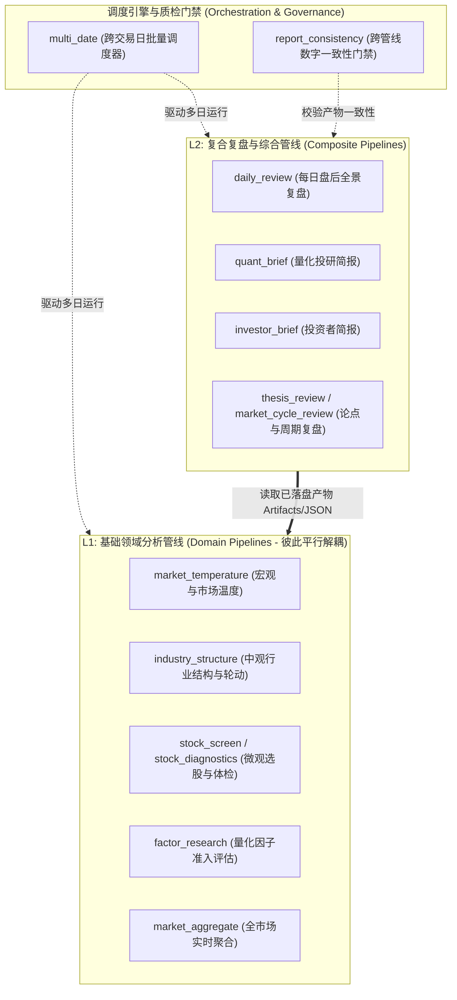
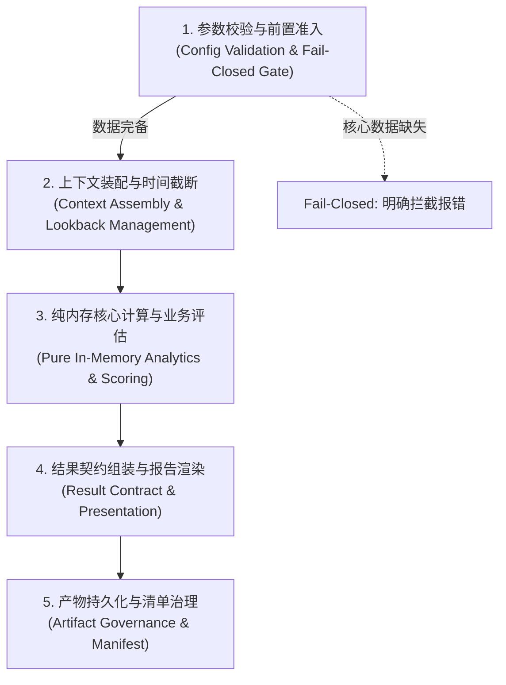

# 量化投研管线设计规范 (Pipeline Design Guide)

本文档定义 `stock_analytics.pipelines` 下所有业务管线的设计原则、生命周期模型、模块拆分规范与交付标准。

相关边界规则见 [`analytics-boundaries.md`](analytics-boundaries.md)，领域职责地图见 [`domain-responsibilities.md`](domain-responsibilities.md)，底层数据流见 [`data_pipeline.md`](data_pipeline.md)。

---

## 一、 为什么需要管线与管线定位

在量化投研系统中，算子、指标、特征与 Mart 构成了分层的数据资产，而**管线（Pipeline）**则是将这些通用数据资产转化为**面向业务目标的决策结论与结构化研报**的端到端加工流水线。

```text
算子 (primitives)  ──> 怎么算 (纯数学函数，无状态，无 I/O)
      ↓
指标 (metrics)     ──> 是什么状态 (单标的时序长表)
      ↓
因子/特征 (features)──> 谁更好 (截面可排序，声明方向与单位)
      ↓
领域表 (marts)     ──> 领域聚合事实 (按领域主键聚合的宽表)
      ↓
管线 (pipelines)   ──> 面向具体投研目标，执行窗口截断、事实融合、业务打分、研报渲染与产物落盘
```

管线解决的核心矛盾：
1. **防止业务逻辑散落**：打分规则、权重、极端状态判定不再散落在 CLI 或随手编写的脚本中；
2. **严格防未来函数**：统一管理时间截断点 $T$ 与历史回溯窗口，杜绝前视偏差（Lookahead Bias）；
3. **实现跨领域事实融合**：在宏观、中观、微观多主体间执行交叉研判与背离分析；
4. **保证可复现与可审计**：运行结果以双轨产物（Markdown + JSON）和元数据清单（`manifest.json`）落盘，确保任何历史结论 100% 可追溯。

---

## 二、 管线体系拓扑结构

管线之间并非纯扁平结构，而是呈现 **“同层平行解耦，纵向分层聚合”** 的拓扑形态：



1. **基础领域管线（Domain Pipelines）**：
   - 输入直连 `data/curated/` 或 `marts/`；
   - 彼此完全平行正交，互不调用，独立配置、独立运行、独立落盘。
2. **复合综合管线（Composite Pipelines）**：
   - 采用**产物级解耦消费（Artifact-level Integration）**，直接读取基础管线已落盘校验的 JSON/Markdown 产物，毫秒级组装全景报告，不重复执行全市场重算。
3. **横切调度与治理工具**：
   - `multi_date` 统一驱动历史区间批量回放；`report_consistency` 在多管线生成后校验指标数字一致性，拦截数据矛盾。

---

## 三、 管线的“五段式”标准生命周期

所有标准管线必须严格遵循五段式生命周期：



### 1. 参数校验与前置准入 (Input Validation & Fail-Closed Gate)
- 消费强类型配置对象（`dataclass`），通过 YAML 文件加载参数；
- 检查基准日 $T$ 的数据水位。若核心事实（如行情数据）不可回溯，**立即执行 Fail-Closed 拦截报错**，严禁生成空报告或部分失真报告。

### 2. 上下文装配与时间截断 (Context Assembly & Lookback Management)
- 严格以 $T$ 日为基准截断历史窗口（例如 2 年行情、5 年分位数）；
- 严禁读取 $T$ 日之后的数据，杜绝前视偏差（Lookahead Bias）；
- 从 Curated / Marts 加载所需数据，必要时触发前置 Mart 增量刷新。

### 3. 纯内存核心计算与业务评估 (Pure In-Memory Computing)
- 调用 `primitives` 纯算子执行指标计算、Rank IC 评估、截面标准化、多维打分或状态机推断；
- **此阶段严禁任何磁盘 I/O 或网络访问**，确保纯逻辑可独立进行毫秒级单元测试。

### 4. 结果契约组装与报告渲染 (Result Contract & Presentation)
- 封装为不可变强类型返回对象（`RunResult` dataclass）；
- **双轨呈现**：
  - **人类可读**：渲染 Markdown 投研研报（排版、图表、警示框）；
  - **机器可读**：整理 JSON 结构化指标与打分明细。

### 5. 产物持久化与元数据清单治理 (Artifact Governance & Manifest)
- 写入版本化目录 `data/analytics/<domain>/<date>_<run_id>/`；
- 生成 `manifest.json`，记录 Git Commit、输入数据指纹 Hash、参数配置快照、耗时与执行状态；
- 全流程无异常后，原子更新 `latest` 展示软链。

---

## 四、 六大核心设计原则

### 原则 1：真实性优先与严格防未来函数 (Ground Truth & Temporal Integrity)
- **Point-in-Time 真实性**：所有点位、估值、分位数必须来自本地 Curated 或校验通过的事实，严禁脑补；
- **时序截断绝对性**：在 $T$ 日做出的研判，只能使用 $T$ 日收盘前已发布的信息；
- **缺失防御**：
  - 核心强依赖缺失 $\rightarrow$ 直接报错中断（Fail-Closed）；
  - 辅助弱依赖缺失 $\rightarrow$ 填充 `None`/缺失标记并在报告中显式披露，严禁私自填充默认均值。

### 原则 2：依赖单向流动与共享事实下沉 (Unidirectional & Shared Downstream)
- **单向依赖**：`primitives` $\leftarrow$ `(metrics, features, marts)` $\leftarrow$ `pipelines`；
- **底层不感知上层**：算子、指标和 Mart 严禁反向依赖管线；
- **跨管线逻辑统一下沉**：若多个管线需要相同的事实提取逻辑，必须下沉到 `marts/shared/<domain>`，管线内只保留纯业务编排。

### 原则 3：计算核心与边缘 I/O 严格隔离 (Functional Core, Imperative Shell)
- 打分模型、判定规则、指标计算必须是**无副作用的纯内存函数**；
- 读写文件与环境装配收拢在管线的起止边界，使单测完全无需依赖 Parquet 真实文件即可快速执行。

### 原则 4：配置数据驱动与强类型契约 (Config-Driven & Typed Contracts)
- **业务参数零硬编码**：回溯窗口、前向周期、分箱数、准入阈值等必须配置在独立的 YAML 文件中（如 `config/analytics/<domain>.yaml`）；
- **强类型贯穿全流程**：入参 `Config`、中间状态 `Context`、返回结果 `RunResult` 均使用 `dataclass` 定义，杜绝任意 `dict` 传递。

### 原则 5：双轨产物与可审计清单 (Dual Artifacts & Manifest Governance)
- 每次运行必须同时交付 Markdown 报告与 JSON 机器数据；
- 必须写入 `manifest.json` 记录环境、数据指纹与状态，确保历史结论 100% 可重现；
- 只有成功执行的批次才能更新 `latest` 软链。

### 原则 6：产物级解耦与幂等批处理重放 (Artifact Decoupling & Idempotent Batching)
- 复合管线优先消费下游 Artifacts，避免重复消耗算力；
- 相同输入参数和数据必定产生完全一致的确定性输出；
- 管线天然支持 `multi_date` 批量调度与跨周期回放。

---

## 五、 标准模块目录与代码范式

### 1. 标准目录结构

新建分析管线时，应在 `src/stock_analytics/pipelines/<domain>/` 下建立以下标准结构：

```text
src/stock_analytics/pipelines/<domain>/
├── __init__.py          # 顶层门面：导出 run_<domain>、RunResult、Config
├── config.py            # 配置 dataclass、YAML 加载器与路径常量
├── pipeline.py          # 核心流程编排：串联生命周期 1~4 步，返回 RunResult
├── artifacts.py         # 产物落盘与 Manifest 写入
└── report.py (可选)     # 专职 Markdown 渲染与文本排版（从 pipeline.py 解耦）
```

### 2. 核心代码设计范式

#### 配置模块 (`config.py`)
```python
from dataclasses import dataclass
from pathlib import Path
import yaml

DEFAULT_CONFIG_PATH = Path("config/analytics/example_domain.yaml")


@dataclass(frozen=True, slots=True)
class ExamplePipelineConfig:
    lookback_days: int = 250
    threshold: float = 0.5
    artifact_root: Path = Path("data/analytics/example_domain")


def load_example_config(path: Path | str = DEFAULT_CONFIG_PATH) -> ExamplePipelineConfig:
    # 加载 YAML 并构建强类型配置对象
    ...
```

#### 产物定义与运行结果 (`pipeline.py`)
```python
@dataclass(frozen=True, slots=True)
class ExampleRunResult:
    as_of_date: date
    paths: ExampleRunPaths
    manifest: dict[str, Any]
    report_markdown: str
    report_json: dict[str, Any]


def run_example_pipeline(
    *,
    as_of_date: date | None = None,
    config: ExamplePipelineConfig | None = None,
    storage_dir: Path | str | None = None,
) -> ExampleRunResult:
    # 1. 校验与前置准入
    # 2. 截断装配上下文
    # 3. 纯内存计算与评估
    # 4. 组装 Markdown 与 JSON
    # 5. 写入 artifacts、manifest 并返回 RunResult
    ...
```

#### 包级门面导出 (`__init__.py`)
```python
from stock_analytics.pipelines.example_domain.config import (
    DEFAULT_CONFIG_PATH,
    ExamplePipelineConfig,
    load_example_config,
)
from stock_analytics.pipelines.example_domain.pipeline import (
    ExampleRunResult,
    run_example_pipeline,
)

__all__ = [
    "DEFAULT_CONFIG_PATH",
    "ExamplePipelineConfig",
    "ExampleRunResult",
    "load_example_config",
    "run_example_pipeline",
]
```

---

## 六、 错误处理与数据缺口准则

| 场景 | 处理方式 | 依据与原则 |
| :--- | :--- | :--- |
| **必需事实表缺失（如行情面板）** | 立即抛出明确异常中断管线，不写产物 | Fail-Closed：基础数据不可信时，任何推断均无意义 |
| **历史数据长度不足（如未满 2 年）** | 判定状态为 `insufficient` 或明确抛错 | 避免小样本统计严重失真 |
| **辅助字段缺失（如龙虎榜、大宗交易）** | 填充 `None`/`NaN`，并在报告中显式提示“数据缺失” | 降级容错，但必须保证事实知情权 |
| **计算过程中出现异常除零/溢出** | 纯算子内做合法性防御，返回 `NaN`，记录 Warning | 保证计算稳定性，杜绝静默产生极端异常值 |

---

## 七、 质量与测试验收标准

每个新增或重构的管线必须通过以下门禁：
1. **纯内存 Mock 端到端单测**：使用 Mock 数据在毫秒级内验证计算逻辑、门槛判定与报告生成；
2. **边界条件测试**：覆盖历史水位不足（Fail-Closed 拦截）、数据为空、边缘阈值等情况；
3. **产物落盘与 Manifest 验证**：断言产出的 Markdown 包含核心段落、JSON 包含关键键值、Manifest 正确记录指纹；
4. **架构边界 Lint**：通过 `make lint` 中的 `scripts/lint_analytics_boundaries.py` 检查，确保无跨层非法导入。
