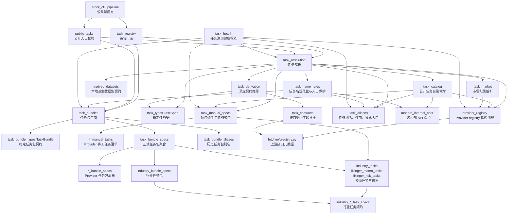

# 任务注册与任务包架构

本文定义 `stock_data` 内任务注册、任务解析和任务包编排的稳定边界。这里的“任务”不是后台智能体任务，而是数据管线可以调度的采集契约：一个公开项目任务名映射到一个上游接口、一个落盘数据集和一组调度/质量/存储规则。

## 1. 当前定位

当前任务体系是“显式契约 + 自动推导 + 任务包展开”，不是“所有任务都是智能采集”。

- 公开入口只接受原子任务；任务包需要先展开，别名和上游路径会被拒绝或规范化。
- `TaskSpec` 是稳定任务契约；Fetcher registry 是上游接口事实；解析层把两者合成管线可执行的调度契约。
- 任务包只负责组合原子任务，不负责决定 Fetcher 请求参数、质量规则或落盘位置。
- 行业、理杏仁宏观和理杏仁风险这类增长快的任务清单由领域模块生成，不继续堆在通用任务包门面里。

## 2. 分层关系



## 3. 模块职责

| 模块 | 高内聚职责 | 不负责内容 |
| --- | --- | --- |
| `task_types.py` | 定义 `TaskSpec` 字段和默认值 | 解析、注册清单、Provider 依赖 |
| `task_bundle_types.py` | 定义 `TaskBundle` | 任务包清单、展开策略 |
| `provider_registry.py` | 延迟加载各数据源原生 registry，避免循环依赖 | 任务策略推导、任务包 |
| `task_contracts.py` | 从 Provider 元数据补齐主键、日期列、单位、更新时间等接口契约字段 | 维护任务清单 |
| `derived_datasets.py` | 维护本地派生数据集契约与分区规则 | 任务别名、Provider 上游接口 |
| `task_catalog.py` | 枚举指定 Provider 下可默认公开的原子任务，过滤别名、停用和显式入口任务 | 单任务解析、任务包展开 |
| `task_market.py` | 从 Provider 元数据解析上游 API 的市场归属，并维护缺省市场兜底 | 任务名解析、任务包展开 |
| `task_name_rules.py` | 规范化任务名，集中处理内部 API 拦截、停用任务、任务包误用和历史别名 | TaskSpec 合成、Provider 元数据读取 |
| `task_health.py` | 只读检查任务注册、任务包、别名和 `TaskSpec` 基本契约，输出可用于门禁的问题清单 | 真实数据采集、RAW/Curated 写入、运行时调度 |
| `tushare_internal_apis.py` | 拦截 TuShare `*_vip` 等上游内部 API 名，强制使用项目任务名 | 调度策略、任务包 |
| `task_aliases.py` | 维护项目任务别名、停用任务和显式入口任务 | 正式任务包、Provider 元数据 |
| `task_manual_specs.py` | 汇总 Provider 手工任务和领域任务生成器输出 | 具体 Provider 清单、解析逻辑、任务包解析 |
| `*_manual_tasks.py` | 按 Provider 维护项目级手工任务映射 | 跨 Provider 聚合、任务解析 |
| `industry_tasks.py` | 生成垂直产业 `TaskSpec` | 通用任务解析、任务包清单、其他 Provider 清单 |
| `industry_task_specs.py` / `industry_*_task_specs.py` | 按业务域维护垂直产业景气指标任务契约，并保持聚合顺序 | 任务包清单、通用任务解析 |
| `industry_bundle_specs.py` | 维护垂直产业任务包名称到原子任务列表的映射 | 行业任务字段契约、通用任务解析 |
| `lixinger_macro_tasks.py` | 维护理杏仁宏观/大宗商品补充任务 | 通用理杏仁 registry |
| `lixinger_risk_tasks.py` | 维护理杏仁公司风险事件任务 | 调度入口校验 |
| `task_bundle_specs.py` | 汇总各 Provider 正式任务包 | 历史兼容别名、具体 Provider 任务包、任务契约推导 |
| `*_bundle_specs.py` | 按 Provider 维护正式任务包名称到原子任务列表的映射 | 历史兼容别名、任务契约推导 |
| `task_bundle_aliases.py` | 维护历史任务包别名 | 新增正式任务包 |
| `task_bundles.py` | 提供任务包查询、解析和展开门面 | 维护大清单、判断任务是否可公开 |
| `public_tasks.py` | 公共调度入口的严格校验和任务包展开 | 兼容旧内部私有常量 |
| `task_resolution.py` | 合成单个 `TaskSpec`，衔接任务名规则、手工任务、Provider registry 和推导层 | 维护任务名保护规则、公开目录枚举、市场归属查询、静态任务包清单 |
| `task_derivation.py` | 从 Provider 元数据推导 `TaskSpec` 的调度与存储默认契约 | 任务名别名、手工任务、任务包展开 |
| `task_registry_helpers.py` | 兼容旧辅助函数导入路径 | 新增共享事实；新代码应导入 `derived_datasets.py` 或 `tushare_internal_apis.py` |
| `task_registry.py` | 兼容旧导入路径的薄门面 | 新增业务逻辑 |

## 4. 依赖方向

稳定依赖方向是：

```text
stock_data 内部调用方
  -> public_tasks / task_resolution / task_bundles
外部旧调用方
  -> task_registry 兼容门面
  -> task_resolution / task_bundles
  -> task_derivation / task_types / task_contracts / task_aliases / task_manual_specs / task_catalog
     / task_name_rules
  -> derived_datasets / task_market / tushare_internal_apis
  -> provider_registry
  -> fetcher/*/registry.py
```

反向依赖需要避免：

- Fetcher registry 不应导入 `task_resolution` 或 `task_bundles`。
- 任务包清单不应读取 Fetcher 实例或执行网络请求。
- `stock_data` 内部不应直接依赖 `task_registry.py`；需要任务能力时使用 `public_tasks.py`、`task_resolution.py` 或 `task_bundles.py`。
- 领域任务清单不应把通用解析逻辑复制到自己的模块里。
- `task_health.py` 只能读取任务注册相关配置，不应依赖 Pipeline、Storage、Governance 或 CLI 运行时。

## 5. 新任务落点

| 场景 | 修改位置 | 说明 |
| --- | --- | --- |
| 新增普通 Provider 端点，任务名和上游 API 名一致 | `fetcher/<provider>/registry.py` | 优先靠 `task_derivation.derive_task_spec()` 自动推导 |
| 新增项目公开短任务名，且需要映射到不同上游 API 路径 | 对应 `*_manual_tasks.py` 或领域任务模块 | 例如 `index_daily_bar -> index_daily`、理杏仁完整路径映射 |
| 新增行业景气任务 | `industry_*_task_specs.py` | 按科技/能源/消费/宏观映射等业务域维护任务契约，聚合顺序由 `industry_task_specs.py` 控制 |
| 新增理杏仁宏观/风险补充任务 | `lixinger_macro_tasks.py` 或 `lixinger_risk_tasks.py` | 避免通用手工任务模块继续膨胀 |
| 新增正式任务包 | 对应 `*_bundle_specs.py` | 面向新文档和新 CLI 示例 |
| 兼容历史任务包名称 | `task_bundle_aliases.py` | 只为迁移旧调用，不作为新名称入口 |
| 兼容历史任务名或上游路径 | `task_aliases.py` | 新示例仍应使用项目短任务名 |
| 调整 per-symbol、单次同步或分区策略 | `fetcher/<provider>/registry.py` 或对应 `*_manual_tasks.py` / 领域任务模块 | 优先让 Provider 元数据或显式 `TaskSpec` 表达 `fetch_mode`、`partitioned`、`is_single_sync` 等事实，不再新增中心白名单 |

## 6. 后续可继续拆的边界

当前拆分已经把增长最快的清单从解析门面中拿出来。后续如果任务继续增长，优先按以下信号继续拆，而不是先增加新的抽象层：

1. **兼容门面再次内流**：`stock_data` 内部模块不得导入 `task_registry.py`；新增架构测试会拦截这类回流。
2. **单个 Provider 清单继续膨胀**：当某一类手工任务或任务包超过 8 到 10 个，可继续按业务域拆分，例如 `tushare_financial_tasks.py`、`yfinance_market_tasks.py`；行业任务已经按 `industry_*_task_specs.py` 分域维护。
3. **推导层再次出现任务名白名单**：如果 `task_derivation.py` 又开始按任务名堆规则，说明 Provider registry 或显式 `TaskSpec` 元数据不够，应把 `fetch_mode`、`partitioned`、`is_single_sync` 等事实前移。
4. **任务包开始带业务语义**：如果任务包不只是列表，而开始承载顺序、依赖、失败策略，应新增计划层对象，不要把编排规则塞进 `TaskBundle`。
5. **公开入口校验规则变复杂**：如果 CLI、调度器、配置文件需要不同可见性规则，应把可见性从 `public_tasks.py` 抽成独立策略模块。

## 7. 维护原则

- 对外只承诺项目任务名、`TaskSpec` 字段和任务包名称；内部清单模块可以继续演进。
- 新文档和配置示例使用正式任务名和正式任务包名，不使用历史别名。
- 普通源码和普通测试都使用具体模块；只有 `test_task_registry_facade.py` 验证 `task_registry.py` 旧导入兼容。
- 解析逻辑保持少量、稳定、可测；清单增长由领域模块吸收。
- 任务系统只产出“要采什么、怎么采、落哪里”的契约；真正采集逻辑仍属于 Fetcher 和 Pipeline。

## 8. 任务注册健康检查

任务注册健康检查是只读架构自检，不连接外部数据源、不读取 Token、不写 RAW/Curated：

```bash
UV_CACHE_DIR=.uv_cache UV_PYTHON_INSTALL_DIR=.uv_python uv run python -m stock_cli.task_health
UV_CACHE_DIR=.uv_cache UV_PYTHON_INSTALL_DIR=.uv_python uv run python -m stock_cli.task_health --provider tushare --json
```

当前检查范围：

- Provider registry 是否可加载；
- 正式任务包和历史任务包别名是否只引用已注册原子任务；
- 任务别名是否指向有效项目任务名；
- 默认公开目录是否误暴露停用任务、上游路径、内部 API 或历史别名；
- 候选任务是否能解析为字段完整且枚举值合法的 `TaskSpec`；
- 手工任务映射的上游 API 是否仍存在于对应 Provider registry。
