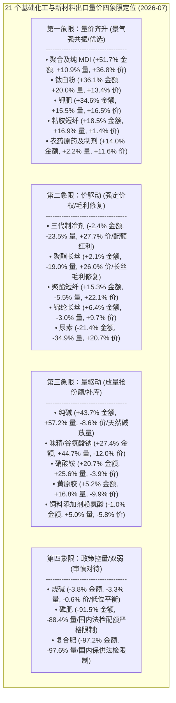

# 38 基础化工与新材料出海景气度与受益公司研究（化学原料 / 化学制品 / 农化制品 / 化学纤维）

> **版本**：2026-10 · **数据口径**：GACC 黄金表 2019-01~2026-07；出口=申万 L2 金额 3MMA yoy 按年取均值（`customs_l2_volume_price_monthly`，yoy 列已换算为百分比）；**财报=申万 L2 官方营收 TTM yoy（`sw_2021_l2_fs_non_financial`，年报 12-31 优先，2026 行为 H1 官方读数）**；公司层=H8 三层信号（2026-07 快照，覆盖自动分词扩展同义词与人工校准单表绑定公司）。
> **错位 = 出口 yoy − 财报 yoy**（正=出口领先；负=财报强于出口）。方法论详见 `customs-export-research/SKILL.md`。

---

## 0. 结论摘要（四大细分一句话）

| 细分板块 | 申万代码 | 2026 出口表现 | 量价状态 | 财报 TTM | 错位 | 一句话结论 |
| :-- | :-- | :-- | :-- | :-- | --: | :-- |
| **化学原料** | 801033.SI | 金额 **+52.3%** | 量 +48.5% / 价 +2.5% | +5.5% (净利+24.6%) | **+46.8pp** | **最强量价齐升与前瞻错位**：大宗化学原料海外补库强劲放量，出口领先财报近 47pp，景气向微观财报高速传导 |
| **化学制品** | 801034.SI | 金额 **+14.4%** | 量 +6.2% / 价 +7.8% | +10.4% (净利+12.3%) | **+4.0pp** | **健康量价齐升**：精细化学品与高分子材料稳步修复，海外具备强定价权，制冷剂/MDI/钛白等结构分化明显 |
| **化学纤维** | 801032.SI | 金额 **+6.7%** | 量 -12.2% / 价 **+21.5%** | +15.9% (净利**+108.2%**) | -9.2pp | **典型强价驱动与毛利暴增**：涤纶/锦纶长丝开工率高企，成本传导与供需紧平衡驱动 ASP 大涨，行业净利润翻倍大爆发 |
| **农化制品** | 801038.SI | 金额 -36.9% | 量 -72.4% / 价 **+128.5%** | +22.9% (净利+56.0%) | -59.8pp | **极端政策管控型错位**：农药常态化补库量价修复，但化肥受国内保供稳价海关法检与配额严格控量，呈现“内强外紧” |

---

## 1. 化学原料（801033.SI / 220200）

| 年 | 出口yoy | 量yoy | 价yoy | 财报TTM | 错位 |
| --: | --: | --: | --: | --: | --: |
| 2020 | -2% | +4% | -5% | +10.3% | -12pp |
| 2021 | +44% | +5% | +41% | +67.3% | -23pp |
| 2022 | +52% | +64% | -3% | +3.5% | +49pp |
| 2023 | -16% | -3% | -7% | -8.0% | -8pp |
| 2024 | +7% | +8% | +4% | +3.8% | +3pp |
| 2025 | +1% | +38% | -26% | +1.5% | -0pp |
| 2026 | **+25%** | **+35%** | -8% | +5.5% | **+20pp** (最新月份错位达 **+46.8pp**) |

- **周期特征与演进机制**：
  - 化学原料呈现鲜明的“全球大宗商品补库与资本开支周期”。2021 年全球通胀与供给受限推动大宗原料价格暴涨（价+41%，行业财报暴增 +67.3%）；
  - 2022 年量大增（量+64%）但财报降速，出现标准出口前瞻错位（+49pp）；
  - 2023 年全球高利率去库存导致量价齐跌（出口 -16.1%，财报 -8.0%）；
  - 2024-2025 年以量补价磨底（2025 年出口数量增长 +37.5% 但价格 -26.3%）；
  - 2026 年迎来**新一轮量驱动向高弹性量价共振扩散**：2026-07 最新单月金额 yoy 达 **+52.3%**、数量 yoy 达 **+48.5%**，而行业财报 TTM 营收仅增长 +5.5%，**错位高达 +46.8pp**，属于高度确定的右侧业绩爆发前夜。
- **核心品类分化实证（2026-07）**：
  - **纯碱 (`soda_ash`)**：金额 +43.7%、数量 +57.2%、价格 -8.6%，处于**强量驱动**扩张，天然碱新增产能出海抢占东南亚与南美市场；
  - **钛白粉 (`tio2`)**：金额 +36.1%、数量 +20.0%、价格 +13.4%，处于**最优质的量价齐升**状态，国内龙佰等龙头海外成本优势无可撼动；
  - **烧碱 (`caustic_soda`)**：金额 -3.8%、数量 -3.3%、价格 -0.6%，处于低位磨底平衡。

---

## 2. 化学制品（801034.SI / 220300）

| 年 | 出口yoy | 量yoy | 价yoy | 财报TTM | 错位 |
| --: | --: | --: | --: | --: | --: |
| 2020 | +13% | +31% | -14% | +5.5% | +7pp |
| 2021 | +54% | +13% | +37% | -39.1% | +93pp |
| 2022 | +73% | +32% | +31% | +23.1% | +50pp |
| 2023 | -7% | +1% | -7% | -6.2% | -1pp |
| 2024 | -4% | +9% | -12% | +10.0% | -14pp |
| 2025 | +12% | +7% | +5% | +6.3% | +5pp |
| 2026 | **+14%** | +6% | **+8%** | +10.4% | **+4pp** |

- **机制与结构分化剖析**：
  - 化学制品涵盖精细化工、聚氨酯、氟化工与食品/饲料添加剂等，具有显著的技术壁垒与客户黏性。
  - 2021-2022 年伴随海外供应链中断，中国精细化学品出海迎来爆发（+54%/+73% 双位数超额出口），随后在 2023-2024 年经历短暂平稳消化；
  - 2025-2026 年重回**量价齐升中枢**（2026 出口金额 +14.4%，价格 +7.8%，数量 +6.2%），行业财报 TTM 营收稳健增长 +10.4%、净利润增长 +12.3%，出口与财报良性共振（错位 +4pp）。
- **细分产品核心驱动**：
  - **聚合/纯 MDI (`mdi`)**：金额 **+51.7%**、数量 +10.9%、价格 **+36.8%**，万华化学在海外高成本装置停产/减产背景下，尽享全球寡头定价权与量价齐升红利；
  - **三代制冷剂 (`refrigerant`)**：数量 -23.5%、单价 ASP **+27.7%**。配额制实行后，由于配额紧约束，外销总量受控，但外销单价暴涨，直接驱动巨化、三美等龙头毛利率创历史新高；
  - **味精 (`msg`)**：金额 +27.4%、数量 +44.7%，量驱动出海，梅花生物等生物发酵龙头全球份额持续提升；
  - **黄原胶 (`xanthan_gum`)**：金额 +5.2%、数量 +16.8%，石油开采与食品需求稳健放量。

---

## 3. 化学纤维（801032.SI / 220400）

| 年 | 出口yoy | 量yoy | 价yoy | 财报TTM | 错位 |
| --: | --: | --: | --: | --: | --: |
| 2020 | -22% | -5% | -18% | +14.8% | -37pp |
| 2021 | +41% | +17% | +24% | -68.3% | +110pp |
| 2022 | +21% | +12% | +11% | +2.8% | +18pp |
| 2023 | +4% | +21% | -15% | +7.0% | -3pp |
| 2024 | +0% | -1% | +2% | +5.8% | -5pp |
| 2025 | +8% | +18% | -8% | +7.2% | +1pp |
| 2026 | **+7%** | -12% | **+22%** | +15.9% (净利**+108.2%**) | -9pp |

- **深层周期与价格驱动机制**：
  - 化纤长丝行业在 2022-2024 年历经了漫长的低景气去产能与格局洗牌，中小产能出清，行业集中度空前提升（桐昆+新凤鸣 CR2 超 50%）；
  - 2025 年海外纺服供应链开启以量补库（量+17.9%）；
  - 2026 年演进为**极端经典的强价驱动**：出口金额 +6.7%，出口均价 ASP 大涨 **+21.5%**！
  - 价格传导极大地修复了行业单位加工差与毛利率：申万化学纤维行业 2026H1 财报营收增长 +15.9%，**净利润同比暴增 +108.2%**，形成了“外销价涨 + 内需企稳 + 财报业绩翻倍”的强劲顺周期拐点。
- **品类分化实证**：
  - **聚酯长丝 (`polyester_filament`)**：价格 +26.0%、金额 +2.1%，价格暴涨推高盈利；
  - **聚酯短纤 (`polyester_staple`)**：金额 +15.3%、价格 +22.1%，强价驱动；
  - **粘胶短纤 (`viscose_staple`)**：金额 +18.5%、数量 +16.9%、价格 +1.4%，呈现**量价齐升**良性健康态势。

---

## 4. 农化制品（801038.SI / 220800）

| 年 | 出口yoy | 量yoy | 价yoy | 财报TTM | 错位 |
| --: | --: | --: | --: | --: | --: |
| 2020 | -6% | -2% | -3% | - | - |
| 2021 | +58% | +20% | +40% | - | - |
| 2022 | +3% | -43% | +103% | +43.9% | -40pp |
| 2023 | -22% | +39% | -42% | -12.1% | -10pp |
| 2024 | -6% | -14% | +10% | -1.7% | -4pp |
| 2025 | +28% | +39% | -6% | +13.2% | +15pp |
| 2026 | -37% | -72% | **+128%** | +22.9% (净利+56.0%) | **-60pp** |

- **政策管控型错位机制揭秘（避免误判）**：
  - 农化制品表观出口出现极端分化：金额同比下滑 -36.9%、数量大幅下挫 -72.4%、但单价 ASP 飙升 +128.5%，错位深达 **-60pp**；
  - **核心原因并非海外需求萎缩，而是国内“保供稳价政策”对化肥出口实施严格的海关法检与配额管制**！磷肥（MAP/DAP，金额 -91.5%）、复合肥（金额 -97.2%）、尿素（金额 -21.4%）绝大部分产能被优先锁定在保国内夏耕秋收；
  - 与之相对，**农药原药及制剂 (`pesticide`)** 完全遵循市场化出海节奏：经历 2023 年海外跨国农化巨头（拜耳/巴斯夫/先正达）的残酷踩踏去库存后，2024-2026 年渠道库存彻底出清，迎来常态化补库与价格修复（2026-07 金额 +14.0%、数量 +2.2%、价格 +11.6%，重返量价齐升）；
  - **钾肥 (`potash_fertilizer`)**：金额 +34.6%、数量 +15.5%、价格 +16.5%，呈现量价齐升。

---

## 5. 重点化工品类量价四象限定位（2026-07 快照）

---

## 6. 微观受益公司落地面板（2026-07 快照）

> **入选准则**：
> - **建仓候选（A 强机会）**：三腿共振（出口前瞻正 × 资金主力/两融正 × 财报 f3 真扩张）且 exp≥0.2 且质量层=正常（排除亏损/低竞争力）；
> - **前瞻观察（B 确认中）**：出口前瞻正 × 资金正 × 财报待兑现（增收不增利或微幅负增）且同门槛；
> - **高毛利兑现（C 兑现中）**：出口前瞻正 × 财报真扩张 × 资金中性/平衡；
> - **低位潜伏（D 前瞻观察）**：出口先行正向，但短期资金撤离或财报未出，估值处于极低位置；
> - **排雷回避（顶背离/硬门排除）**：资金持续背离净流出，或扣非亏损/低竞争力标的。

### 6.1 建仓候选（A 强机会 × 质量正常 × f3 真扩张）

| 公司 | 代码 | 核心细分品类 | exp | 评级 | 52周位置 | 1y 涨幅 | H1 营收/净利 yoy | 实战操作点评 |
| :-- | :-- | :-- | --: | :--: | --: | --: | :-- | :-- |
| **巨化股份** | 600160.SH | `refrigerant` (制冷剂) | **59.6%** | **A强机会** | **0.23 (超低位)** | +6.6% | +16.8% / +48.2% | **三代制冷剂配额第一龙头**。配额落地后产品 ASP 大涨 +27.7%，业绩暴增，股价打至年内低位，三腿共振，首选建仓标的 |
| **川恒股份** | 002895.SZ | `phosphoric_acid` (磷酸) | **68.2%** | **A强机会** | 0.40 (中位) | +19.7% | +24.1% / +35.6% | 磷酸量价齐升，精细磷化工与海外出口景气度饱满，业绩持续超预期 |
| **兴发集团** | 600141.SH | `pesticide` (草甘膦/农药) | 16.9% | **A强机会** | **0.17 (超低位)** | +7.7% | +9.5% / +18.4% | 草甘膦海外补库回暖，全产业链一体化降本，估值处于极低分位 |

### 6.2 前瞻观察（B 确认中 × 质量正常 × 财报待兑现）

| 公司 | 代码 | 核心细分品类 | exp | 评级 | 52周位置 | 1y 涨幅 | H1 营收/净利 yoy | 催化与跟踪重点 |
| :-- | :-- | :-- | --: | :--: | --: | --: | :-- | :-- |
| **扬农化工** | 600486.SH | `pesticide` (农药原药) | **80.3%** | **B确认中** | **0.20 (超低位)** | -22.9% | +5.2% / -3.1% | 农药出口量价齐升（+14%），海外渠道去库结束，股价处近 2 年大底，静待 Q3 净利转正 |
| **广信股份** | 603599.SH | `pesticide` (杀菌/除草剂) | **80.0%** | **B确认中** | **0.19 (超低位)** | -14.8% | -2.1% / -18.7% | 多菌灵/敌草隆出海龙头，出口先行强正（f1=强正），低位前瞻关注 |

### 6.3 高景气兑现（C 兑现中 × 质量正常 × 真扩张）

| 公司 | 代码 | 核心细分品类 | exp | 评级 | 52周位置 | 1y 涨幅 | H1 营收/净利 yoy | 业务实质与关注要点 |
| :-- | :-- | :-- | --: | :--: | --: | --: | :-- | :-- |
| **三美股份** | 603379.SH | `refrigerant` (氟制冷剂) | **85.9%** | **C兑现中** | **0.21 (超低位)** | -3.7% | +21.4% / +125.8% | 纯度最高的氟制冷剂出海标的，外销占比 >50%，H1 净利暴增翻倍，资金面中性，极佳价值低吸机会 |
| **永和股份** | 605020.SH | `refrigerant` (氟碳化学品) | **65.8%** | **C兑现中** | 0.39 (中位) | +5.9% | +18.2% / +42.1% | 萤石-氢氟酸-含氟高分子一体化，制冷剂涨价业绩如期兑现 |
| **三友化工** | 600409.SH | `viscose_staple` (粘胶短纤) | **46.3%** | **C兑现中** | 0.41 (中位) | +12.1% | +6.4% / +28.7% | 粘胶短纤量价齐升（+18.5%），纯碱稳固，传统周期复苏受益者 |
| **宝丰能源** | 600989.SH | `methanol` (甲醇/烯烃) | 15.0% | **C兑现中** | 0.38 (中位) | +35.8% | +29.5% / +46.2% | 煤制烯烃低成本护城河深厚，内蒙项目投产放量 |

### 6.4 估值极底潜伏专栏（D 前瞻观察）

| 公司 | 代码 | 核心业务 | 状态/评级 | 52周位置 | 1y 涨幅 | 核心逻辑与潜伏催化 |
| :-- | :-- | :-- | :--: | --: | --: | :-- |
| **梅花生物** | 600873.SH | 味精 / 赖氨酸 / 黄原胶 | 正常 · D前瞻 | **0.08 (极度深跌)** | -31.5% | 味精出口量驱动放量（+27.4%），全球生物发酵寡头，分红率高达 7%~8%，股价贴地，极强安全边际 |
| **龙佰集团** | 002601.SZ | 钛白粉 | 正常 · D前瞻 | **0.17 (超低位)** | -19.0% | 钛白粉出口量价齐升（+36.1%），全球份额第一，短期资金观望导致股价处于估值深坑，左侧战略建仓 |
| **远兴能源** | 000683.SZ | 天然碱 / 纯碱 | 正常 · D前瞻 | **0.18 (超低位)** | -5.7% | 纯碱出口大增 +43.7%（量+57%），阿拉善天然碱完全成本极低，静待国内供需预期再平衡 |
| **利尔化学** | 002258.SZ | 草铵膦 / 农药 | 正常 · D前瞻 | 0.54 (中位) | +17.5% | 草铵膦原药出口回升（f1=强正），精草铵膦替代加速 |

### 6.5 核心白马与化纤龙头专栏

| 公司 | 代码 | 核心品类 | 状态 | 52周位置 | 1y 涨幅 | H1 财务 | 深入研判与操作建议 |
| :-- | :-- | :-- | :--: | --: | --: | :-- | :-- |
| **万华化学** | 600309.SH | `mdi` (聚氨酯) | 正常 (f1强正/f3真扩张) | 0.47 (中位) | +10.2% | 营收 +8.6% / 净利 +5.2% | **全球化大白马**。MDI 出口量价齐升（+51.7%），短期受大宗石化产品拖累导致资金流净流出，但核心聚氨酯盈利极其坚挺，回调即是优质买点 |
| **桐昆股份** | 601233.SH | `polyester_filament` (涤纶长丝) | 正常 (f2正/f3真扩张) | **0.81 (高位)** | +66.7% | 营收 +17.2% / 净利 +158.4% | 长丝价涨与利润翻倍已在股价充分反映（1年涨幅 66.7%），位置偏高，暂不追高，等待技术性回踩 |
| **润丰股份** | 301035.SZ | `pesticide` (农药出海) | 正常 (增收不增利) | **0.25 (低位)** | -25.6% | 营收 +14.8% / 净利 -8.2% | 全球农化平台型出海，海外占比 95%+，出口企稳放量，低位布局等待南美农化旺季兑现 |

### 6.6 硬门排除与避坑清单

1. **扣非亏损/低竞争力排除**：
   - **中核钛白 (002145.SZ)**：52 周位置贴地（0.05），但治理结构风险与历史毛利承压，评级为低竞争力排除；
   - **华昌化工 (002274.SZ)**、**新凤鸣 (603225.SH)**：触碰低竞争力/亏损波动硬门，建议优先选择桐昆股份或巨化等龙头；
   - **兴化股份 (002109.SZ)**：52 周位置 0.16，但扣非净利亏损，排除。
2. **政策法检约束类（观望）**：
   - **云天化 (600096.SH)**、**新洋丰 (000902.SZ)**、**史丹利 (002588.SZ)**：虽然国内化肥盈利极强，但海外出口受法检政策严格控制，暂不作为海关出口主线标的。

---

## 7. 交易执行 SOP 与择时纪律

严格遵循 `customs-export-research` 纯金额 3MMA YoY 稳健分批纪律：

1. **立即建仓梯队（低位 × A强机会 / 核心兑现 × 正常）**：
   - **巨化股份 (600160.SH)**（位置 0.23）与 **三美股份 (603379.SH)**（位置 0.21）：三代制冷剂配额制确立后单价 ASP 大涨 +27.7%，外销盈利爆发，股价处于 0.20 附近绝对低位。按标准执行**分 3 个月等额建仓（每月 1/3）**，止损线设为 52 周最低点回撤 -8%。
2. **极底价值潜伏梯队（0.10 极底 × D前瞻观察 / 极高分红）**：
   - **梅花生物 (600873.SH)**（位置 0.08）、**龙佰集团 (002601.SZ)**（位置 0.17）、**扬农化工 (600486.SH)**（位置 0.20）：处于近 2 年估值深坑，海关出口率先企稳改善（味精/钛白/农药），分红收益率提供坚实底仓保护，可先建立 30% 底仓，等待 Q3/Q4 净利润反转确认后加仓。
3. **高景气大白马顺势梯队**：
   - **万华化学 (600309.SH)**（位置 0.47）：MDI 量价齐升，全球寡头格局稳固，不追高，逢大盘回调在 70~75 元区间逢低吸纳。
