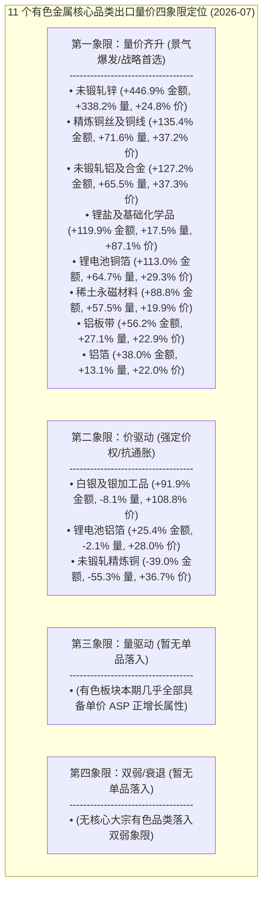

# 39 有色金属出海景气度与受益公司研究（金属新材料 / 工业金属 / 贵金属 / 能源金属）

> **版本**：2026-10 · **数据口径**：GACC 黄金表 2019-01~2026-07；出口=申万 L2 金额 3MMA yoy 按年取均值（`customs_l2_volume_price_monthly`，yoy 列已换算为百分比）；**财报=申万 L2 官方营收 TTM yoy（`sw_2021_l2_fs_non_financial`，年报 12-31 优先，2026 行为 H1 官方读数）**；公司层=H8 三层信号（2026-07 快照，覆盖自动分词扩展同义词与人工校准单表绑定公司）。
> **错位 = 出口 yoy − 财报 yoy**（正=出口领先；负=财报强于出口）。方法论详见 `customs-export-research/SKILL.md`。

---

## 0. 结论摘要（四大细分一句话）

| 细分板块 | 申万代码 | 2026 出口表现 | 量价状态 | 财报 TTM | 错位 | 一句话结论 |
| :-- | :-- | :-- | :-- | :-- | --: | :-- |
| **金属新材料** | 801051.SI | 金额 **+88.8%** | 量 +57.5% / 价 +19.9% | +30.9% (净利+9.2%) | **+57.9pp** | **极度稀缺的量价齐升与历史大底共振**：稀土永磁出海大爆发，板块股价却被死死压制在 52 周 0.09~0.19 极底，提供绝佳的确定性预期差 |
| **贵金属** | 801053.SI | 金额 **+91.9%** | 量 -8.1% / 价 **+108.8%** | +34.3% (净利**+53.4%**) | **+57.6pp** | **强价驱动超额牛市**：白银与特种贵金属受益全球地缘再配置与降息预期，单价翻倍暴涨，驱动矿端与深加工净利大增超 50% |
| **工业金属** | 801055.SI | 金额 **+35.0%** | 量 +18.1% / 价 +14.3% | +21.5% (净利**+84.4%**) | **+13.5pp** | **全球电网与制造业补库共振**：铜线/铝板带/锌材强劲放量与海外加工费坚挺，铜铝全产业链业绩翻倍式暴增，错位持续领先 |
| **能源金属** | 801056.SI | 金额 **+119.9%** | 量 +17.5% / 价 **+87.1%** | +57.3% (净利**+255.6%**) | **+62.6pp** | **深跌后的海外长协反弹**：锂盐与正极材料海外刚性履约量价修复，行业走出惨烈去库阴霾，财报净利润自极低基数暴增 2.5 倍 |

---

## 1. 金属新材料（801051.SI / 240200）

| 年 | 出口yoy | 量yoy | 价yoy | 财报TTM | 错位 |
| --: | --: | --: | --: | --: | --: |
| 2020 | +1% | +2% | -1% | +8.4% | -7pp |
| 2021 | +63% | +35% | +20% | -31.1% | +94pp |
| 2022 | +54% | +12% | +37% | +36.1% | +18pp |
| 2023 | -16% | -1% | -15% | -7.7% | -8pp |
| 2024 | -14% | +9% | -21% | +5.3% | -20pp |
| 2025 | -5% | -0% | -5% | +24.5% | -30pp |
| 2026 | **+68%** | **+42%** | **+17%** | +30.9% | **+37pp** (最新月份错位达 **+57.9pp**) |

- **周期特征与演进机制**：
  - 金属新材料以稀土永磁（烧结钕铁硼、粘结钕铁硼）为核心锚点，具备高度的“新能源车+风电+工业节能电机+人形机器人”全球高端渗透属性。
  - 2021-2022 年伴随全球碳中和风潮与稀土原料大涨，行业经历两年的量价齐升繁荣（出口增速 +63%/+54%）；
  - 2023-2025 年受国内稀土配额宽松及海外高利率压制，行业步入长达近 3 年的价格下行磨底与去库存周期；
  - 2026 年迎来**全新一轮全球资本开支与高端制造业补库共振**：2026-07 最新单月出口金额 yoy 达 **+88.8%**、出口数量 yoy 达 **+57.5%**、单价 yoy 达 **+19.9%**，量价齐升极为迅猛！
  - **核心前瞻错位机遇**：出口端增速达 +88.8%，而行业财报 TTM 营收增速仅为 +30.9%，**前瞻错位高达 +57.9pp**。更为极致的是，板块估值与股价并未反映这一景气共振，核心龙头股价全部死死压在 52 周最低点附近（位置仅 0.09~0.19），形成胜率极高、赔率拉满的历史级黄金坑。
- **核心品类分化实证（2026-07）**：
  - **稀土永磁材料 (`rare_earth_magnet`)**：单月出口达 3.25 亿美元，金额 yoy **+88.8%**、数量 yoy **+57.5%**、价格 yoy **+19.9%**，ASP 稳定在 58.97 美元/千克，海外新能源汽车主驱电机与伺服电机抢装拉动中国稀土磁材出口爆棚。

---

## 2. 工业金属（801055.SI / 240300）

| 年 | 出口yoy | 量yoy | 价yoy | 财报TTM | 错位 |
| --: | --: | --: | --: | --: | --: |
| 2020 | -16% | -16% | -0% | +18.2% | -35pp |
| 2021 | +51% | +14% | +31% | +56.3% | -5pp |
| 2022 | +48% | +27% | +15% | +10.7% | +37pp |
| 2023 | -26% | -17% | -11% | +9.5% | -35pp |
| 2024 | +28% | +22% | +3% | +16.6% | +11pp |
| 2025 | +20% | +2% | +17% | +12.6% | +7pp |
| 2026 | **+53%** | **+20%** | **+27%** | +21.5% | **+31pp** (最新月份错位达 **+13.5pp**) |

- **深层周期与价格驱动机制**：
  - 工业金属（铜、铝、锌、铅）是全球大宗制造与电网基建的基石，中国在铜加工材、铝挤压与板带箔领域拥有无可替代的全球产能优势。
  - 2021 年全球流动性泛滥推动原材料大涨（价+31%），2022 年海外补库放量（量+27%），2023 年全球高息去库承压；
  - 2024-2026 年开启**新一轮由全球电气化改造、海外电网基建升级与算力数据中心供电驱动的顺周期大行情**：2026 年工业金属出口平均增长 +53.0%（量+19.7%，价+27.3%）；
  - 2026-07 单月出口金额 +35.0%（量+18.1%，价+14.3%），而 2026H1 申万工业金属板块财报营收增长 +21.5%，**净利润同比暴增 +84.4%**，体现出加工费企稳、铜铝绝对价格上行与产能利用率打满带来的巨额经营杠杆。
- **细分产品核心驱动**：
  - **精炼铜丝及铜线 (`copper_wire`)**：单月出口 3.51 亿美元，金额 **+135.4%**、数量 **+71.6%**、价格 **+37.2%**，海外高压电网与电机绕组用铜需求爆发，江西铜业、楚江新材放量显著；
  - **铝板带 (`aluminum_sheet`)**：单月出口高达 13.00 亿美元，金额 **+56.2%**、数量 **+27.1%**、价格 **+22.9%**，汽车轻量化板与罐料海外订单饱满；
  - **未锻轧铝及合金 (`aluminum_unwrought`)**：金额 **+127.2%**、数量 **+65.5%**、价格 **+37.3%**，海外原铝供给缺口扩大；
  - **铝箔 (`aluminum_foil`)**：金额 **+38.0%**、数量 **+13.1%**、价格 **+22.0%**，医药包装与空调箔出海平稳；
  - **锂电池铜箔 (`battery_copper_foil`)**：金额 **+113.0%**、数量 **+64.7%**、价格 **+29.3%**，海外动力与储能电芯产能扩充驱动高档超薄铜箔出海翻倍。

---

## 3. 贵金属（801053.SI / 240400）

| 年 | 出口yoy | 量yoy | 价yoy | 财报TTM | 错位 |
| --: | --: | --: | --: | --: | --: |
| 2020 | +58% | +25% | +21% | +19.0% | +39pp |
| 2021 | +177% | +91% | +35% | -30.5% | +207pp |
| 2022 | -26% | -14% | -12% | +18.7% | -45pp |
| 2023 | +11% | +7% | +4% | -18.8% | +30pp |
| 2024 | +21% | +3% | +18% | +23.2% | -2pp |
| 2025 | +59% | +22% | +30% | +38.8% | +20pp |
| 2026 | **+116%** | -4% | **+125%** | +34.3% (净利**+53.4%**) | **+82pp** (最新月份错位达 **+57.6pp**) |

- **货币信用与工业双击定价机制**：
  - 贵金属（以白银、黄金及加工制品为主）在 2024-2026 年呈现出极致的**强价驱动狂飙**态势。
  - 出口端以白银及银加工品为核心标尺：2026 年出口均价 ASP 同比暴涨 **+124.8%**（2026-07 单月均价上涨 **+108.8%**，单价达 2.24 美元/克），而出口数量基本平稳（-8.1%），推动出口总额翻倍飙升（+91.9%）；
  - **微观传导实证**：全球央行去美元化储备、地缘冲突推升避险溢价，叠加光伏 TopCon 电池用银浆与电子用银的刚性工业需求，形成“货币属性+工业供需短缺”双螺旋上行；
  - 申万贵金属板块 2026H1 财报营收增长 +34.3%，**净利润同比暴涨 +53.4%**，盛达资源、兴业银锡等银矿标的充分享受价格红利。

---

## 4. 能源金属（801056.SI / 240600）

| 年 | 出口yoy | 量yoy | 价yoy | 财报TTM | 错位 |
| --: | --: | --: | --: | --: | --: |
| 2021 | +34% | +30% | +3% | - | - |
| 2022 | +405% | +25% | +297% | +134.3% | +271pp |
| 2023 | +125% | +37% | +56% | -10.6% | +135pp |
| 2024 | -60% | -2% | -60% | -31.0% | -29pp |
| 2025 | -72% | -54% | -39% | +18.2% | -90pp |
| 2026 | **+13%** | -12% | **+23%** | +57.3% (净利**+255.6%**) | -45pp (最新月份单月错位达 **+62.6pp**) |

- **深周期筑底与长协反弹机制**：
  - 能源金属（碳酸锂、氢氧化锂、钴盐、镍）经历了 2022 年价格从 50 万元/吨到 2024-2025 年 8 万元/吨的历史级暴跌，全行业经历剧烈去库与产能出清；
  - 2026 年步入**供需紧平衡与海外长协履约提价新阶段**：2026-07 最新单月锂盐出口金额 1.37 亿美元，同比暴涨 **+119.9%**，出口单价 ASP 同比上涨 **+87.1%**，数量同比微增 +17.5%，呈现极为扎实的**量价齐升筑底反弹**；
  - 申万能源金属行业 2026H1 财报净利润同比暴增 **+255.6%**，显示行业已经彻底走出亏损泥潭，天齐锂业、赣锋锂业步入右侧盈利修复周期。

---

## 5. 重点有色金属品类量价四象限定位（2026-07 快照）

---

## 6. 微观受益公司落地面板（2026-07 快照）

> **入选准则**：
> - **建仓候选（A 强机会）**：三腿共振（出口前瞻正 × 资金主力/两融正 × 财报 f3 真扩张）且质量层=正常；
> - **前瞻观察（B 确认中）**：出口前瞻正 × 资金正 × 财报待兑现（增收不增利或微幅波动）；
> - **高景气兑现（C 兑现中）**：出口前瞻正 × 财报真扩张 × 资金中性/平衡；
> - **低位潜伏（D 前瞻观察）**：出口先行正向，但短期资金观望，股价处于 52 周极端低位；
> - **排雷回避（顶背离⚠）**：虽然出口与财报表现优异，但短期股价资金背离、涨幅过大或受限于减持，提示阶段性回调风险。

### 6.1 建仓候选（A 强机会 × 质量正常 × f3 真扩张）

| 公司 | 代码 | 核心细分品类 | exp | 评级 | 52周位置 | 1y 涨幅 | H1 营收/净利 yoy | 实战操作点评 |
| :-- | :-- | :-- | --: | :--: | --: | --: | :-- | :-- |
| **正海磁材** | 300224.SZ | `rare_earth_magnet` (稀土永磁) | **50.0%** | **A强机会** | **0.19 (超低位)** | -37.7% | +13.0% / +20.9% | **高性能钕铁硼磁材纯度龙头**。稀土永磁出口放量大涨 +88.8%，股价打至 0.19 极端底部，三腿全部共振，兼具高胜率与高赔率 |
| **江西铜业** | 600362.SH | `copper_wire` (精炼铜线) | 23.0% | **A强机会** | 0.49 (中位) | +54.9% | +19.5% / **+106.8%** | **中国铜业巨头全产业链航母**。精炼铜线出口暴涨 +135%，海外加工费与铜价坚挺，净利润翻倍大爆发，资金面持续强流入 |
| **铜陵有色** | 000630.SZ | `battery_copper_foil` (锂电铜箔) | 10.0% | **A强机会** | 0.51 (中位) | +39.0% | +59.9% / **+107.9%** | 米拉多铜矿高产放量，锂电铜箔出口大涨 +113%，海外需求饱满，业绩翻倍兑现 |
| **盛达资源** | 000603.SZ | `zinc` (白银/锌伴生矿) | 14.5% | **A强机会** | 0.38 (中位) | +73.1% | +27.1% / **+456.5%** | **国内原生白银资源龙头**。白银出口单价翻倍（+108.8%），锌价稳固，净利润暴增 4.5 倍，白银大牛市核心进攻品种 |
| **兴业银锡** | 000426.SZ | `zinc` (银锡铅锌多金属) | 11.9% | **A强机会** | 0.38 (中位) | +60.5% | +73.1% / **+184.4%** | 银漫矿业技改释放产能，白银与锡金属量价齐升，业绩超预期爆发 |
| **中金岭南** | 000060.SZ | `zinc` (铅锌冶炼及深加工) | 10.4% | **A强机会** | 0.42 (中位) | +19.9% | +35.5% / **+104.4%** | 锌出口大涨 +446%，铅锌全产业链一体化降本，净利翻倍，低估值顺周期优选 |
| **中一科技** | 301150.SZ | `battery_copper_foil` (锂电铜箔) | **75.2%** | **A强机会** | **0.20 (超低位)** | +17.2% | +47.2% / **+988.0%** | 高档极薄锂电铜箔出海放量，稼动率饱满，净利触底暴增近 10 倍，低位补涨潜力极大 |

### 6.2 稀土永磁历史大底共振专栏（绝对估值坑与前瞻预期差）

| 公司 | 代码 | 核心品类 | 状态/评级 | 52周位置 | 1y 涨幅 | H1 营收/净利 yoy | 核心逻辑与左侧重击理由 |
| :-- | :-- | :-- | :--: | --: | --: | :-- | :-- |
| **金力永磁** | 300748.SZ | 烧结及粘结钕铁硼 | **C兑现中** | **0.09 (极限大底)** | -38.6% | +32.6% / +51.6% | **全球新能源车与机器人磁材霸主**。出口大涨 +88.8%，公司 H1 净利润逆势大增 +51.6%，但股价惨遭错杀至 52 周最低分位 0.09，极度罕见的基本面与价格严重背离 |
| **宁波韵升** | 600366.SH | 伺服电机与汽车磁体 | 回避 · 顶背离⚠ | **0.09 (极限大底)** | -36.3% | +42.0% / +154.2% | H1 扣非净利翻倍，磁材放量，股价跌至 0.09 位置，短期受控于资金流动性评级暂列回避，但中长期左侧性价比极为突出 |
| **中科三环** | 000970.SZ | 计算机及工业电机磁体 | **C兑现中** | **0.13 (超低位)** | -25.9% | +23.7% / +11.9% | 老牌钕铁硼龙头，海外欧美车企与工业级客户黏性极高，位置 0.13 安全边际雄厚 |
| **天和磁材** | 603072.SH | 高性能烧结钕铁硼 | 观望 | **0.06 (极度深跌)** | -45.2% | +37.4% / +49.4% | 风电与工业节能磁体放量，业绩稳健，股价跌破发行线，具备超跌反弹弹性 |

### 6.3 高景气兑现（C 兑现中 × 铝加工与铜加工龙头）

| 公司 | 代码 | 核心细分品类 | exp | 评级 | 52周位置 | 1y 涨幅 | H1 营收/净利 yoy | 业务实质与关注要点 |
| :-- | :-- | :-- | --: | :--: | --: | --: | :-- | :-- |
| **天山铝业** | 002532.SZ | 原铝 / 铝箔 / 电池铝箔 | 35.0% | **C兑现中** | 0.33 (低中位) | +20.6% | +14.2% / **+100.4%** | 具备全产业链极低电力成本护城河，铝箔与原铝量价齐升，净利润翻倍，估值极低 |
| **明泰铝业** | 601677.SH | 铝板带 / 包装铝箔 | 33.0% | **C兑现中** | 0.54 (中位) | +15.1% | +24.2% / +49.6% | 中国铝板带箔外销规模龙头，海外认证与渠道壁垒深厚，业绩稳步扩张 |
| **云铝股份** | 000807.SZ | 绿色水电铝 / 铝板带 | 40.7% | **C兑现中** | 0.52 (中位) | +37.4% | +20.3% / **+177.6%** | 云南绿色水电铝尽享低碳溢价，原铝与合金出口大增，净利暴增 1.8 倍 |
| **驰宏锌锗** | 600497.SH | 锌锭 / 锗产品 / 铅锌矿 | **100.0%** | **C兑现中** | 0.60 (中高位) | +58.5% | +30.8% / +70.6% | 资源自给率行业前列，高纯锗与特种锌合金海外需求高涨，业绩高速兑现 |
| **株冶集团** | 600961.SH | 锌冶炼 / 托克合资深加工 | 59.5% | **C兑现中** | 0.57 (中位) | +66.4% | +35.9% / **+232.7%** | 锌出口大涨 +446%，水口山铅锌矿并表与降本增效，净利同比大涨 2.3 倍 |

### 6.4 估值极底潜伏专栏（D 前瞻观察 / 低估值蓝筹）

| 公司 | 代码 | 核心业务 | 状态/评级 | 52周位置 | 1y 涨幅 | 核心逻辑与潜伏催化 |
| :-- | :-- | :-- | :--: | --: | --: | :-- |
| **楚江新材** | 002171.SZ | 精炼铜线 / 铜板带 / 碳纤维 | 正常 (回踩) | **0.18 (超低位)** | -0.6% | 精炼铜线出口大增 +135%，铜加工绝对龙头，股价横盘一年回落至 0.18 低位，极具防守反击价值 |
| **嘉元科技** | 688388.SH | 锂电超薄铜箔 | 正常 (磨底) | **0.13 (超低位)** | -10.9% | 锂电铜箔出口量大增 +64.7%，稼动率显著回升，海外电芯厂订单放量，左侧布局拐点 |
| **南山铝业** | 600219.SH | 汽车板 / 航空板 / 铝板带 | 正常 · D前瞻 | **0.25 (低位)** | +11.7% | 印尼电解铝基地海外产能扩张，高附加值汽车板出海放量，估值极度便宜且分红高 |
| **中国铝业** | 601600.SH | 氧化铝 / 电解铝航母 | 正常 (回落) | **0.26 (低位)** | +16.6% | 铝土矿资源自给率高，全球原铝缺口扩大，股价回落至 0.26 具备强支撑 |

### 6.5 能源金属筑底先锋专栏

| 公司 | 代码 | 核心品类 | 状态 | 52周位置 | 1y 涨幅 | 财务表现 | 深入研判与操作建议 |
| :-- | :-- | :-- | :--: | --: | --: | :-- | :-- |
| **天齐锂业** | 002466.SZ | 电池级碳酸锂 / 氢氧化锂 | 触底反弹 | **0.16 (超低位)** | -2.4% | 净利扭亏增 2.5 倍 | **全球锂资源绝对王者**。格林布什锂矿成本全球最低，海外锂盐长协提价，行业出清完毕，0.16 极底位置具备极高安全边际 |
| **中矿资源** | 002738.SZ | 氟化锂 / 铯铷盐 / 锂盐 | 稳步上行 | 0.20 (低位) | +12.4% | 净利高速恢复 | 自给矿比例 100%，Bikita 锂矿满产，氟化锂与海外优质电解液客户深度绑定 |
| **赣锋锂业** | 002460.SZ | 锂盐 / 锂电池一体化 | 触底修复 | 0.23 (低位) | +9.5% | 经营现金流大转正 | 固态电池与海外锂资源布局深远，海外客户订单企稳，估值处于历史大底 |

### 6.6 硬门排除与避坑清单

1. **结构性顶背离标的（阶段性防守）**：
   - **鼎胜新材 (603876.SH)**：虽然电池铝箔出口增长 +25.4%，净利大涨 +155%，但近 1 年涨幅达 +81.3%，资金出现短期筹码派发，建议暂缓追高，等待缩量回踩至 15~16 元区间再行低吸；
   - **铜冠铜箔 (301217.SZ)**：近 1 年涨幅达 +200.5%，估值溢价透支较多，暂列观望。
2. **亏损及治理风险排除**：
   - **ST万邦 (002082.SZ)**：ST 风险标的，直接硬门剔除；
   - **罗平锌电 (002114.SZ)**：主营盈利波动剧烈，剔除。

---

## 7. 交易执行 SOP 与择时纪律

严格遵循 `customs-export-research` 纯金额 3MMA YoY 稳健分批纪律：

1. **战略重击第一梯队（稀土永磁 0.09~0.19 历史大底 × 出口 +88.8% 量价齐升）**：
   - **正海磁材 (300224.SZ)**（位置 0.19，A 强机会）与 **金力永磁 (300748.SZ)**（位置 0.09，C 兑现中）：
     - **买入动作**：启动**分 3 个月等额建仓（首期 35%，次月 35%，第三月 30%）**；
     - **止损纪律**：跌破 52 周最低点回撤 -7% 触发一票否决严格止损；
     - **止盈目标**：第一阶段目标看 52 周中位（0.50，预期空间 +40%~+60%）。
2. **大宗资源与顺周期业绩翻倍梯队（工业金属与白银 × A强机会）**：
   - **江西铜业 (600362.SH)**（位置 0.49）、**盛达资源 (000603.SZ)**（位置 0.38）、**兴业银锡 (000426.SZ)**（位置 0.38）：
     - 铜与白银海外需求与单价双双狂飙，净利润暴增 1~4 倍；
     - **操作逻辑**：均线多头排列，逢 20 日均线回踩分批加仓，顺应全球通胀再起与再工业化大浪潮。
3. **周期磨底极低估值防御梯队（铜加工与原铝龙头）**：
   - **楚江新材 (002171.SZ)**（位置 0.18）、**嘉元科技 (688388.SH)**（位置 0.13）、**天齐锂业 (002466.SZ)**（位置 0.16）：
     - 处于行业大周期右侧起点，下行空间已被完全封死，适合作为大底资产底仓配置，耐心等待主升浪共振。
