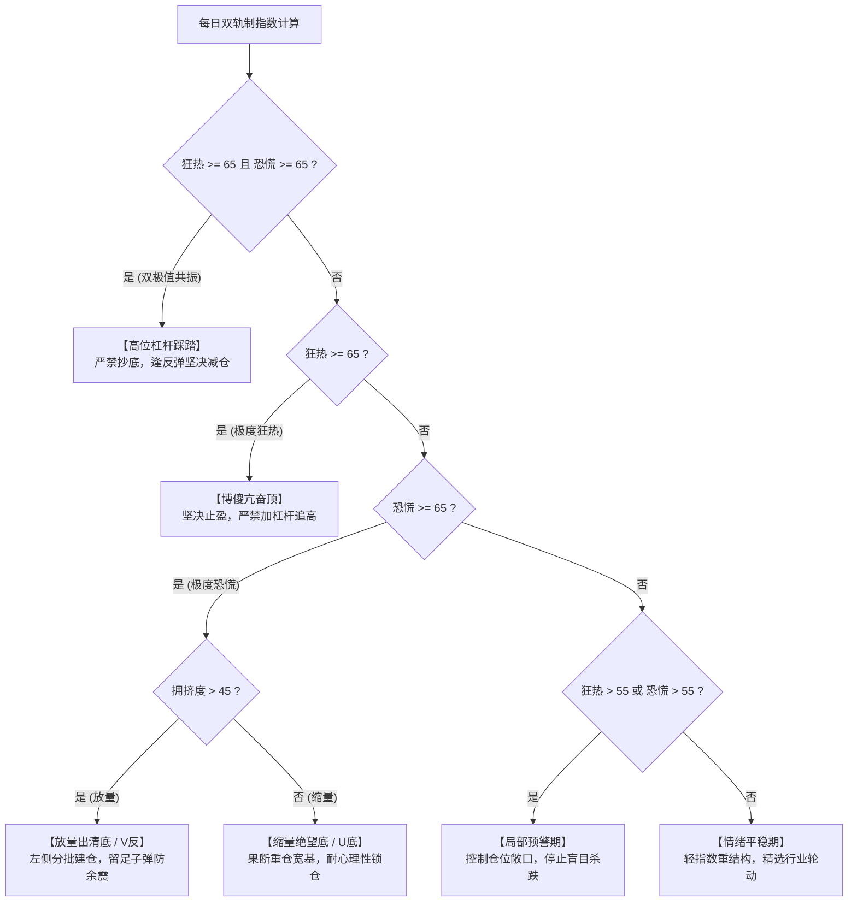

# 宏观风控双轨制系统性风险雷达：极值规律与实证研究

- 文档状态: 已完成 (研究规范与实证实操指南)
- 实证样本: 2015-01-05 至 2026-08-26 (共 2,831 个交易日，全量 876 个极值日)
- 数据资产: `data/analytics/macro_risk/latest/risk_factors.parquet`
- 关联配置: `config/analytics/macro_risk.yaml`
- 关联源码: `src/stock_analytics/pipelines/macro_risk/`, `src/stock_reporting/interpretation/macro_risk/logic.py`

---

## 1. 指标体系与数学定义

宏观风控雷达采用**狂热指数 (Overheat Index)** 与 **恐慌指数 (Panic Index)** 双轨制体系，通过多维因子的历史滚动分位数（Rolling Percentile）加权聚合生成：

### 1.1 核心指数数学公式

$$
\text{overheat\_index} = \frac{1}{5} \left( \text{dim\_valuation} + \text{dim\_leverage} + (100 - \text{dim\_sentiment}) + (100 - \text{dim\_flow}) + \text{dim\_crowding} \right)
$$

$$
\text{panic\_index} = \frac{1}{3} \left( \text{dim\_breadth} + \text{dim\_sentiment} + \text{dim\_flow} \right)
$$

### 1.2 六大核心维度与底层因子映射

| 维度 ID | 维度名称 | 包含底层因子 | 滚动窗口 (天) | 极值含义 |
| :--- | :--- | :--- | :--- | :--- |
| `dim_valuation` | 估值维度 | ERP (反转), PB (正向) | 2500 | 分位越高估值越贵，安全边际越低 |
| `dim_leverage` | 杠杆维度 | 两融渗透率 (`margin_pen`), 两融买入占比 (`margin_buy_ratio`) | 1250 | 存量杠杆水平，90+ 代表杠杆资金过度堆积 |
| `dim_crowding` | 拥挤度 | 全市场换手率 (`market_turnover`) | 1250 | 交易活跃度与情绪博弈烈度 |
| `dim_breadth` | 广度维度 | 涨跌比 (`adv_dec`, 反转), 60日新高占比 (`newhigh60_ratio`, 反转) | 1250 | 分位越高代表普跌或破位越严重 |
| `dim_sentiment` | 情绪维度 | 期权 PCR, 期权 IV, VIX 指数 | 750 / 1250 | 分位越高代表恐慌与避险需求越强烈 |
| `dim_flow` | 资金流 | 现货+ETF综合主力 (`composite_flow`, 反转), 散户接盘背离度 (`divergence_score`, 正向), 两融买入占比 (`margin_buy_ratio`, 正向), 国家队ETF托底 (`etf_flow_ratio`, 特异性) | 1250 | 分位越高代表综合主力出逃与散户高位接盘越严重；国家队大额申购时对冲抛压并触发托底底 |

---

## 2. 统计分布与极值阈值界定

基于 2,831 个交易日的统计分布：

| 指标 | 样本均值 | 标准差 | 中位数 | 预警线 (Warning) | 极端危险线 (Extreme) | 历史峰值 (Peak) |
| :--- | :--- | :--- | :--- | :--- | :--- | :--- |
| **狂热指数 (`overheat_index`)** | 52.62 | 12.70 | 53.80 | `> 55.0` | **`> 65.0`** (占比 17.8%) | **`84.57`** (2015-07-23) |
| **恐慌指数 (`panic_index`)** | 49.31 | 13.47 | 48.18 | `> 55.0` | **`> 65.0`** (占比 13.6%) | **`92.90`** (2015-08-24) |

### 2.1 后验前瞻收益回测矩阵 (全样本 2015~2026)

| 狂热指数区间 | 样本量 | 沪深300 后20日 | 沪深300 后60日均值 (胜率) | 沪深300 后120日均值 | 中证全指 后120日均值 |
| :--- | :--- | :--- | :--- | :--- | :--- |
| `< 45.0` (冷清) | 822 | +1.09% | +3.08% (52.7%) | +6.43% | +6.64% |
| `45.0 ~ 55.0` (中性) | 680 | +0.20% | +0.78% (50.7%) | +1.16% | +0.50% |
| `55.0 ~ 65.0` (局部过热) | 824 | +0.22% | +1.99% (66.4%) | +1.81% | +0.77% |
| `65.0 ~ 70.0` (极度狂热) | 291 | -0.35% | -2.55% (33.0%) | -4.20% | -3.04% |
| `70.0 ~ 75.0` (深度狂热) | 142 | +0.36% | -0.86% (31.7%) | -10.69% | -7.46% |
| **`> 75.0` (极端亢奋顶)** | **72** | **-1.73%** | **-9.49% (16.7%)** | **-20.45%** | **-16.73%** |

| 恐慌指数区间 | 样本量 | 沪深300 后20日 | 沪深300 后60日均值 (胜率) | 沪深300 后120日均值 | 中证全指 后60日均值 |
| :--- | :--- | :--- | :--- | :--- | :--- |
| `< 45.0` (无恐慌) | 1151 | +0.27% | +0.08% (47.6%) | -0.39% | +0.14% |
| `45.0 ~ 55.0` (平稳) | 755 | +0.41% | +1.12% (54.4%) | +1.62% | +1.26% |
| `55.0 ~ 65.0` (恐慌蔓延) | 541 | +0.25% | +2.26% (54.5%) | +3.28% | +2.36% |
| `65.0 ~ 70.0` (极度恐慌) | 169 | +0.33% | +1.82% (58.0%) | +2.83% | +1.92% |
| `70.0 ~ 75.0` (深度恐慌) | 116 | +0.49% | +3.48% (51.7%) | +4.04% | +4.29% |
| **`> 75.0` (绝望冰点底)** | **99** | **+1.81%** | **+4.35% (66.7%)** | **+4.23%** | **+6.42%** |

---

## 3. 普遍规律 (Universal Patterns)

### 规律一：均值回归的非对称性（恐慌快反弹，狂热慢阴跌）
- **恐慌极值由流量快变量驱动**：市场广度瞬间破位、资金急撤与期权 IV 飙升，属于高烈度情绪宣泄，风险出清快。后 20~60 交易日均值回归弹性大、胜率高（60日胜率最高达 88.9%）。
- **狂热极值由存量慢变量驱动**：两融杠杆与换手拥挤度堆积后无法短期化解，行情多呈现“高位剧烈宽幅震荡 $\to$ 滞涨分化 $\to$ 漫长阴跌”。狂热指数突破 75 时，后 60 日下跌概率高达 83.3%，120 日平均回撤达 `-20.45%`。

### 规律二：恐慌底部的形态由流动性换手决定
- **放量出清底 (`dim_crowding > 45`)**：
  - 属于“强制平仓与带血筹码换手”，后验多呈 **V 型强反转**（后 60 日全市场平均反弹 `+4.65%`）。
  - **实操纪律**：短期余震剧烈，**必须采取“左侧分批建仓”策略**，切忌一次性打满。
- **缩量绝望底 (`dim_crowding <= 45`)**：
  - 属于“流动性枯竭与无人问津”，向下空间已被彻底封死，后验多呈 **U 型长线大底**（后 60 日全市场平均反弹 `+1.08%`，120 日稳健上升）。
  - **实操纪律**：**果断重仓宽基**，无需精准择时，长线锁仓。

### 规律三：杠杆维度是系统性大顶的充要条件
- 历史上所有系统性大级别见顶（2015 年 5178 点、2021 年核心资产茅指数顶、2026 年 5000 点顶），`dim_leverage` 均触及 **`90 ~ 100` 历史天花板**。
- 只要杠杆未实质性退潮，单纯的技术性急跌都不构成安全买点。

---

## 4. 特殊规律 (Special Regimes & Traps)

### 特殊规律一：“双极值共振”是高位诱多的致命陷阱
- **现象**：存量杠杆顶在天花板（`dim_leverage = 100`）时，突发单日全市场暴跌踩踏，导致恐慌指数瞬间拉满（`panic >= 65`）。
- **微观机制**：高杠杆背景下的单日暴跌并非风险出清，而是**杠杆多杀多连锁平仓的序幕**（历史 13 天，如 2015-06-26、2015-08-18、2026-05-26）。
- **实证表现**：**后 60 日下跌概率 100%**，沪深 300 后 60 日平均下跌 `-5.4% ~ -23.0%`。
- **研报裁决**：**狂热风险优先级绝对高于恐慌机会**，强制输出“双极值共振 —— 高位杠杆踩踏 (严禁抄底)”，禁止左侧接飞刀。

### 特殊规律二：高低杠杆环境下的恐慌“纯度”差异
- **低杠杆周期 (如 2025 年上半年，杠杆分位 30~50)**：
  - 恐慌属于“纯情绪冲击”，无杠杆踩踏抛压，恐慌爆表即为**纯净黄金坑**（2025-04-07 恐慌 82.7，后 60 日大涨 `+10.94%`，无二次探底）。
- **高杠杆周期 (如 2026 年，杠杆分位 90~100)**：
  - 恐慌往往伴随杠杆预警线压力，筑底过程会出现反复多次洗盘回踩（如 2026 年 2~3 月震荡多次才最终确立主升浪）。

### 特殊规律三：狂热信号具备“左侧动量惯性期” (Lead Time)
- 狂热指数首次突破 65 时，指数往往凭借流动性惯性继续冲刺 **5~15 个交易日**（如 2015 年 5 月、2020 年 7 月、2026 年 5 月上旬）；
- **实操定义**：狂热信号属于**“左侧止盈与去杠杆”的战略级防守信号**，拉长至 1~3 个月其避险胜率高达 84.6%。

### 特殊规律四：流动性危机时“情绪快变量”显著领先于“估值慢变量”
- 在微盘流动性冲击或急跌踩踏中，ERP/PB 等估值指标变化迟钝；
- 期权隐含波动率 (`dim_sentiment`)、跌幅广度 (`dim_breadth`) 和主力资金 (`dim_flow`) 会提前 **1~3 个交易日呈现极端脉冲**，构成捕捉左侧拐点的核心先验雷达。

---

## 5. 专题深研：杠杆风险 vs 估值风险（为什么杠杆是第一杀手？）

从微观机制、回撤斜率与极端穿仓风险来看，**杠杆带来的系统性破坏力显著大于单纯的估值过高**：

### 5.1 核心机制差异：硬约束 (强平机制) vs 软约束 (收益折价)

| 比较维度 | 估值风险 (Valuation Risk) | 杠杆风险 (Leverage Risk) |
| :--- | :--- | :--- |
| **本质属性** | **赔率问题（静态/慢变量）** | **生存问题（动态/正反馈）** |
| **清算机制** | **无强制清算**。即便 100 倍 PE，也没有任何机构有权强行卖出你的股票 | **带强制平仓线（硬约束）**。触及维持担保比例（如 130%）直接被券商强平 |
| **调整方式** | 可通过**“时间换空间”**（横盘震荡、以业绩增长消化估值）或温和阴跌化解 | 必须通过**“筹码血洗”**（短时间内强制抛售大量现货换取现金）才能出清 |
| **调整斜率** | **缓慢释放**（以月/季为单位），投资者有充裕的时间纠错或调仓 | **断崖式崩塌**（以日/周为单位），往往伴随流动性枯竭与连环踩踏 |
| **杀伤范围** | 主要集中在高估值个股/板块自身，具有局部性 | **全市场无差别通杀**（高杠杆爆仓时，跌停股卖不掉，只能抛售优质低估值白马换现金） |

### 5.2 全样本量化对比数据

基于 2015~2026 年事实表数据：

#### (1) 单维度极值回撤对比

| 风险状态 | 样本量 | 后60日上涨胜率 | 后60日平均最大回撤 | 历史最极端单次最大回撤 |
| :--- | :--- | :--- | :--- | :--- |
| **极高杠杆 (`dim_leverage >= 85`)** | 561 天 | **42.2%** | **`-8.26%`** | **`-43.48%`** (2015 杠杆牛爆仓) |
| **极高估值 (`dim_valuation >= 85`)** | 29 天 | **65.5%** | **`-4.87%`** | **`-14.75%`** |

#### (2) “杠杆 $\times$ 估值” 2x2 交叉矩阵

| 杠杆水平 | 估值水平 | 样本量 | 沪深300 后60日收益 | 后60日上涨胜率 | 后60日平均最大回撤 | 典型历史阶段 |
| :--- | :--- | :--- | :--- | :--- | :--- | :--- |
| **高杠杆 ($\ge 75$)** | **高估值 ($\ge 75$)** | **24 天** | **`-7.09%`** | **`0.0%` (必跌)** | **`-10.66%`** | **2015年5~6月、2021年抱团顶** |
| **高杠杆 ($\ge 75$)** | 低/中估值 ($< 75$) | 495 天 | `+1.50%` | 59.2% | `-4.25%` | 2026年结构性行情（高杠杆博弈） |
| 低/中杠杆 ($< 75$) | **高估值 ($\ge 75$)** | 215 天 | `+1.64%` | **69.3%** | **`-3.42%`** | 2017年白马慢牛、2020年下半年 |
| 低/中杠杆 ($< 75$) | 低/中估值 ($< 75$) | 1617 天 | `+1.23%` | 49.5% | `-6.02%` | 震荡市与熊市底部 |

### 5.3 流动性踩踏正反馈螺旋

```
市场小幅扰动 (-3% ~ -5%)
       ↓
部分高杠杆账户触及预警线/平仓线
       ↓
券商系统发起被动强制平仓（挂跌停价无差别砸盘）
       ↓
引发更多杠杆账户跌破平仓线（多杀多）
       ↓
流动性断崖式枯竭（千股跌停，流动性黑洞）
       ↓
为补保证金，机构被迫抛售优质低估值核心资产（估值防线全面击穿）
```

> **实操准则**：“**估值决定空间，杠杆决定生死**”。当全市场估值偏高但杠杆很低时，只需做结构切换；一旦全市场两融杠杆突破 `90~100` 分位，风控系统必须无条件将避险等级提至最高，严禁加杠杆追高。

---

## 6. 历史典型极值战役全景复盘表

| 历史事件 | 代表交易日 | 狂热指数 | 恐慌指数 | 核心定性与研报建议 | 沪深300 后20日 | 沪深300 后60日 | 最终市场走势验证 |
| :--- | :--- | :--- | :--- | :--- | :--- | :--- | :--- |
| **2015 杠杆牛巅峰** | 2015-06-12 | **81.4** | 29.6 | **极度狂热**：坚决止盈，严禁追高 | -14.2% | -34.8% | 5178 历史大顶，股灾爆发 |
| **2015 股灾首轮踩踏** | 2015-06-26 | **69.5** | **70.9** | **双极值共振**：高位杠杆踩踏，严禁抄底 | -3.7% | -23.0% | 千股跌停，后续连续跌停破位 |
| **2015 二次探底暴跌** | 2015-08-18 | **71.0** | **68.1** | **双极值共振**：高位杠杆踩踏，严禁抄底 | -15.4% | -1.3% | 5 日内断崖暴跌 -20.5% |
| **2015 股灾绝望底** | 2015-08-24 | 50.4 | **92.9** | **放量出清底**：黄金坑，左侧分批建仓 | +5.7% | +18.6% | 极端强平出清，V 型大反弹 |
| **2016 年初熔断底** | 2016-01-07 | 31.9 | **87.1** | **缩量绝望底**：黄金坑，重仓宽基锁仓 | -6.5% | +4.6% | 流动性冰点，开启长线慢牛 |
| **2018 质押危机底** | 2018-10-18 | 23.2 | **74.8** | **缩量绝望底**：黄金坑，重仓宽基锁仓 | +3.5% | +4.9% | 政策底确立，2019 牛市起点 |
| **2020 疫情流动性底** | 2020-03-23 | 38.6 | **83.7** | **放量出清底**：黄金坑，左侧分批建仓 | +5.8% | +20.3% | 全球流动性底，迎来全面牛市 |
| **2021 茅指数大顶** | 2021-02-18 | **69.1** | 45.4 | **极度狂热**：坚决止盈，严禁追高 | -12.5% | -13.2% | 核心资产见历史大顶 |
| **2024 微盘流动性底** | 2024-02-06 | 32.7 | **80.9** | **放量出清底**：黄金坑，左侧分批建仓 | +5.9% | +9.7% | 汇金入场，微盘股报复性反弹 |
| **2025 节后黄金坑** | 2025-04-07 | 47.0 | **82.7** | **放量出清底**：黄金坑，左侧分批建仓 | +7.3% | +10.9% | 全年最大 V 型主升反转 |
| **2025 年内最高恐慌** | 2025-11-21 | 50.7 | **92.5** | **放量出清底**：黄金坑，左侧分批建仓 | +2.6% | +6.3% | 剧烈洗盘出清，快速见底拉升 |
| **2026 春季主升买点** | 2026-03-23 | 56.3 | **87.1** | **放量出清底**：黄金坑，左侧分批建仓 | +7.9% | +14.5% | 捕获 2026 年最强大波段行情 |
| **2026 5000点共振顶** | 2026-05-26 | **65.8** | **65.9** | **双极值共振**：高位杠杆踩踏，严禁抄底 | -0.1% | -7.3% | 阻止 5000 点高位接飞刀被套 |

---

## 7. 投资者实操决策指引矩阵


