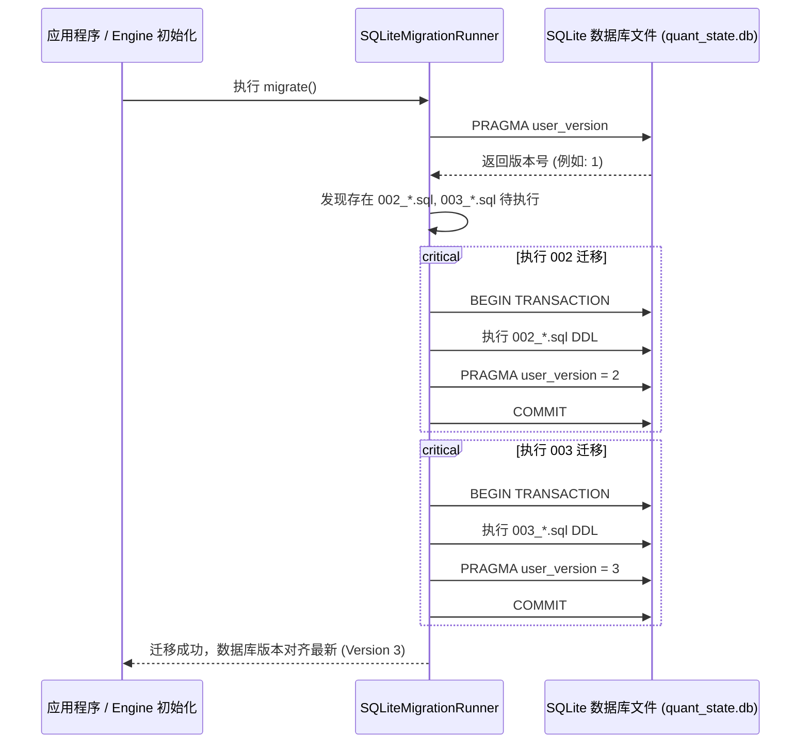

# 关系型数据库 (SQLite) 设计、性能与一致性规范

> **适用范围**：本规范适用于本项目中所有基于关系型数据库（以 SQLite 为主）构建的事务持久化、状态机管理、账户持仓账本、信号审计流水、实验版本库及数据同步元数据模块。
> **文档定位**：作为仓库顶层技术规范，所有涉及 SQLite 的 Schema 定义、Python 代码封装、事务编写与性能调优必须严格遵循本文档。

---

## 1. 存储架构选型与业务边界 (OLAP vs OLTP)

量化投研系统严禁“一刀切”混用存储引擎，必须严格遵守以下分工边界：

| 维度 | **OLAP 分析型存储 (Parquet + DuckDB)** | **OLTP 事务型存储 (SQLite)** |
| :--- | :--- | :--- |
| **承载业务** | 历史日线/分钟行情事实表、宏观风险因子大矩阵、全市场行业与估值 Mart 宽表 | 实盘/模拟盘账户资金、当前持仓份额、委托成交流水、14:50 信号推演审计、回测实验版本库、API 频次配额 |
| **数据特征** | 只读或批量追加、百万至数千万行、列式高压缩比 (10:1) | 频繁单条增删改查、千至百万行、强 ACID 事务保证 |
| **禁止事项** | ❌ 禁止在 Parquet 中记录频繁单行状态更新（不可变文件重写开销极大） | ❌ 禁止在 SQLite 中堆砌海量全市场高频 Tick/K 线时序数据（行存扫描性能与体积劣势） |

---

## 2. Schema 与 DDL 设计规范

### 2.1 命名规范
- **表名**：使用全小写下划线命名法（`snake_case`），且统一使用**复数名词**（如 `accounts`, `positions`, `trade_orders`, `signal_history`）；
- **字段名**：使用全小写下划线命名法，语义明确无缩写（如 `cash_available`, `total_capital`, `filled_shares`）；
- **主键命名**：
  * 单表唯一主键优先命名为 `{table_singular}_id`（如 `account_id`, `order_id`, `signal_id`）或递增整型 `id`；
- **布尔字段**：SQLite 无原生布尔类型，统一使用 `INTEGER` 存储 `0`（False）或 `1`（True），字段名采用 `is_` 或 `has_` 前缀（如 `has_rebalance`, `is_alert`）；
- **时间与日期**：
  * 日期字段（无时分秒）：统一使用 `DATE` 类型，格式为 `YYYY-MM-DD`（如 `2026-08-29`）；
  * 时间戳字段（含时分秒）：统一使用 `TIMESTAMP` 类型，存盘统一为 ISO 8601 格式或带有明确时区的字符串，默认值为 `CURRENT_TIMESTAMP`。

### 2.2 字段与约束定义
- **严格非空**：业务核心字段（代码、金额、份额、状态）必须显式声明 `NOT NULL`，杜绝隐式 `NULL` 脏数据；
- **外键约束**：
  * 存在主从关系的表必须声明 `REFERENCES parent_table(parent_id)`；
  * 必须显式声明级联动作：父记录删除时使用 `ON DELETE CASCADE`（如从属明细）或 `ON DELETE RESTRICT`（防误删主表）或 `ON DELETE SET NULL`；
- **唯一性与幂等约束**：
  * 对于事件、信号或流水类表，必须根据业务唯一维度建立复合唯一索引（如 `UNIQUE(strategy_key, trade_date, signal_hash)`），从底层阻断重复数据写入。

---

## 3. 事务安全与一致性准则 (ACID Guarantees)

### 3.1 资金与持仓原子性原则
涉及账户资金转移、持仓份额变更与订单成交记录的操作，**必须且只能在单一事务（Transaction）内完成**，严禁跨多次非事务连接分步写入：

```python
# 正确范例：使用事务上下文管理器保证原子性
with sqlite_engine.transaction() as conn:
    # 1. 扣减账户可用资金
    conn.execute(
        "UPDATE accounts SET cash_available = cash_available - ? WHERE account_id = ?",
        (amount, acc_id),
    )
    # 2. 增加持仓份额并更新均价
    conn.execute("INSERT INTO positions (...) VALUES (...) ON CONFLICT(...) DO UPDATE ...", (...))
    # 3. 记录成交订单流水
    conn.execute("INSERT INTO trade_orders (...) VALUES (...)", (...))
# 若上述任意一步抛出异常，整个事务全额自动回滚，数据库状态保持绝对纯净
```

### 3.2 幂等写入策略 (Idempotent Writes)
为了保证定时任务或网络重试不产生副作用，所有写入操作应优先遵循幂等性：
- 插入时存在主键冲突：使用 `INSERT OR IGNORE`（忽略重复）或 `INSERT INTO ... ON CONFLICT(...) DO UPDATE`（UPSERT 更新最新状态）；
- 严禁通过 `SELECT` 检查存在再 `INSERT` 的非原子竞态写法（TOCTOU 漏洞）。

---

## 4. 性能调优与并发模型 (Performance Standards)

SQLite 默认的初始配置偏保守，在本项目中，所有 SQLite 引擎初始化时**必须强制注入以下 4 项 PRAGMA 参数**：

```sql
-- 1. 开启 WAL 预写日志模式 (核心并发优化：读写互不阻塞，读写操作可完全并行)
PRAGMA journal_mode = WAL;

-- 2. 设置等待锁超时为 5000ms (避免多进程并发瞬间抛出 Database is locked 异常)
PRAGMA busy_timeout = 5000;

-- 3. 强制开启外键完整性约束检查 (SQLite 默认关闭外键约束，必须显式开启)
PRAGMA foreign_keys = ON;

-- 4. 设置安全同步级别为 NORMAL (在 WAL 模式下兼顾掉电安全与极速 I/O 写入性能)
PRAGMA synchronous = NORMAL;
```

### 4.1 索引设计铁律
1. **外键必建索引**：所有从表中的外键字段（如 `positions.account_id`、`trade_orders.account_id`）必须建立索引，防止联表查询全表扫描；
2. **高频复合条件索引**：对频繁在 `WHERE`、`ORDER BY` 联合出现的字段建立组合索引（如 `CREATE INDEX idx_orders_acc_date ON trade_orders(account_id, trade_date DESC);`）；
3. **避免过度索引**：单表总索引数量原则上不超过 4 个，避免降低批量写入吞吐量；
4. **大文本/JSON 严禁直接建普通索引**：对 JSON 字段的查询，如需加速应使用生成列（Generated Column）加索引。

---

## 5. Schema 独立管理与增量迁移生命周期 (Migration Lifecycle)

### 5.1 目录组织结构
所有数据库 DDL 与版本升迁脚本统一收敛在 `schema/sqlite/migrations/` 目录下，严禁在 Python 业务代码中内联 `CREATE TABLE` 字符串：

```
schema/
  sqlite/
    migrations/
      001_initial_schema.sql        # 初始版本：账户账本、持仓快照、成交流水、信号与告警日志
      002_experiment_registry.sql   # 实验版本库：回测参数记录、全周期绩效指标排行榜
      003_etl_watermarks.sql        # 运维版本库：数据同步断点水位、API 频次配额
```

### 5.2 迁移引擎与版本升级机制
- **版本槽位**：利用 SQLite 原生自带的 `PRAGMA user_version` 跟踪当前数据库 Schema 版本号（整型，从 0 递增）；
- **升迁流程**：
  1. 引擎启动时查询 `PRAGMA user_version` 得到当前版本 V_current；
  2. 扫描 `schema/sqlite/migrations/*.sql`，提取前缀序号 > V_current 的所有迁移文件；
  3. 按照版本号严格升序排列，逐一在独立事务中执行 SQL 脚本，并将 `PRAGMA user_version` 递增为新版本号；
  4. 任何一个脚本执行失败，立即回滚当前事务并中断启动，阻止脏版本遗留。



### 5.3 变更规范与向后兼容
- **禁止直接修改已发布的历史 `.sql` 脚本**：一旦某个版本发布并执行，严禁修改旧文件，任何新增字段或索引必须新增 `00X_*.sql` 文件；
- **添加字段优先使用 `ALTER TABLE ADD COLUMN`** 并指定默认值；
- **重构或删表**：采用渐进迁移模式（创建新表 -> 拷贝旧数据 -> 切换视图/重命名 -> 清理旧表）。

---

## 6. 存储物理路径、文件安全与备份管理

### 6.1 路径规范
- 数据库文件统一落盘至：`data/state/quant_state.db`；
- 辅助文件（自动生成）：`data/state/quant_state.db-wal`（预写日志）、`data/state/quant_state.db-shm`（共享内存索引）。

### 6.2 安全隔离
- 根目录 `.gitignore` 必须包含 `data/state/` 及所有 `*.db`, `*.db-wal`, `*.db-shm` 文件；
- 严禁将含有个人资产、真实交易流水或敏感凭据的 SQLite 数据文件提交至 Git 仓库。

### 6.3 备份与故障恢复
- **在线热备**：在数据库运行期间，禁止直接用操作系统 `cp` 拷贝正在写入的 `.db` 文件（可能拷贝到脏页）；必须使用 SQLite 原生 `VACUUM INTO 'backup.db'` 或 Python `sqlite3.Connection.backup()` 进行热备份；
- **灾备建议**：生产运行环境下，建议每日收盘后（15:30）自动触发一次在线备份，保留最近 30 天的滚动快照。

---

## 7. Python 代码分层与封装准则

```
src/stock_core/storage/
  ├── sqlite_engine.py      # 底层连接管理、PRAGMA 配置、事务上下文与单例工厂
  └── sqlite_migration.py   # 迁移器引擎 (扫描 migrations/ 并递增 user_version)

src/stock_strategy/state/
  ├── portfolio_repo.py     # 账户与持仓仓储 (Repository 模式：数据存取与领域模型转换)
  ├── signal_repo.py        # 信号审计与告警日志仓储
  └── experiment_repo.py    # 回测实验与参数版本库仓储
```

- **禁止直接在业务层拼接 SQL 字符串**：所有 SQL 参数必须使用问号占位符 `?` 或命名占位符 `:name` 传参，严禁使用 f-string 拼接 SQL，彻底杜绝 SQL 注入风险；
- **仓储模式（Repository Pattern）**：业务代码（如策略引擎、CLI 工具）只能调用 Repository 层暴露的方法（如 `get_position(symbol)`、`record_order(order)`），不得在业务代码中直接持有数据库游标。
